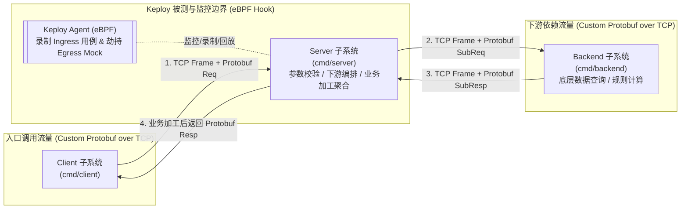

# flowbench

> 基于 Go 与自定义 Protobuf 二进制协议的三级微服务（`Client` -> `Server` -> `Backend`）及 [Keploy](https://github.com/keploy/keploy) 流量录制/回放验证环境

`flowbench` 是一个专为验证 **Keploy** 在**非 HTTP / 非 gRPC 自定义 TCP 二进制协议**场景下流量检测、录制（Record）与回放测试（Replay/Test）能力而设计的标准基准测试环境。系统由三个独立的 Go 微服务/子系统组成，全链路采用自定义二进制帧头（Frame Header）+ Protobuf 载荷（Payload）在原生 TCP Socket 上通信。

本项目严格遵循 **规范驱动开发 (Spec-Driven Development, SDD)** 模式：
**「文档规范先行 -> 架构设计定稿 -> 协议契约明晰 -> 任务拆解与验收清单 -> 分阶段实施与验证」**

---

## 核心业务与流量拓扑 (System Topology)



1. **三层微服务协同**：`Client` 发起业务请求至 `Server`；`Server` 解析请求并执行前置逻辑后，向 `Backend` 发起下游调用；`Backend` 返回原始数据后，`Server` 进行二次加工处理（如费用核算、风控评分聚合、状态富化等），最终将结果返回给 `Client`。
2. **自定义 Protobuf 二进制协议（无 gRPC）**：摒弃 HTTP/2 与 gRPC 框架，直接基于 TCP Socket 设计定长二进制帧头（Magic、Version、OpCode、Flags、RequestID、PayloadLength、CRC32 Checksum）承载 Protobuf 二进制字节流。
3. **Keploy 流量检测与录制回放**：通过 Keploy 的 eBPF 机制挂载监控 `Server`，验证其在自定义二进制 TCP 协议下的 Ingress 流量录制、Egress (`Server -> Backend`) 依赖 Mock 录制以及脱离 `Backend` 真实进程时的回放测试表现。

---

## 目录结构 (Repository Layout)

```text
flowbench/
├── docs/                # 规范文档库 (SDD 提示词、特性矩阵、架构设计、协议契约、任务拆解与 ADR)
├── proto/               # Protobuf 协议源定义 (.proto 消息结构定义，不使用 gRPC)
├── cmd/                 # 三大微服务/子系统主程序入口
│   ├── client/          # Client 端：流量发生器与场景验证客户端
│   ├── server/          # Server 端：核心被测服务 (SUT)，负责业务加工与承上启下
│   └── backend/         # Backend 端：下游依赖服务，提供底层数据与计算响应
├── internal/            # 内部核心模块 (阶段二架构设计定稿后实施)
│   ├── codec/           # 自定义二进制协议帧封包/拆包、CRC32 校验与粘包处理
│   ├── protocol/        # Protobuf 编译产物与消息类型映射
│   ├── transport/       # 原生 TCP 客户端/服务端传输层封装
│   ├── server/          # Server 业务处理管线与下游调用编排
│   └── backend/         # Backend 领域处理逻辑与模拟数据源
├── keploy/              # Keploy 配置文件、录制生成的测试集 (test-set) 与 TCP Mock 资产
├── scripts/             # 自动化构建、三端启停编排、Keploy 录制与回放验证脚本
├── tests/               # 端到端集成测试、协议拆粘包边界测试与回放验证套件
├── AGENTS.md            # AI Agent 协作准则与工程红线
└── README.md            # 项目概览与 SDD 研发路线图
```

完整文档规范与分层索引请见 [docs/README.md](file:///home/fugui/flowbench/docs/README.md)。

---

## SDD 开发生命周期 (Phases)

- [ ] **阶段一：特性清单与边界明确** (`docs/01-features/01-feature-matrix.md`)
- [ ] **阶段二：系统架构设计文档** (`docs/02-design/`)
  - [ ] `01-system-architecture.md` (【总览篇】三级微服务总体架构与数据流)
  - [ ] `02-wire-protocol-and-codec.md` (【协议篇】自定义 Protobuf 二进制帧协议与 TCP 拆粘包机制)
  - [ ] `03-service-orchestration.md` (【业务篇】Server 侧业务加工编排与确定性控制设计)
  - [ ] `04-keploy-traffic-verification.md` (【验证篇】Keploy eBPF 流量监控、录制与 Mock 回放架构)
- [ ] **阶段三：协议契约与任务分解** (`docs/03-api/`, `docs/04-tasks/`)
  - [ ] `docs/03-api/01-binary-frame-spec.md` (【帧协议契约】二进制帧头字段字典与字节序规范)
  - [ ] `docs/03-api/02-protobuf-messages.md` (【消息契约】Protobuf 消息 Schema 与 OpCode 映射规范)
  - [ ] `docs/04-tasks/01-roadmap.md` (【工程路线图】Milestone 划分与依赖拓扑)
- [ ] **阶段四：工程实施与交付验证** (代码实现、单元/集成测试、Keploy 录制与回放实测验证)

---

## 开源协议 (License)

Apache-2.0
