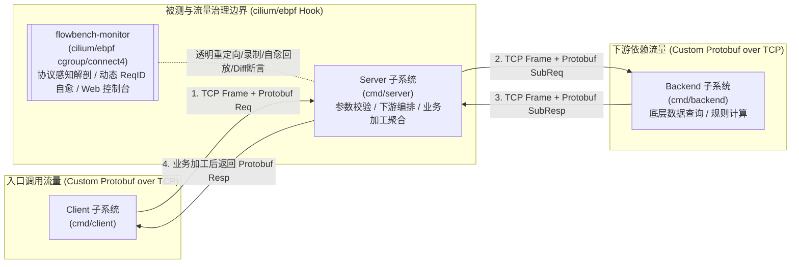

# flowbench

> 基于 Go 与自定义 Protobuf 二进制协议的三级微服务（`Client` -> `Server` -> `Backend`）及原生 `cilium/ebpf` 协议感知流量监控与智能回放环境

`flowbench` 是一个采用 Go 语言构建的基准测试与流量治理环境，专注于**非 HTTP / 非 gRPC 自定义 TCP 二进制协议**场景下的流量检测、深度协议解剖、录制（Record）与离线自愈回放测试（Replay/Test）。系统由独立微服务与原生 eBPF 监控控制台组成，全链路采用 24 字节定长二进制帧头（Frame Header）+ Protobuf 载荷（Payload）在原生 TCP Socket 上通信。

本项目严格遵循 **规范驱动开发 (Spec-Driven Development, SDD)** 模式：
**「文档规范先行 -> 架构设计定稿 -> 协议契约明晰 -> 任务拆解与验收清单 -> 分阶段实施与验证」**

---

## 核心业务与流量拓扑 (System Topology)



1. **三层微服务协同**：`Client` 发起业务请求至 `Server`；`Server` 解析请求并执行前置逻辑后，向 `Backend` 发起下游调用；`Backend` 返回原始数据后，`Server` 进行二次加工处理（如费用核算、风控评分聚合、状态富化等），最终将结果返回给 `Client`。
2. **纯净自定义 Protobuf 二进制协议（无 gRPC / 无 HTTP）**：摒弃 HTTP/2 与 gRPC 框架，直接基于 TCP Socket 设计定长二进制帧头（Magic、Version、OpCode、Flags、Status、RequestID、PayloadLength、CRC32 Checksum）承载 Protobuf 二进制字节流。
3. **原生 eBPF 协议感知流量治理与回放引擎**：利用 `cilium/ebpf` 在内核层挂载 `cgroup/connect4` 实现透明重定向；支持 24B 帧头字段级解剖、动态 `RequestID` 识别与 `CRC32` 校验自愈；脱离真实 `Backend` 即可进行高保真离线回放断言，并通过内嵌 Web 控制台（`http://127.0.0.1:9300`）实现全链路实时可视化。

---

## 目录结构 (Repository Layout)

```text
flowbench/
├── docs/                # 规范文档库 (SDD 提示词、特性矩阵、架构设计、协议契约、任务拆解与 ADR)
├── proto/               # Protobuf 协议源定义 (.proto 消息结构定义，不使用 gRPC)
├── cmd/                 # 四大微服务/子系统主程序入口
│   ├── client/          # Client 端：流量发生器与场景验证客户端
│   ├── server/          # Server 端：核心被测服务 (SUT)，负责业务加工与承上启下
│   ├── backend/         # Backend 端：下游依赖服务，提供底层数据与计算响应
│   └── monitor/         # Monitor 端：原生 eBPF 协议感知监控与实时 Web 控制台
├── internal/            # 内部核心模块
│   ├── codec/           # 自定义二进制协议帧封包/拆包、CRC32 校验与粘包处理
│   ├── protocol/        # Protobuf 编译产物与消息类型映射
│   ├── ebpf/            # cilium/ebpf 内核探针与 cgroup/connect4 透明重定向
│   ├── monitor/         # 协议解剖器、自愈回放引擎与内嵌 Web 控制台
│   ├── transport/       # 原生 TCP 客户端/服务端传输层封装
│   ├── server/          # Server 业务处理管线与下游调用编排
│   └── backend/         # Backend 领域处理逻辑与模拟数据源
├── data/                # 协议感知流量资产：原生录制的测试用例与二进制 Mock 资产
├── scripts/             # 自动化构建、三端启停编排、监控控制台拉起脚本与 E2E 验证脚本
├── tests/               # 端到端集成测试、协议拆粘包边界测试与 eBPF 回放验证套件
├── AGENTS.md            # AI Agent 协作准则与工程红线
└── README.md            # 项目概览与 SDD 研发路线图
```

完整文档规范与分层索引请见 [docs/README.md](file:///home/fugui/flowbench/docs/README.md)。

---

## 快速上手与验证 (Quickstart)

```bash
# 1. 编译全量子系统
make build

# 2. 运行全量单元测试与数据竞争检测
make test

# 3. 运行三端全链路 E2E 场景自动化验证
make verify-e2e

# 4. 启动原生 eBPF 协议感知监控与实时 Web 控制台 (默认监听 http://127.0.0.1:9300)
make monitor
# 或直接执行:
# sudo ./scripts/start-monitor.sh
```

---

## SDD 开发生命周期 (Phases)

- [x] **阶段一：特性清单与边界明确** (`docs/01-features/`)
  - [x] [`01-feature-matrix.md`](file:///home/fugui/flowbench/docs/01-features/01-feature-matrix.md) (【基础篇】三级微服务与自定义二进制协议特性矩阵)
  - [x] [`02-ebpf-native-monitor-and-console.md`](file:///home/fugui/flowbench/docs/01-features/02-ebpf-native-monitor-and-console.md) (【演进篇】原生 `cilium/ebpf` 协议感知监控、智能回放与实时 Web 控制台特性规范)
  - [x] [`03-universal-protobuf-platform.md`](file:///home/fugui/flowbench/docs/01-features/03-universal-protobuf-platform.md) (【平台篇】通用私有 Protobuf 协议监听与自愈回放工具平台特性规范)
- [x] **阶段二：系统架构设计文档** (`docs/02-design/`)
  - [x] [`01-system-architecture.md`](file:///home/fugui/flowbench/docs/02-design/01-system-architecture.md) (【总览篇】三级微服务总体架构与数据流)
  - [x] [`02-wire-protocol-and-codec.md`](file:///home/fugui/flowbench/docs/02-design/02-wire-protocol-and-codec.md) (【协议篇】自定义 Protobuf 二进制帧协议与 TCP 拆粘包机制)
  - [x] [`03-service-orchestration.md`](file:///home/fugui/flowbench/docs/02-design/03-service-orchestration.md) (【业务篇】Server 侧业务加工编排与确定性控制设计)
  - [x] [`05-ebpf-native-monitor-and-console.md`](file:///home/fugui/flowbench/docs/02-design/05-ebpf-native-monitor-and-console.md) (【核心篇】原生 `cilium/ebpf` 协议感知监控、智能回放与实时 Web 控制台架构)
- [x] **阶段三：协议契约与任务分解** (`docs/03-api/`, `docs/04-tasks/`)
  - [x] [`01-binary-frame-spec.md`](file:///home/fugui/flowbench/docs/03-api/01-binary-frame-spec.md) (【帧协议契约】二进制帧头字段字典与字节序规范)
  - [x] [`02-protobuf-messages.md`](file:///home/fugui/flowbench/docs/03-api/02-protobuf-messages.md) (【消息契约】Protobuf 消息 Schema 与 OpCode 映射规范)
  - [x] [`01-roadmap.md`](file:///home/fugui/flowbench/docs/04-tasks/01-roadmap.md) (【工程路线图】Milestone 1~5 划分与依赖拓扑)
  - [x] [`02-m1-protocol-and-codec.md`](file:///home/fugui/flowbench/docs/04-tasks/02-m1-protocol-and-codec.md) ~ [`06-m5-ebpf-monitor-and-console.md`](file:///home/fugui/flowbench/docs/04-tasks/06-m5-ebpf-monitor-and-console.md) (【作战卡】各里程碑实施任务与 AC)
- [x] **阶段四：工程实施与交付验证** ([`proto/`](file:///home/fugui/flowbench/proto/flowbench/v1/messages.proto), [`cmd/`](file:///home/fugui/flowbench/cmd/), [`internal/ebpf/`](file:///home/fugui/flowbench/internal/ebpf/interceptor.go), [`internal/monitor/`](file:///home/fugui/flowbench/internal/monitor/engine.go), [`tests/`](file:///home/fugui/flowbench/tests/))

---

## 开源协议 (License)

Apache-2.0
