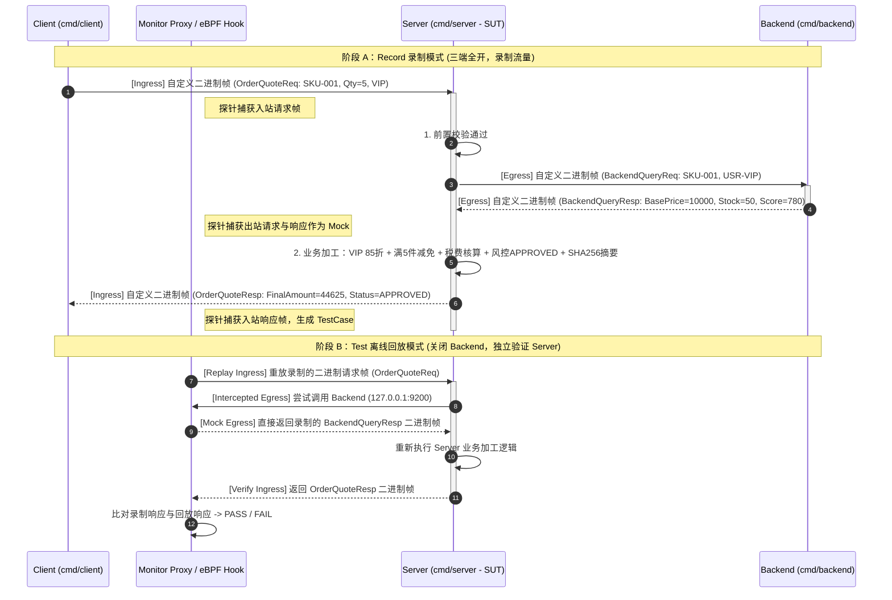

# flowbench 特性清单与需求范围界定规范 (Feature Matrix & Scope)

- **文档编号**：`01-feature-matrix.md`
- **文档版本**：v1.0.0
- **编制日期**：2026-10-25
- **当前阶段**：阶段一：特性清单与边界明确
- **状态**：定稿待审 (Ready for Review)

---

## 1. 系统愿景与产品定位 (Vision & Positioning)

### 1.1 项目愿景
**flowbench** 是一套采用 Go 语言构建、专为验证在**自定义 Protobuf 二进制协议（非 gRPC、非 HTTP）**场景下三级微服务协同、流量检测、透明拦截、录制（Record）与离线自愈回放测试（Replay/Test）能力的基准测试环境。

在诸多高性能网关、金融交易核心、游戏服务端及存量企业私有 RPC 体系中，微服务之间并非采用标准 HTTP/JSON 或基于 HTTP/2 的 gRPC，而是直接在原生 **TCP Socket** 上通过**自定义二进制帧头（Custom Binary Frame Header）+ Protobuf 序列化字节流（Payload）**进行通信。`flowbench` 通过构建 `Client -> Server -> Backend` 的典型三层调用与业务加工链路，系统性检验透明代理/内核级探针对纯 TCP 自定义二进制流量的捕获能力、下游依赖（`Server -> Backend`）二进制 Mock 劫持能力以及端到端自愈回放断言能力。

### 1.2 核心价值主张 (Core Value Propositions)
1. **纯净自定义二进制协议栈（Zero gRPC / Zero HTTP）**：全链路基于原生 `net.Conn` (TCP) 与 24 字节定长大端（Big-Endian）二进制帧头封装 `google.golang.org/protobuf/proto` 序列化载荷，真实还原私有二进制 RPC 通信形态。
2. **真实的三级微服务与 Server 侧深度业务加工（Three-Tier Orchestration & Processing）**：`Server` 绝非简单的字节透传代理，而是承载了**前置参数校验 -> 下游 `Backend` 二进制调用 -> 多维业务二次加工（阶梯折扣核算、税费叠加、风控评分聚合、履约路由判定、结果摘要签名）-> 响应封装返回 `Client`** 的完整业务逻辑，使离线回放能够真正检验 `Server` 侧代码逻辑的正确性与回归突变。
3. **确定性与非确定性流量对照实验台（Determinism Lab for Binary Replay）**：内置确定性开关（Deterministic Mode），支持在“纯确定性加工输出”与“注入动态时间戳/随机流水号”之间切换，直观揭示动态字段对自定义二进制协议字节级回放比对的影响及工程化解决路径。
4. **TCP 底层流特性与连接模型全覆盖（Framing & Connection Models）**：支持短连接（Per-Request TCP Conn）与长连接多帧顺序复用（Keep-Alive Connection Reuse）、TCP 粘包（Packet Coalescing）与半包（Fragmentation）流式拆帧验证。
5. **零外部存储依赖，单机一键闭环验证（Self-Contained Verification）**：三大子系统（`Client`、`Server`、`Backend`）均为无外部数据库依赖的独立轻量二进制，`Backend` 内置确定性内存数据集，配合自动化脚本即可在单机完成三端联调、流量录制与脱离 `Backend` 的回放测试全流程。

---

## 2. 需求功能矩阵 (Feature Matrix)

特性优先级定义：
- **P0 (Must-Have)**：核心基石特性，必须在基础阶段全部落地，直接支撑三端自定义 Protobuf 通信与录制/回放核心闭环。
- **P1 (Should-Have)**：健壮性与深度验证特性，用于检验粘包拆包、连接模式差异、确定性对照及回归失败检出等进阶场景。
- **P2 (Nice-to-Have)**：扩展观测与压力基准特性，提供更丰富的调试诊断与高并发压测手段。

---

### 2.1 自定义 Protobuf 二进制协议栈领域 (Custom Protobuf Wire Protocol & Codec)

| 编号 | 特性名称 | 涉及子系统 | 优先级 | 功能描述与技术规范 | 验收指标 / 衡量标准 |
| :--- | :--- | :---: | :---: | :--- | :--- |
| **PROTO-01** | 24 字节定长二进制帧头契约 (Binary Frame Header) | `Client` `Server` `Backend` | **P0** | 定义统一的大端字节序（`binary.BigEndian`）24 字节定长帧头： - `Magic` (2B): 固定魔数 `0xFB 0x01`（FlowBench v1） - `Version` (1B): 协议版本 `0x01` - `OpCode` (1B): 业务操作码（区分请求/响应类型） - `Flags` (1B): 标志位（确定性标记、调试标记等） - `Status` (1B): 帧级状态码（`0x00` 正常，非零为协议层错误） - `Reserved` (2B): 字节对齐保留位 `0x0000` - `RequestID` (8B): `uint64` 全局请求关联 ID - `PayloadLen` (4B): `uint32` Protobuf 载荷字节长度 - `CRC32` (4B): `uint32` 载荷 CRC32 (IEEE) 校验值 | 1. 帧头固定 24 字节（8 字节对齐），序列化与反序列化零内存歧义。 2. 非 `0xFB 0x01` 魔数或未知版本在拆帧首阶段立即拦截报错。 |
| **PROTO-02** | 原生 Protobuf 载荷序列化封装 | `Client` `Server` `Backend` | **P0** | 仅使用 `google.golang.org/protobuf/proto` 将 `.proto` 定义的结构体编译并序列化为紧凑二进制字节流填入 Frame Payload；**严禁引入 `google.golang.org/grpc` 或 HTTP 包装**。 | `go.mod` 中不包含 `grpc` 依赖；所有业务数据 100% 通过 Protobuf Wire Format 编码传输。 |
| **PROTO-03** | 多业务操作码 (OpCode) 消息映射字典 | `Client` `Server` `Backend` | **P0** | 支持多类典型请求/响应 OpCode 映射： 1. `0x01 / 0x02` (`PingReq / PongResp`)：链路探活与帧协议连通性校验； 2. `0x11 / 0x12` (`OrderQuoteReq / OrderQuoteResp`)：核心订单计价、库存核验与风控聚合链路； 3. `0x21 / 0x22` (`CreditEvalReq / CreditEvalResp`)：客户授信评估与多维规则加工链路； 4. `0xFF` (`ErrorFrameResp`)：通用协议级/系统级异常响应帧。 | 编解码器可根据帧头 `OpCode` 自动反射或路由至对应的 Protobuf Message 类型完成反序列化。 |
| **PROTO-04** | 流式 TCP 粘包与半包拆帧状态机 | `Client` `Server` `Backend` | **P0** | 基于 `io.ReadFull` 实现流式帧读取器（FrameReader）：先精确读取 24 字节帧头，校验 `Magic`、`Version` 与 `PayloadLen <= MaxPayloadSize (4MB)`，再精确读取 `PayloadLen` 字节载荷，彻底解决 TCP 粘包（单次 Read 多帧）与半包（单帧分多次 Read 到达）问题。 | 单元测试模拟单字节碎片流（1 Byte per Read）与多帧合并流（10 Frames in 1 Write）均能 100% 准确拆出独立业务帧。 |
| **PROTO-05** | CRC32 载荷完整性校验 | `Client` `Server` `Backend` | **P0** | 封包时计算 Protobuf Payload 的 `crc32.ChecksumIEEE` 写入帧头；拆包时比对计算值与帧头 `CRC32` 字段，不一致则立即拒绝并返回帧损坏错误。 | 篡改 Payload 任意 1 比特，接收端立即检出 `ErrChecksumMismatch` 并阻断处理。 |
| **PROTO-06** | 确定性序列化保证 (Deterministic Marshal) | `Client` `Server` `Backend` | **P1** | 封装 `proto.MarshalOptions{Deterministic: true}`，保证当 Protobuf 消息中包含 `map` 字段时，序列化出的二进制字节序在每次运行中严格一致，消除 Protobuf 自身非确定性对二进制比对的干扰。 | 包含多键值对 `map<string, string>` 的相同消息连续序列化 1,000 次，输出的字节切片 100% 逐字节相等。 |

---

### 2.2 三级微服务与 Server 业务加工编排领域 (Three-Tier Subsystems & Server Processing)

| 编号 | 特性名称 | 涉及子系统 | 优先级 | 功能描述与技术规范 | 验收指标 / 衡量标准 |
| :--- | :--- | :---: | :---: | :--- | :--- |
| **SVC-01** | `Client` 多模式流量驱动器 | `Client` | **P0** | 提供命令行可配置的流量发送模式： - `ping`：发送心跳探活帧； - `quote`：发起单笔订单计价与风控请求； - `credit`：发起单笔授信评估请求； - `suite`：按序执行预设的全套标准测试场景集（含正常单、VIP 折扣单、高风险拦截单、库存不足单等），专供录制阶段一键产生完备流量； - `verify`：断言 `Server` 返回的各项加工字段是否符合预期公式。 | 执行 `flowbench-client -mode=suite` 能顺序触发全部预设业务分支，并在终端输出清晰的通过/失败断言表。 |
| **SVC-02** | `Server` 前置参数校验与快速短路拦截 | `Server` | **P0** | `Server` 收到 `Client` 的二进制帧后，先解析 Protobuf 请求并执行前置校验（如 `user_id` 非空、`quantity > 0`、限购上限校验）。若校验不通过，直接由 `Server` 构造业务拒绝响应返回 `Client`，**不发起下游 `Backend` 调用**。 | 非法入参请求由 `Server` 直接拦截返回错误状态码，`Backend` 收到 0 次调用。 |
| **SVC-03** | `Server -> Backend` 下游二进制调用编排 | `Server` `Backend` | **P0** | 前置校验通过后，`Server` 提取业务关键要素（如 `sku_id`、`user_id`、`region`），构造发往下游 `Backend` 的专属二进制请求帧（保持相同的 `RequestID` 以串联链路），通过 TCP 发送给 `Backend` 并等待其二进制 Protobuf 响应。 | `Server` 与 `Backend` 之间通过自定义 Protobuf 二进制协议完成请求与响应交互，链路 `RequestID` 保持一致。 |
| **SVC-04** | `Server` 核心多维业务加工与聚合引擎 | `Server` | **P0** | `Server` 拿到 `Backend` 返回的底层基础数据（商品基准单价 `base_price_cents`、实时库存 `available_stock`、用户基础信用分 `credit_score`、黑名单标记 `risk_tags`）后，在 `Server` 侧执行四大核心加工逻辑： 1. **阶梯折扣与会员折算**：根据购买数量与用户等级计算折后价； 2. **区域税费与履约费核算**：根据 `region` 与商品重量计算税费与运费，汇总应付总额 `final_amount_cents`； 3. **综合风控决策**：结合金额阈值与 `Backend` 返回的 `credit_score` 判定审批状态（`APPROVED` / `MANUAL_REVIEW` / `REJECTED`）； 4. **加工结果数字摘要**：对加工核心字段计算确定性摘要 `processing_digest` (SHA-256 前 16 位十六进制)，随响应一并返回给 `Client`。 | 1. `Client` 收到的响应包含 `Backend` 原始指标与 `Server` 加工后的净额、税费、风控结论及摘要。 2. 修改 `Server` 侧任意折扣/税率公式会导致响应报文确定性改变。 |
| **SVC-05** | `Server` 确定性模式开关 (Deterministic Control) | `Server` | **P0** | 支持通过启动参数 `-deterministic=true/false` 或请求帧 `Flags` 位控制非确定性字段： - **确定性模式（默认 `true`）**：响应中的处理时间戳 `processed_at_unix` 固定取自基准值或请求传入的逻辑时钟，加工流水号基于 `RequestID` 确定性派生，确保相同输入产生 100% 相同的二进制响应字节流； - **非确定性模式（`false`）**：注入真实系统时钟 `time.Now().UnixNano()` 与随机盐值，用于对照实验。 | 确定性模式下，相同请求重复调用任意次，`Server` 返回的二进制帧（含 CRC32）逐字节 100% 一致。 |
| **SVC-06** | `Backend` 内存确定性数据底座与计算服务 | `Backend` | **P0** | `Backend` 内置预置的多组商品（SKU）、用户画像与信用分、区域库存数据字典（只读或可重置确定性内存表），根据 `Server` 请求的 `sku_id` 与 `user_id` 精确返回底层数据及原子核验结果。 | 无需部署外部数据库，启动 `flowbench-backend` 即可稳定响应所有测试 SKU 与用户查询。 |
| **SVC-07** | `Backend` 异常与边界场景触发器 | `Backend` | **P1** | 支持根据特定预留测试 ID（如 `sku_id = "SKU-TIMEOUT"` 模拟超时、`sku_id = "SKU-OUT-OF-STOCK"` 模拟无库存、`user_id = "USR-BLACKLIST"` 模拟高危黑名单、`sku_id = "SKU-LARGE-PAYLOAD"` 返回大体积元数据）触发对应边界行为。 | `Client` 可通过特定测试 ID 稳定触发全链路正常、库存不足、风控拒单、下游超时等完整测试分支。 |

---

### 2.3 TCP 传输控制与高可靠通信领域 (TCP Transport & Reliability)

| 编号 | 特性名称 | 涉及子系统 | 优先级 | 功能描述与技术规范 | 验收指标 / 衡量标准 |
| :--- | :--- | :---: | :---: | :--- | :--- |
| **NET-01** | 本地环回安全绑定与并发监听 | `Server` `Backend` | **P0** | 默认严格绑定本地环回地址（`Server` 默认 `127.0.0.1:9100`，`Backend` 默认 `127.0.0.1:9200`）；每个入站 TCP 连接由独立 Goroutine 处理，内置 `recover()` 防护避免单连接异常导致进程崩溃。 | `ss -tlnp` 确认仅监听 `127.0.0.1`，并发连接互不阻塞。 |
| **NET-02** | 短连接 (Short-Conn) 与长连接复用 (Keep-Alive) 双模式 | `Client` `Server` | **P0** | `Client -> Server` 与 `Server -> Backend` 的传输客户端均支持配置： 1. **Per-Request 短连接模式**：每次请求建立独立 TCP 连接，收发一帧后关闭（最契合 eBPF 按连接粒度录制/匹配 TCP Mock 的经典场景）； 2. **Keep-Alive 长连接复用模式**：在单个 TCP 连接上连续收发多个业务帧，用于验证在长连接多帧流下的录制与回放表现。 | 通过命令行标志 `-conn-mode=short\|keepalive` 可无缝切换两种连接模型并完成通信。 |
| **NET-03** | 全链路超时控制 (`Deadline` & `Context`) | `Client` `Server` `Backend` | **P0** | 所有 TCP 建联（`DialTimeout`）与帧读写（`SetReadDeadline` / `SetWriteDeadline`）均受超时保护（默认 3 秒，可配置），防止下游挂死导致连接句柄泄漏。 | 模拟 `Backend` 慢响应超过阈值时，`Server` 准确触发超时并向 `Client` 返回下游超时状态帧。 |
| **NET-04** | TCP 粘包/半包人工模拟发送器 | `Client` | **P1** | `Client` 提供 `-framing-test` 模式：故意将单帧拆分为多个微小 TCP 分片（如先发 5 字节头、停顿 10ms、再发剩余头与载荷），或将连续 3 个请求帧拼接在一次 `conn.Write` 中发送，检验 `Server` 拆帧器与探针抓包能力。 | 在人工分片与多帧粘连发送下，`Server` 均能 100% 正确解析并返回对应 3 个响应帧。 |
| **NET-05** | 信号捕获与优雅停机 (Graceful Shutdown) | `Server` `Backend` | **P0** | 监听 `SIGINT` / `SIGTERM` 信号，收到信号后立即停止 `Accept` 新连接，等待在途请求处理完毕后优雅退出（返回码 `0`），确保录制/回放测试周期结束时能够正常回收被测进程并落盘录制文件。 | 向 `Server` 发送 `SIGINT` 后 1 秒内平滑退出，成功保存资产且无僵尸进程残留。 |

---

### 2.4 二进制流量检测、录制与回放验证领域 (Traffic Detection & Replay Verification)

| 编号 | 特性名称 | 涉及子系统 | 优先级 | 功能描述与技术规范 | 验收指标 / 衡量标准 |
| :--- | :--- | :---: | :---: | :--- | :--- |
| **VER-01** | 全链路二进制流量录制模式适配 | `Server` `Monitor` | **P0** | 以 `Server` 为被测目标，当 `Client` 向 `Server` 发起自定义 Protobuf 二进制调用且 `Server` 调用 `Backend` 时，透明代理/探针自动检测并录制入站请求/响应及出站 `Backend` 流量。 | 录制结束后，资产库成功生成测试用例与二进制 Mock 依赖文件。 |
| **VER-02** | 出站自定义二进制协议 Mock 劫持与离线回放 | `Server` `Monitor` | **P0** | 在**完全停止 `Backend` 真实进程**的前提下，回放引擎自动向 `Server` 重放入站二进制请求，并在网络层拦截 `Server -> 127.0.0.1:9200 (Backend)` 的出站连接，返回录制期保存的二进制 Mock 数据。 | `Backend` 进程未启动时，`Server` 在回放模式下依然能成功拿到下游响应并完成全部业务加工，回放测试通过。 |
| **VER-03** | `Server` 业务加工逻辑回归缺陷检出验证 | `Server` `Monitor` | **P0** | 提供回归突变模拟开关（如 `-fault-mutation=discount_bug`），人为使 `Server` 在计算折扣时多减 100 分。在此状态下运行离线回放，验证比对引擎能否精准识别 `Server` 返回的二进制帧与录制基线不一致并判定用例 **FAILED**。 | 开启 `-fault-mutation` 时，准确报错拦截；关闭后重新运行恢复 **PASSED**。 |
| **VER-04** | 确定性 vs 非确定性二进制载荷回放对比验证 | `Server` `Monitor` | **P1** | 系统性对比两种模式下的离线回放表现： 1. `-deterministic=true`：验证二进制帧（Payload + CRC32）100% 精确匹配通过； 2. `-deterministic=false`：由于动态时间戳导致 Protobuf 序列化字节与帧头 CRC32 改变，观测并记录比对的失败详情，形成二进制协议可测试性设计规范。 | 产出清晰的对照实验结论与日志证据，明确自定义二进制协议确定性设计准则。 |
| **VER-05** | 短连接 vs 长连接复用兼容性基准 | `Client` `Server` `Monitor` | **P1** | 分别在 `-conn-mode=short` 与 `-conn-mode=keepalive` 下执行流量录制与回放，评估透明代理/探针对单连接单报文与单连接多报文流的捕获与回放支持度。 | 输出两种连接模式在录制/回放下的实测兼容性矩阵与推荐配置。 |

---

### 2.5 可观测性、自动化编排与诊断工具领域 (Observability & Automation)

| 编号 | 特性名称 | 涉及子系统 | 优先级 | 功能描述与技术规范 | 验收指标 / 衡量标准 |
| :--- | :--- | :---: | :---: | :--- | :--- |
| **OPS-01** | 帧级结构化日志与链路追踪 | `Client` `Server` `Backend` | **P0** | 基于标准库 `log/slog` 输出结构化日志，每条请求日志包含：`subsystem`、`req_id`、`op_code`、`payload_len`、`crc32_hex`、`backend_latency_ms`、`total_latency_ms`、`digest` 及业务加工前后关键数值对比。 | 通过 `req_id` 可在 `Client`、`Server`、`Backend` 三端日志中完整串联单次调用轨迹。 |
| **OPS-02** | 二进制帧 Hex Dump 调试探针 | `Client` `Server` `Backend` | **P1** | 开启 `-debug-frame` 时，将收发的 24 字节二进制帧头拆解字段及 Protobuf Payload 十六进制字节流（Hex Dump）格式化打印，便于与录制的二进制资产直接人工比对。 | 日志输出的帧字节流与录制测试用例中的原始载荷完全对应。 |
| **OPS-03** | 标准 `Makefile` 与自动化验证脚本库 | `scripts/` | **P0** | 提供开箱即用的自动化脚本： - `make build`：编译子系统二进制至 `bin/`； - `make test`：运行全量单元与集成测试； - `scripts/verify-e2e.sh`：自动拉起 `Backend` 与 `Server`，运行 `Client` 全套校验后自动清理全部后台进程； - `scripts/start-monitor.sh`：以特权拉起原生 eBPF 监控与 Web 控制台。 | 所有脚本均包含 `trap cleanup EXIT` 机制，确保无论成功或异常退出均不留存任何后台僵尸进程。 |

---

## 3. 流量验证场景矩阵 (Verification Scenarios Matrix)

为确保测试验证环境的深度与说服力，本项目规划了 **6 大标准验证场景（`SC-01` ~ `SC-06`）**，构成 `Client -mode=suite` 及录制回放的核心用例集：

| 场景编号 | 场景名称 | 触发方式 (`Client` 请求特征) | 链路行为特征 | 验证目标 |
| :--- | :--- | :--- | :--- | :--- |
| **SC-01** | **链路探活与基础帧校验 (`Ping/Pong`)** | `OpCode=0x01 (PingReq)`，携带客户端标识与回显载荷 | `Client -> Server`（无需调用 `Backend`，由 `Server` 直接返回 `PongResp`） | 验证对无下游依赖的纯入站（Ingress-only）自定义二进制帧的录制与回放能力。 |
| **SC-02** | **标准订单计价与 VIP 折算 (`Normal & VIP Quote`)** | `OpCode=0x11 (OrderQuoteReq)`，`sku_id="SKU-PRO-01"`, `qty=5`, `vip_level=2` | `Client -> Server -> Backend -> Server(折扣+税费+风控加工) -> Client` | 验证典型三层调用链下，同时录制入站用例与出站 `Backend` 二进制 Mock，并在关闭 `Backend` 时完整回放成功。 |
| **SC-03** | **Server 前置参数拦截短路 (`Pre-Validation Reject`)** | `OpCode=0x11 (OrderQuoteReq)`，`qty=0` 或 `sku_id=""` | `Client -> Server`（前置校验失败，直接返回业务错误码，0 次 `Backend` 调用） | 验证同一服务中“有下游调用”与“无下游调用短路返回”混合流量下的 Mock 匹配准确性。 |
| **SC-04** | **下游库存不足与高危风控拒单 (`Backend Reject & Risk Control`)** | `OpCode=0x11`，`sku_id="SKU-OUT-OF-STOCK"` 或 `user_id="USR-LOW-CREDIT"` | `Client -> Server -> Backend(返回库存=0或低信用分) -> Server(判定REJECTED并计算拒单原因) -> Client` | 验证异常业务分支及不同长度 Protobuf 载荷在录制与回放中的二进制一致性。 |
| **SC-05** | **授信评估多维规则聚合 (`Credit Evaluation`)** | `OpCode=0x21 (CreditEvalReq)`，申请额度与负债率评估 | `Client -> Server -> Backend(查询历史履约与风险标签) -> Server(综合授信额度计算) -> Client` | 验证在同一个 TCP 端口上承载多种不同 `OpCode` 与不同 Protobuf Message 结构时的流量监控与回放能力。 |
| **SC-06** | **加工逻辑突变与非确定性对照 (`Mutation & Determinism Check`)** | 保持 `SC-02` 录制资产不变，切换 `Server` 参数重新执行离线回放 | 1. 开启 `-fault-mutation` 模拟代码 Bug； 2. 开启 `-deterministic=false` 注入动态时间戳 | 1. 验证能 100% 捕获 `Server` 加工结果哪怕 1 字节的回归偏差； 2. 验证自定义二进制协议中确定性字段控制对回放成功率的关键作用。 |

---

## 4. 非目标边界界定 (Non-Goals)

为了保持基准验证环境的高内聚、高可复现性与清晰边界，本项目在当前阶段**明确不做（Non-Goals）**以下内容：

### 🚫 Non-Goal 1: 严禁使用 gRPC 或 HTTP/REST 承载业务协议
- **原因**：本项目的核心使命是验证**自定义 Protobuf 二进制协议（Raw TCP + Custom Framing + Protobuf）**下的表现，因此严禁退化为 gRPC 或 HTTP 接口。

### 🚫 Non-Goal 2: 不引入外部数据库、缓存或消息队列 (No MySQL / Redis / Kafka)
- **原因**：引入外部中间件会增加环境搭建负担并引入与核心验证目标无关的外部变量。`Backend` 统一采用内存确定性数据集模拟底层存储，保证在任何 Linux 机器上零依赖秒级启动。

### 🚫 Non-Goal 3: 不构建分布式服务发现、配置中心或复杂 RBAC 权限系统
- **原因**：本项目聚焦于三端网络协议栈、业务编排加工与原生 eBPF 流量治理与回放验证，无需构建 Etcd/Consul 注册中心或复杂 RBAC 权限后台。

### 🚫 Non-Goal 4: 不对 TCP 链路启用 TLS 加密（默认明文自定义二进制）
- **原因**：自定义二进制协议直接运行于本地环回明文 TCP Socket 之上，便于直接通过抓包与 Hex Dump 清晰观测和比对底层二进制帧结构。

---

## 5. 非功能性需求与安全规范 (NFR & Security Guardrails)

### 5.1 网络与绑定安全 (Network Security)
- **强制本地环回监听**：`Server`（默认 `127.0.0.1:9100`）、`Backend`（默认 `127.0.0.1:9200`）与 `Monitor`（默认 `127.0.0.1:9300`）在开发与测试中默认仅监听 `127.0.0.1`，严禁默认绑定 `0.0.0.0` 暴露至外部网络。
- **防恶意大包 OOM 保护**：拆帧器强制校验 `PayloadLen <= 4MB`（可配置上限），遇到超大或畸形 `PayloadLen` 立即关闭连接并记录安全告警日志，防止内存耗尽攻击。

### 5.2 性能与可靠性指标 (Performance & Reliability)
- **单机低延迟通信**：在本地环回网络下，单次 `Client -> Server -> Backend -> Server -> Client` 全链路调用延迟 $P99 \le 5\text{ms}$。
- **并发与竞态安全**：全量代码必须通过 `go test -race ./...` 竞态检测，零数据竞争（Data Race）、零 Goroutine 泄漏。
- **进程生命周期洁净度**：所有自动化测试与联调脚本执行完毕后，后台进程清理率 100%，绝不残留占用端口的孤儿进程。

---

## 6. 阶段一结论与后续演进衔接

本特性清单与需求范围界定规范（`docs/01-features/01-feature-matrix.md`）已完成以下核心定义：
1. 确立了 **24 字节定长大端二进制帧头 + 原生 Protobuf 载荷** 的自定义二进制协议栈（`PROTO-01` ~ `PROTO-06`）；
2. 明确了 **`Client` -> `Server` -> `Backend`** 的三层职责分工，重点定义了 `Server` 侧的**前置校验、下游二进制编排、四大业务二次加工（折扣、税费、风控、SHA-256 摘要）及确定性控制开关**（`SVC-01` ~ `SVC-07`）；
3. 规划了覆盖 **正常调用、短路拦截、多 OpCode、异常分支、逻辑突变检出与确定性对照** 的 6 大流量验证场景（`SC-01` ~ `SC-06`）。

待本特性矩阵确认后，将进入 **阶段二：系统架构设计文档 (`docs/02-design/`)** 的编制，输出三端总体架构、二进制协议拆粘包状态机、Server 业务加工算子及流量治理架构设计。
