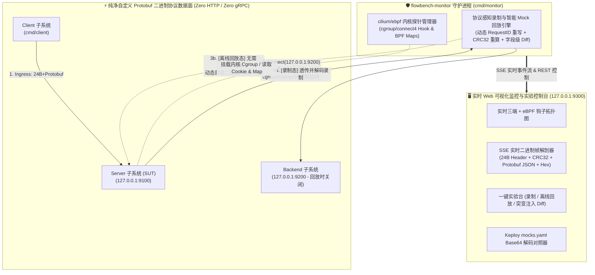

# flowbench 原生 `cilium/ebpf` 协议感知监控、录制回放与实时 Web 控制台特性规范

- **文档编号**：`02-ebpf-native-monitor-and-console.md`
- **文档版本**：v1.0.0
- **编制日期**：2026-10-26
- **当前阶段**：阶段一（演进篇）：原生 eBPF 协议感知监控与可视化控制台特性定义
- **状态**：定稿待审 (Ready for Review)

---

## 1. 演进背景与产品定位 (Evolution Background & Positioning)

### 1.1 为什么从通用 Keploy 演进到自研原生 `cilium/ebpf` 引擎？

在第一阶段的实机验证中，我们在 `Linux 6.8.0-147-generic` 环境下使用 **Keploy v3.6.163** 对 `flowbench` 的三级微服务（`Client -> Server -> Backend`）自定义 Protobuf 二进制协议进行了全面测试，通过实证数据揭示了通用开源流量回放工具在面对**企业私有二进制协议**时的四大固有局限：

1. **入站代理（Ingress Proxy）硬编码 HTTP/1.1 导致协议排斥**：
   - Keploy 的 `record / test` 模式通过 eBPF 将 `Server` 的监听端口（`9100`）重映射并接入内置的 HTTP/1.1 代理。当收到 `0xFB01` 魔数开头的自定义二进制帧时，直接报 `malformed HTTP request "\xfb\x01..."` 并向客户端返回 `HTTP 400 Bad Request`（`0x4854`），无法直接录制非 HTTP 入站流量。
2. **出站代理（Egress Proxy）退化为“盲字节流切片（Opaque Binary Chunk）”**：
   - Keploy 的 `V2 generic parser` 完全无法理解我们的 24 字节大端帧头（`Magic`、`OpCode`、`RequestID`、`PayloadLength`、`CRC32`）和 Protobuf Schema，只能依赖读写停顿与连接关闭（`FIN`）盲切字节流，并以不可读的 Base64 字符串（`+wEB...`）保存在 `mocks.yaml` 中。
3. **动态字段与长连接复用脆弱性**：
   - 由于把 `24B Header + Protobuf Payload` 当作一整块静态二进制匹配，一旦帧头中的 `RequestID` 动态递增或载荷中包含非确定性字段，整帧字节与 `CRC32` 随之改变，静态二进制 Mock 即刻失效。
4. **缺乏私有协议可视化监控与解码控制台**：
   - 面对 `mocks.yaml` 中的 Base64 数据与内核态 eBPF 转发过程，开发者无法直观看到当前捕获了哪些业务帧、帧头字段是否正确、`CRC32` 是否通过、Protobuf 载荷明文是什么，也无法在界面上直观看到回归突变的字段级 Diff。

### 1.2 核心价值主张 (Core Value Propositions)

基于上述实证结论，`flowbench` 在保留 Keploy 作为“通用黑盒对照组”的基础上，直接基于 **`github.com/cilium/ebpf`** 与项目原生协议栈（[`internal/codec`](file:///home/fugui/flowbench/internal/codec/codec.go) + [`internal/protocol`](file:///home/fugui/flowbench/internal/protocol/protocol.go)），构建一套 **100% 协议感知的原生 eBPF 流量监控、录制回放与实时 Web 可视化控制台（`flowbench-monitor`）**：

1. **内核级零侵入连接劫持与观测 (`cilium/ebpf`)**：直接通过 `cilium/ebpf` 挂载内核 `cgroup/connect4` 与 Socket 探针，在不修改 `Client`、`Server`、`Backend` 任何一行代码的前提下，透明拦截并重定向 TCP 流量。
2. **全链路 24B 帧头 + Protobuf 深度协议感知 (Protocol-Aware Deep Inspection)**：无论是 `Client -> Server (:9100)` 的入站流量，还是 `Server -> Backend (:9200)` 的出站流量，均按 `0xFB01` 帧头协议精准拆帧（彻底免疫 TCP 粘包/半包），自动校验 `CRC32` 并将二进制 Protobuf 载荷反序列化为可读的业务 JSON 明文。
3. **智能动态字段重写与 `CRC32` 自愈回放 (Smart Binary Replay)**：在脱离真实 `Backend` 的离线回放中，支持按“业务语义（`OpCode` + Protobuf 请求字段）”匹配 Mock，自动忽略每次请求变化的 `RequestID`，并在返回 Mock 响应帧时**动态回填当前请求的 `RequestID` 并重新计算 24B 帧头Checksum**。
4. **内置实时 Web 可视化监控与实验控制台 (`127.0.0.1:9300`)**：采用 Go `embed` 单二进制内嵌轻量级 Web 控制台，实时展示三端 + eBPF 拓扑状态、实时捕获的二进制帧流、24B 帧头字节解剖图、Protobuf JSON 明文、Keploy `mocks.yaml` 解码对照，并支持在网页上一键触发**录制、离线回放、故障突变注入（`discount_bug`）与字段级 Diff 断言**。

---

## 2. 系统目标拓扑与工作原理 (Target Architecture Overview)

---

## 3. 需求功能矩阵 (Feature Matrix)

特性优先级定义：
- **P0 (Must-Have)**：核心基石特性，构成 `cilium/ebpf` 内核监控劫持、协议感知录制回放与 Web 可视化控制台的完整闭环。
- **P1 (Should-Have)**：高阶增强特性，包含智能动态 `RequestID` 重写、Keploy `mocks.yaml` 导入解码对比及非特权环境优雅降级。

---

### 3.1 `cilium/ebpf` 内核探针与透明流量劫持领域 (eBPF Kernel Interception)

| 编号 | 特性名称 | 涉及模块 | 优先级 | 功能描述与技术规范 | 验收指标 / 衡量标准 |
| :--- | :--- | :---: | :---: | :--- | :--- |
| **EBPF-01** | 基于 `cilium/ebpf` 的 `cgroup/connect4` 出站透明劫持 | `internal/ebpf` | **P0** | 使用 `github.com/cilium/ebpf` 加载内核态 BPF 程序并挂载至目标 cgroup v2（如 `/sys/fs/cgroup`）： 1. 监听 IPv4 TCP `connect()` 系统调用； 2. 当检测到目标地址为被监控下游 `Backend (127.0.0.1:9200)`（且非监控代理自身发起的透传连接）时，在内核态将 `ctx->user_ip4` 与 `ctx->user_port` 透明改写为本地协议感知代理端口（如 `127.0.0.1:19200`）； 3. 在 BPF Map 中记录拦截计数、最后活跃时间戳与连接映射关系。 | 1. `Server` 配置保持 `-backend-addr=127.0.0.1:9200` 不变； 2. 开启 eBPF 探针后，`Server` 发起的 `connect(127.0.0.1:9200)` 被内核 100% 透明重定向至代理端口，BPF Map 拦截计数精确递增。 |
| **EBPF-02** | 入站 (`Ingress`) 与出站 (`Egress`) 全链路二进制协议捕获 | `internal/ebpf` `internal/monitor` | **P0** | 彻底解决 Keploy 入站代理仅支持 HTTP/1.1 的痛点： - 对 `Client -> Server (:9100)` 的入站流量与 `Server -> Backend (:9200)` 的出站流量均使用原生 `codec.ReadFrame` 流式状态机进行拦截与镜像； - 精确提取每一帧的 24B 帧头与 Protobuf 载荷，不发生任何 HTTP 误判或粘包切分错误。 | 全套 6 大场景（`SC-01 ~ SC-05`）的入站请求/响应帧（共 12 帧）与出站查询/响应帧（共 8 帧）100% 被完整捕获并解码。 |
| **EBPF-03** | 内核 BPF Map 实时遥测与资源自洁机制 | `internal/ebpf` | **P0** | 维护内核态与用户态共享的 BPF Map，实时暴露： - 探针挂载状态（`Attached` / `Detached`）、内核 Program ID、Cgroup 路径； - 累计检测到的 `connect` 事件数、已劫持重定向至 Mock/Proxy 的连接数； - 进程收到 `SIGINT`/`SIGTERM` 或测试结束时，100% 自动执行 `link.Close()` 与 `collection.Close()` 卸载内核 eBPF 探针，绝不污染宿主机网络。 | 停止监控器后，`bpftool` 确认无残留挂载程序，宿主机原有网络通信 100% 正常。 |
| **EBPF-04** | 特权内核态 (`eBPF`) 与非特权用户态代理 (`Userspace Proxy`) 双模自适应 | `internal/ebpf` `internal/monitor` | **P1** | - 在具备 `root` / `CAP_BPF` + `CAP_NET_ADMIN` 权限的 Linux 环境中，默认启用 **内核态 `cilium/ebpf` `cgroup/connect4` 透明劫持模式**； - 在无特权 CI 容器环境中，支持自动或手动降级为用户态端口代理模式，确保全量单元与集成测试在任何环境下均可 100% 运行。 | Web 控制台顶部明确显示当前运行引擎模式（`Kernel eBPF cgroup/connect4 Active` vs `Userspace Proxy Fallback`）。 |

---

### 3.2 协议感知录制、智能匹配与离线回放引擎领域 (Protocol-Aware Record & Smart Replay)

| 编号 | 特性名称 | 涉及模块 | 优先级 | 功能描述与技术规范 | 验收指标 / 衡量标准 |
| :--- | :--- | :---: | :---: | :--- | :--- |
| **REPLAY-01** | 结构化可读的二进制录制资产库 (Decoded Test & Mock Store) | `internal/monitor` | **P0** | 摒弃纯 Base64 黑盒存储，录制生成的资产文件（JSON/YAML）同时保存： 1. **帧头结构化字典**：`magic: "0xFB01"`, `version: 1`, `op_code: 0x31`, `op_name: "OpSkuQueryReq"`, `request_id: 1002`, `payload_len: 34`, `crc32: "0x4293DC4D"`； 2. **Protobuf 明文 JSON**：自动调用 `protojson` 将二进制载荷反序列化为可读业务 JSON（如 `{"skuId":"SKU-PRO-01","userId":"USR-VIP-001","region":"CN-EAST"}`）； 3. **原始 Wire Hex**：保留原始 24B+Payload 十六进制字节流用于精确字节级校验。 | 打开录制文件即可直接用肉眼阅读每一笔请求与响应的完整业务字段及帧头校验码。 |
| **REPLAY-02** | 彻底脱离 `Backend` 的 eBPF 离线 Mock 回放 | `internal/monitor` | **P0** | 在**完全停止 `flowbench-backend` 进程**的前提下： 1. `cilium/ebpf` 探针将 `Server -> 127.0.0.1:9200` 的连接透明重定向至本地 Mock 引擎； 2. Mock 引擎读取 `Server` 发出的二进制请求帧，匹配录制库中的出站 Mock 并写回二进制响应帧； 3. 回放驱动器向 `Server (:9100)` 重放入站测试用例，完成端到端闭环验证。 | `flowbench-backend` 进程关闭时，6 大场景（`SC-01 ~ SC-05`）回放通过率 100%，Mock 命中率 `4/4`（`missed: 0`）。 |
| **REPLAY-03** | 智能语义匹配、动态 `RequestID` 重写与 `CRC32` 自愈 | `internal/monitor` | **P1** | 突破 Keploy 静态字节匹配的限制： 1. Mock 匹配支持按 **`OpCode` + 归一化 Protobuf 业务请求字段** 进行语义匹配（忽略帧头中可能变化的 `RequestID`）； 2. 命中 Mock 后，根据当前请求帧的实际 `RequestID` 动态更新响应帧头 Offset `8..15`，并校验/重算 Offset `20..23` 的 `CRC32`，确保 `Server` 侧 `codec.ReadFrame` 100% 校验通过。 | 即使将 `Client` 发起的 `RequestID` 改为任意随机值（如 `99001`），离线 Mock 依然能 100% 命中并正确回填 `RequestID=99001`。 |
| **REPLAY-04** | 字节级 + Protobuf 字段级双层回归断言器 (Field-Level Diff) | `internal/monitor` | **P0** | 回放比对不仅检查原始二进制帧与 `CRC32` 是否一致，当检测到不一致时，自动将“录制基线帧”与“实际回放响应帧”同时反序列化为 Protobuf JSON，逐字段计算结构化 Diff（如精确定位 `discount_cents: expected 6500, actual 6600`、`final_amount_cents: expected 50310, actual 50204`）。 | 注入 `-fault-mutation=discount_bug` 时，不仅报告 CRC32 字节不匹配，还直接输出发生偏差的具体 Protobuf 字段名与前后数值。 |
| **REPLAY-05** | Keploy `mocks.yaml` 二进制资产逆向解码器 | `internal/monitor` | **P1** | 支持直接加载 [`keploy/keploy/flowbench-e2e/mocks.yaml`](file:///home/fugui/flowbench/keploy/keploy/flowbench-e2e/mocks.yaml)，自动提取其中 `genericrequests` 与 `genericresponses` 的 Base64 字符串（`+wEB...`），利用 `flowbench` 编解码器将其逆向还原为 24B 帧头明细 + Protobuf 明文 JSON。 | 在控制台或命令行中可直接查看 Keploy 录制的 `mock-0 ~ mock-3` 对应的真实业务内容。 |

---

### 3.3 实时 Web 可视化监控与实验控制台领域 (Real-Time Web Console)

| 编号 | 特性名称 | 涉及模块 | 优先级 | 功能描述与技术规范 | 验收指标 / 衡量标准 |
| :--- | :--- | :---: | :---: | :--- | :--- |
| **UI-01** | 三端微服务与 `cilium/ebpf` 内核探针实时状态拓扑面板 | `cmd/monitor` `internal/monitor/web` | **P0** | 在浏览器（默认 `http://127.0.0.1:9300`）顶部展示实时动态拓扑图： - 显示 `Client`、`Server (:9100)`、`cilium/ebpf Hook (cgroup/connect4)`、`Backend (:9200)` 四个节点的实时在线状态（Running / Offline / Intercepted）； - 实时显示内核 eBPF Program ID、累计 `connect()` 拦截次数、Ingress/Egress 捕获帧数与 Mock 命中率。 | 启动或停止 `Backend`、切换录制/回放模式时，拓扑图节点状态与 eBPF 拦截路径在 1 秒内实时更新。 |
| **UI-02** | 基于 SSE 的实时二进制帧流监控表 (Live Frame Inspector) | `internal/monitor/web` | **P0** | 通过 Server-Sent Events (`/api/events`) 零延迟向前端推送捕获到的每一个自定义二进制帧： - 列表展示：时间戳、链路方向（`INGRESS Req/Resp` 或 `EGRESS Req/Resp / Mocked`）、`RequestID`、`OpCode` 语义标签、载荷字节长度、`CRC32` 校验状态徽章（`VALID` 绿标）、耗时（ms）。 | 每次执行测试套件，前端实时滚动出现完整的二进制帧交互流水，无丢帧、无需手动刷新页面。 |
| **UI-03** | 24B 帧头字节解剖图与 Protobuf / Hex 对照抽屉 | `internal/monitor/web` | **P0** | 点击任意一帧报文，展开深度解剖视图： 1. **24B 帧头可视化色块图**：按 Offset `0..23` 直观展示 `Magic (2B)`、`Version (1B)`、`OpCode (1B)`、`Flags (1B)`、`Status (1B)`、`Reserved (2B)`、`RequestID (8B)`、`PayloadLen (4B)`、`CRC32 (4B)` 的十六进制值与十进制释义； 2. **Protobuf 解码明文 JSON**：高亮展示反序列化后的业务结构； 3. **Raw Wire Hex Dump**：展示标准 16 字节对齐的十六进制与 ASCII 对照视图。 | 开发者无需任何外部抓包工具，即可在网页上一眼看清私有协议每一个字节的含义。 |
| **UI-04** | Web 一键实验操控台 (Interactive Lab Actions) | `internal/monitor/web` | **P0** | 在控制台提供一键操作按钮（后端自动编排三端进程与 eBPF 探针）： 1. **🟢 一键全链路录制 (`Record Suite`)**：拉起真实 `Backend` + `Server` + eBPF 探针，运行 `SC-01 ~ SC-05` 并录制入站/出站二进制资产； 2. **🔵 一键无 Backend 离线回放 (`Offline eBPF Replay`)**：自动关闭 `Backend`，挂载 `cilium/ebpf` `connect4` 劫持，重放全部用例并展示 PASS 结果； 3. **🔴 一键故障突变检测 (`Mutation Test: discount_bug`)**：关闭 `Backend`，以 `-fault-mutation=discount_bug` 启动 `Server` 执行离线回放，直观展示回归拦截； 4. **🟡 一键非确定性对照 (`Non-Deterministic Check`)**：以 `-deterministic=false` 执行回放，展示动态时间戳导致的 `CRC32` 与摘要变化。 | 用户在浏览器中点击上述 4 个按钮，均可在 2 秒内自动完成对应实验并实时在页面看到完整测试报告。 |
| **UI-05** | 可视化回放断言报告与 Protobuf 字段级 Diff 视图 | `internal/monitor/web` | **P0** | 每次回放实验完成后，在页面生成可视化断言卡片（`SC-01 ~ SC-05`）： - 通过场景显示绿色 `PASS` 与字节一致性确认； - 失败场景（如突变注入或非确定性模式）显示红色 `FAIL`，并并排对比 **录制基线 (Expected)** 与 **实际响应 (Actual)** 的帧头 `CRC32` 及 Protobuf JSON 差异字段高亮。 | 注入 `discount_bug` 后，页面清晰高亮 `discount_cents: 6500 -> 6600`、`final_amount_cents: 50310 -> 50204` 等差异项。 |
| **UI-06** | Keploy `mocks.yaml` 盲二进制 vs 原生协议感知对比视图 | `internal/monitor/web` | **P1** | 提供专门的“Keploy 资产解码对比”标签页： - 左侧展示 [`keploy/keploy/flowbench-e2e/mocks.yaml`](file:///home/fugui/flowbench/keploy/keploy/flowbench-e2e/mocks.yaml) 中的原始 Base64 文本（`+wEBMQE...`）； - 右侧展示由 `flowbench-monitor` 实时逆向解码出的 24B 帧头与 Protobuf 业务字段明文，直观体现原生协议感知引擎的优势。 | 页面成功加载并解码项目仓库中真实录制的 4 条 Keploy Generic Mocks。 |

---

## 4. 架构红线与边界约束 (Guardrails & Constraints)

1. **严守业务面纯净二进制协议红线**：
   - `Client <-> Server (:9100)` 与 `Server <-> Backend (:9200)` 之间的通信**必须 100% 保持原生 TCP + 24B 自定义二进制帧 + Protobuf**，绝不因引入监控控制台而修改业务协议或掺杂 HTTP/gRPC。
   - Web HTTP/SSE 仅用于独立的监控控制台子系统（`cmd/monitor`，默认监听 `127.0.0.1:9300`）向浏览器提供可视化界面。
2. **零外部前端工具链依赖（Zero Node.js / Zero npm Build）**：
   - Web 控制台前端采用原生现代 HTML5 / CSS3 / Vanilla JS 编写，并通过 Go 标准库 `//go:embed` 直接编译进 `bin/flowbench-monitor` 单一可执行文件中，保持 `go build ./...` 一键编译、零外部运行时依赖的极简工程体验。
3. **严格的内核 eBPF 探针安全与清理规范**：
   - eBPF `cgroup/connect4` 探针仅针对目标 IP:Port（`127.0.0.1:9200`）生效，绝不拦截宿主机 SSH、DNS、IDE 或外部网络流量；
   - 任何测试或命令退出时必须确保 eBPF 探针与后台子进程 100% 卸载清理。

---

## 5. 演进路线衔接 (Next Steps in SDD Pipeline)

本特性规范（`docs/01-features/02-ebpf-native-monitor-and-console.md`）确认后，将按 SDD 规范依次推进：
1. **阶段二（架构设计扩充）**：编写 `docs/02-design/05-ebpf-native-monitor-and-console.md`，明确 `cilium/ebpf` `cgroup/connect4` 字节码汇编/加载逻辑、BPF Map 结构、协议感知透明代理状态机及 Web SSE API 契约；
2. **阶段三 & 四（工程实施与实机验证）**：
   - 实现 `internal/ebpf`（基于 `cilium/ebpf` 的内核连接劫持探针）与 `internal/monitor`（协议感知录制回放引擎 + 内嵌 Web 控制台）；
   - 新增 `cmd/monitor` 可视化监控主程序与单元测试/实机 eBPF 测试，并提供一键启动脚本。
