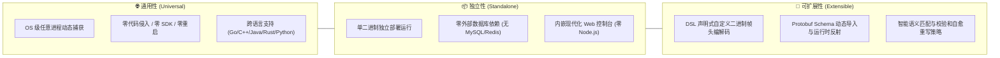
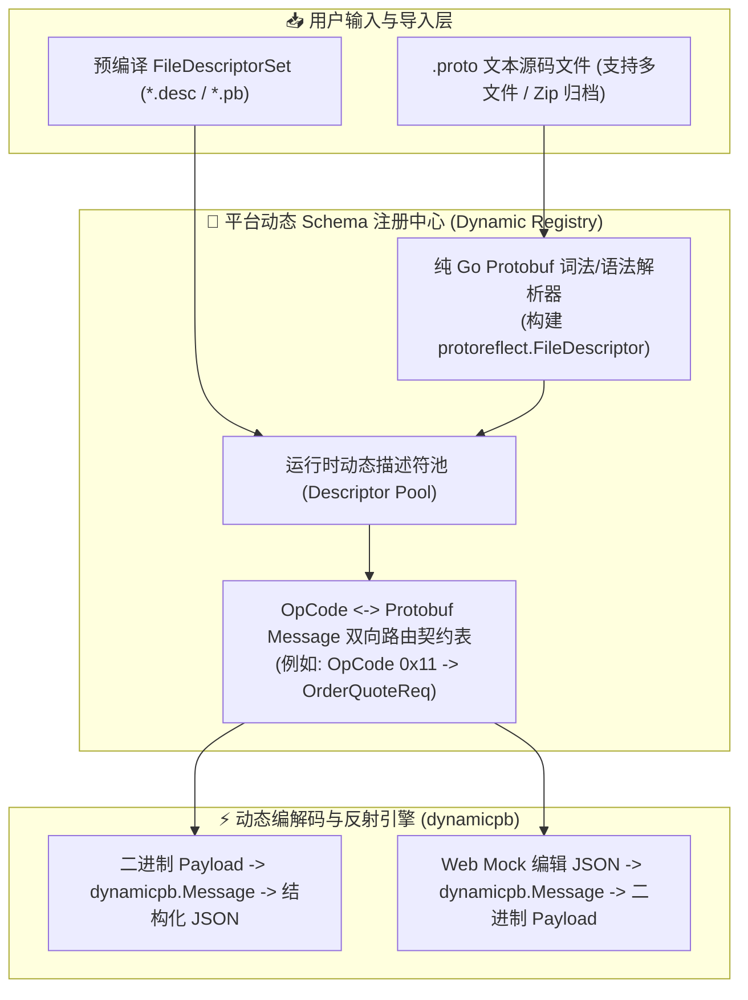
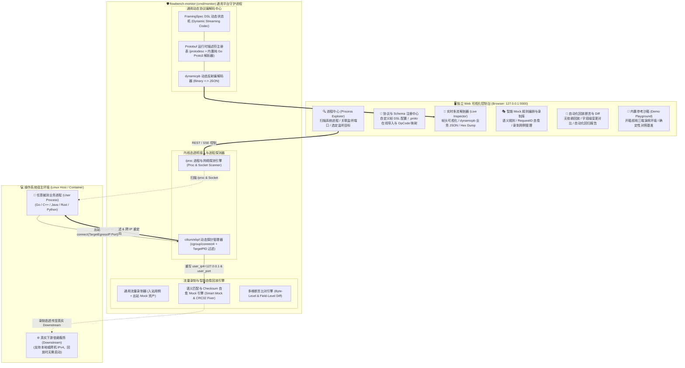
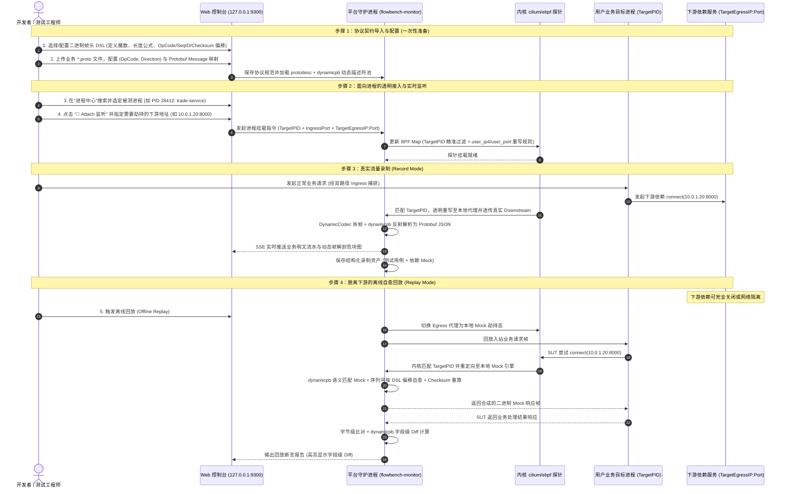

# flowbench 通用私有 Protobuf 协议监听与自愈回放工具平台特性规范 (Universal Platform Specification)

- **文档编号**：`03-universal-protobuf-platform.md`
- **文档版本**：v1.1.0
- **编制日期**：2026-10-27
- **当前阶段**：阶段一（平台化演进）：独立、通用、可扩展的私有 Protobuf 流量监听与自愈回放工具平台特性定义
- **状态**：已定稿 (Finalized)

---

## 1. 演进愿景与平台定位 (Vision & Platform Positioning)

### 1.1 平台跃迁：从“基准验证 Demo”到“通用独立工具平台”

在前期规划中，`flowbench` 成功验证了基于自定义 24B 二进制帧头的典型三级微服务（`Client -> Server -> Backend`）协同，以及基于原生 `cilium/ebpf` 进行透明拦截与确定性回放的核心技术通路（详见 `01-feature-matrix.md` 与 `02-ebpf-native-monitor-and-console.md`）。

然而，面对真实企业级研发与测试生产环境，固定协议头与特定 Demo 绑定的模式存在根本局限：
1. **私有协议千差万别**：不同企业、不同系统的二进制 TCP 协议帧头长度（从 8B、16B 到 32B 不等）、魔数偏移、字节序、序列号/关联ID位置、校验算法（CRC32/Adler32/MD5）均不一致，硬编码协议栈无法适应外部项目；
2. **监听对象受限于特定 Demo**：生产环境需要对宿主机或容器中**任意正在运行的用户业务进程**（无论使用 Go、C++、Java、Rust 或 Python 编写）进行无侵入的流量洞察与依赖 Mock 录制回放，绝不能与特定的三端 Demo 强行绑定；
3. **Protobuf 载荷语义失真**：Protobuf Wire Format 二进制流天然**不携带字段名、枚举及消息嵌套元数据**。如果不提供 `.proto` 动态导入与解析机制，通用工具只能看到晦涩的 Tag 编号（如 `1: 1001, 2: "abc"`），无法做到业务明文审查、字段级动态 Mock 编辑与高精度回归断言。

因此，`flowbench` 正式启动**平台化战略演进**，将系统重塑为一个**独立的、通用的、可扩展的私有 Protobuf 二进制协议流量监听、录制、Mock 劫持与自愈回放工具平台（flowbench Platform）**。原有的三级微服务（`Client/Server/Backend`）转变为平台内置的“开箱即用沙箱演练场（Built-in Playground）”，用于功能教学与基准对照。

### 1.2 三大核心属性深度剖析



1. **通用性 (General-Purpose)**：
   - 能够适配任何基于 Raw TCP + 自定义二进制帧头 + Protobuf 序列化载荷的通信系统；
   - 能够面向操作系统所有用户进程，按 PID、进程名、监听端口进行任意选定与无缝监听，彻底解除服务拓扑假设。
2. **独立性 (Standalone & Self-Contained)**：
   - 平台自身统一收敛于 `cmd/monitor`（编译产物为单一轻量二进制 `bin/flowbench-monitor`），严格遵循 `AGENTS.md` 四大子系统目录边界，开箱即用；
   - 依赖项完全内敛：内核态依赖原生 `cilium/ebpf`，动态协议与反射依赖官方 `google.golang.org/protobuf`（`protodesc` + `dynamicpb`），控制台依赖 Go `embed` 内置原生 Web 前端，存储采用本地文件系统，不引入任何外部重型组件或第三方编译依赖。
3. **可扩展性 (Extensibility & Dynamic Composition)**：
   - **协议帧扩展**：通过声明式 DSL 或配置化 Schema，灵活定义任意二进制帧头结构，支持热加载与多协议模板切换；
   - **载荷解析扩展**：支持在线导入 `.proto` 源文件或 `FileDescriptorSet`，利用运行时 Protobuf 动态反射（`dynamicpb`）无缝将二进制载荷转换为业务明文 JSON，无需重新编译；
   - **回放策略扩展**：提供语义规则匹配引擎，支持基于字段提取、序列号自动自愈重写及 CRC32 自动重算。

---

## 2. 核心命题技术深入分析 (Technical Deep-Dive on Key Questions)

### 2.1 命题一：自定义协议栈如何实现可扩展，而不是固定的？

#### 2.1.1 协议异构性痛点
在私有二进制 RPC 协议设计中，帧头通常由以下基础维度组成，但具体排列组合千变万化：
- **字节序**：大端（`BigEndian`，网络字节序主流）或小端（`LittleEndian`，常见于部分 x86 游戏服务器）；
- **魔数（Magic Number）**：固定偏移、固定长度（2B / 4B）或无魔数；
- **长度字段（Length Field）**：位置不一，宽度（1B / 2B / 4B），含义有“整帧总长（Total Frame Length）”与“仅载荷长度（Payload Length Only）”之分，并存在偏移补偿量（Bias/Adjustment）；
- **操作码（OpCode / CommandID）**：区分请求/响应的业务标识，类型可能是 `uint8`、`uint16`、`uint32` 甚至变长 Varint；
- **请求关联标识（RequestID / Sequence / TraceID）**：用于异步双向通信配对，宽度可能是 4B（`uint32`）、8B（`uint64`）或 16B（UUID）；
- **完整性校验（Checksum）**：无校验、CRC32-IEEE、CRC32-Castagnoli、Adler32 等，校验范围可能是“整帧除校验和外”或“仅载荷部分”。

#### 2.1.2 解决架构：声明式二进制帧头 DSL (Declarative Wire Framing DSL)
平台设计统一的协议帧规范模型（`FramingSpec`），用户可通过 Web 界面或配置文件动态定义任意协议结构：

```yaml
# 示例：自定义金融交易私有协议帧规范 (custom-finance-v2.yaml)
protocol_name: "FinanceTradeProtoV2"
byte_order: "BigEndian"             # BigEndian | LittleEndian
min_header_bytes: 20                # 定长帧头总长度 (必须等于 payload.offset)
magic:
  enabled: true
  offset: 0
  length: 2
  value_hex: "0xAA55"               # 预期魔数字节
length_field:
  offset: 2
  width: 4                          # 1 | 2 | 4 字节无符号整数
  semantics: "total_frame"          # total_frame (整帧长) | payload_only (仅载荷长)
  bias: 0                           # 长度字段有符号整数补偿值 (int32)
  max_allowed_bytes: 4194304        # 最大载荷长度防 OOM (默认 4MB)
opcode_field:
  offset: 6
  width: 2                          # 1 | 2 | 4 字节业务操作码
  type: "uint16"                    # uint8 | uint16 | uint32
seq_id_field:
  offset: 8
  width: 8                          # 4 (uint32) | 8 (uint64) 字节序列号 (用于请求响应配对与 Mock 自愈回填)
  type: "uint64"
checksum_field:
  enabled: true
  offset: 16
  width: 4
  algorithm: "crc32_ieee"           # none | crc32_ieee | crc32_castagnoli | adler32
  scope: "payload_only"             # payload_only | full_frame_except_checksum
  placeholder_mode: "zero_fill"     # 当 scope=full_frame_except_checksum 时: zero_fill (校验和字段置0参与计算) | skip_bytes (跳过校验和字段切片)
payload:
  encoding: "protobuf"              # 载荷序列化格式
  offset: 20                        # 载荷起始字节偏移位置
```

为消除不同私有协议在长度计算与全帧校验和上的歧义，平台严格定义以下两项数学与字节处理契约：
1. **Payload 实际字节长度标准换算公式**：
   $$\text{PayloadLen} = \text{RawLengthVal} + \text{Bias} - \begin{cases} \text{payload.offset}, & \text{if } \text{semantics} == \text{"total\_frame"} \\ 0, & \text{if } \text{semantics} == \text{"payload\_only"} \end{cases}$$
   拆帧状态机在计算出 $\text{PayloadLen}$ 后，必须立即执行边界校验：$0 \le \text{PayloadLen} \le \text{max\_allowed\_bytes}$，若越界则立即阻断连接并返回 `ErrPayloadTooLarge`。
2. **全帧校验和（`full_frame_except_checksum`）占位契约**：
   - **`zero_fill`（默认主流模式）**：计算或验证整帧校验和时，将帧头中 `checksum_field.offset .. offset+width` 区间临时视为全 `0x00` 字节后对整帧计算 Checksum；
   - **`skip_bytes`（切片拼接模式）**：计算或验证时跳过 `checksum_field` 所在字节区间，仅将 `[0 : offset]` 与 `[offset+width : total_len]` 两段字节流拼接送入 Hash 引擎。

#### 2.1.3 运行时动态拆帧状态机 (Dynamic Streaming Codec Engine)
平台在用户态透明代理/拦截器（`internal/codec`）中构建通用的 `DynamicFrameReader`：
1. 依据 `FramingSpec.min_header_bytes`（即 `payload.offset`）执行精确 `io.ReadFull` 探测帧头；
2. 校验魔数（若 `magic.enabled == true`）；
3. 提取长度字段并按标准换算公式得出 `PayloadLen`，验证不超过 `max_allowed_bytes`；
4. 分配安全缓冲区并执行 `io.ReadFull` 读取完整载荷，彻底解决 TCP 粘包与半包；
5. 按配置偏移量提取 `OpCode` 与 `SeqID`，并根据 `checksum_field` 契约校验或自愈重算 Checksum；
6. 实现零重新编译、纯配置热加载驱动的通用拆帧与封包能力。

---

### 2.2 命题二：面向系统运行的用户进程组织方式与 Demo 彻底解耦

#### 2.2.1 传统模式 vs 面向用户进程模式对比

| 维度 | 传统 Demo 绑定模式 | 平台化：面向 OS 用户进程模式 |
| :--- | :--- | :--- |
| **监听对象** | 硬编码特定的 `Server (:9100)` 与 `Backend (:9200)` | 扫描宿主机/容器所有用户进程，支持按 PID/进程名动态选定 |
| **接入成本** | 必须按照特定 demo 规范部署指定组件 | **零代码修改、零注入 SDK、目标业务进程零重启** |
| **多服务适配** | 仅支持单一固定拓扑 | 支持监控单进程、微服务集群中的任意节点或出入站依赖 |
| **Demo 角色定位**| 核心执行体 | 降级为系统内置的“参考沙箱演练场”，用于体验与自我测试 |

#### 2.2.2 OS 级进程与网络发现引擎 (Process & Socket Inspector)
平台内置进程探测器，通过读取 Linux `/proc` 文件系统及网络连接表（无需额外安装 `netstat` 或 `lsof`）：
1. **进程枚举与信息提取**：
   - 收集：`PID`、`PPID`、`Process Name`、`Commandline Arguments`、`Executable Path`、`Working Directory`、`Cgroup v2 Path`、`Container ID`（若运行在 Docker/K8s 容器中）；
2. **Socket 与端口拓扑关联**：
   - 解析 `/proc/[pid]/net/tcp` 与 socket inode，精确识别目标进程：
     - **入站监听端口 (Listen Ports)**：该进程对外暴露的 TCP 监听服务（作为 Ingress 监听点）；
     - **活跃出站连接 (Active Outbound Connections)**：该进程连接到的远端服务 IP:Port（作为 Egress 下游依赖点）；
3. **Web 端直观呈现**：
   - 在 Web 控制台展示“进程中心（Process Center）”，支持按关键字、端口号实时过滤，一键显示每个进程的网络角色与上下游依赖。

#### 2.2.3 基于 eBPF 的目标进程动态透明接入 (Process-Targeted Dynamic Attach)
用户在 Web 页面选定被测目标进程（SUT）后，平台针对 **入站（Ingress）** 与 **出站（Egress）** 流量采用精准解耦的双路径拦截与内核级进程隔离机制：

1. **进程上下文与 PID 级精准隔离 (`TargetPID` Filtering)**：
   - 提取目标进程的 `PID (TGID)` 及所属 Cgroup v2 路径（如 `/sys/fs/cgroup/...`）；
   - 为彻底解决普通 Linux 宿主机上多个业务进程共享同一 Cgroup（如 `user.slice` 或根 `/sys/fs/cgroup`）导致的误拦截问题，内核态 `BPFState` 除维护 `MonitorPID`（平台自身防回环豁免）外，显式维护 `TargetPID`（被测进程 TGID）；
   - 在 `cgroup/connect4` BPF 字节码中调用 `bpf_get_current_pid_tgid() >> 32`，确保 Egress 出站劫持**仅当 `current_tgid == TargetPID` 时生效**，对同 Cgroup 下的其他无关进程 100% 零干扰。
2. **入站流量捕获双路径机制 (Dual-Path Ingress Capture)**：
   - 由于 Linux 内核 `BPF_CGROUP_INET4_CONNECT` 仅在客户端主动调用 `connect()` 时触发，而在服务端被动 `accept()` 时不触发，平台提供自适应双路径入站捕获：
     - **路径 A（同机/同 Cgroup 透明重定向）**：当发起调用的客户端与被测进程位于同一宿主机 Cgroup 树下时，挂载根 Cgroup `cgroup/connect4`，对发往 `127.0.0.1:IngressOrigPort`（且 `tgid != MonitorPID && tgid != TargetPID`）的连接透明改写至平台 `IngressProxyPort`；
     - **路径 B（跨机外部客户端透明反向代理 / 端口接入）**：当入站流量来自宿主机外部客户端或无特权环境时，平台通过 `IngressProxyPort` 提供零配置透明二进制代理入口，外部流量经平台完成 `DynamicFrameReader` 流式拆帧与录制后，透传至被测进程真实 `IngressOrigPort`。
3. **出站依赖跨 IP 劫持与 Mock 重定向 (Cross-IP Egress Interception)**：
   - 用户指定被测进程需要劫持或 Mock 的下游目标地址 `TargetEgressIP:TargetEgressPort`（支持本地环回如 `127.0.0.1:9200` 或任意远端 IPv4 地址如 `10.0.1.20:8000`）；
   - 当内核 `cgroup/connect4` 检测到 `current_tgid == TargetPID` 且目标地址匹配 `TargetEgressIP:TargetEgressPort` 时，在内核态**同时将 `ctx->user_ip4` 改写为本地环回 `127.0.0.1` (`0x0100007f`) 并将 `ctx->user_port` 改写为本地 `EgressProxyPort`**；
   - 在录制态（Record Mode）下，平台 Egress 代理根据会话保存的原始 `TargetEgressIP:TargetEgressPort` 向真实远端下游服务发起透传连接；在离线回放态（Replay Mode）下，直接由本地 Mock 引擎自愈合成二进制响应帧写回被测进程。
4. **生命周期安全隔离**：
   - 当用户点击“停止监听 (Detach)”、切换目标进程或平台退出时，自动重置 BPF Map 规则或卸载 Cgroup Link，对宿主机网络通信产生**绝对零残留影响**。

---

### 2.3 命题三：Protobuf 协议定义文件导入的必要性与动态反射机制

#### 2.3.1 为什么 Protobuf 定义文件“必须导入”？
用户提出的核心疑问：**“Protobuf 的协议定义文件，是不是需要导入？”**
**结论：必须导入。这是私有 Protobuf 工具平台由“通用哑字节透传”跨越到“语义级深层治理”的决定性支柱。**

原因在于 Protobuf 序列化协议的设计哲学：
1. **Wire Format 缺乏自解释性**：Protobuf 为了追求极致的传输性能与紧凑体积，二进制数据中**仅包含 Field Number（Tag 编号）和 Wire Type（如 0=Varint, 2=Length-delimited）**，字段名称（如 `user_id`、`amount`）、嵌套结构类型、枚举映射等所有元信息**完全剥离并仅保留在 `.proto` 源码中**；
2. **无 Schema 时的局限**：如果不导入 `.proto`，系统拦截到二进制流后，即使拆包成功，在 Web 界面上也只能呈现如下晦涩结构：
   ```json
   {"1": 10023, "2": "SKU-001", "3": 5, "4": {"1": 100}}
   ```
   用户无法知道字段的业务含义，更无法在 Web 上直观编写 Mock 响应规则，回放断言也无法给出具体的字段级 Diff 报告；
3. **有 Schema 导入时的质变**：导入 `.proto` 后，系统可瞬间将二进制字节流动态反序列化为人类与程序均极易阅读的结构化业务 JSON：
   ```json
   {
     "request_id": 10023,
     "sku_id": "SKU-001",
     "quantity": 5,
     "client_context": { "vip_level": 2 }
   }
   ```
   开发者可直接在 Web 上查看每个业务字段、搜索特定字段值、按字段设置智能 Mock 条件、并在代码突变时获得精准的高亮提示（如：`final_amount_cents: 预期 5000，实际 4800`）。

#### 2.3.2 零外部编译依赖的动态 Schema 注册表架构 (Dynamic Schema Registry)
传统方案要求宿主机预装 `protoc` 二进制工具，存在环境依赖重、版本冲突等缺陷。本平台采用**纯 Go 原生动态解析与反射架构**：



1. **导入方式双模支持（零 `protoc`、零新增第三方重型依赖）**：
   - **方式 A：直接上传 `.proto` 文本源码**：支持在 Web 界面上传单/多个 `.proto` 文件。平台在 `internal/protocol/schema` 中内置**轻量级纯 Go Proto3 词法/语法解析器**，将 `.proto` 源码直接解析为官方 `descriptorpb.FileDescriptorProto` 结构，并调用 `google.golang.org/protobuf/reflect/protodesc.NewFiles` 构建运行时描述符池，**既无需宿主机安装 `protoc`，也无需引入外部第三方 AST 编译库**；
   - **方式 B：导入标准 `FileDescriptorSet`（`.desc` / `.pb`）**：支持直接导入企业 CI 流水线通过 `protoc --descriptor_set_out` 产出的标准二进制描述符集；
2. **`(OpCode, Direction)` 二元组动态路由映射管理**：
   - 兼顾企业私有协议中“请求与响应使用不同 OpCode（如 `0x11 / 0x12`）”与“请求与响应共享同一 OpCode（如均为 `0x11`，靠连接流向区分）”两种主流范式；
   - 路由契约表以 **`(OpCode, Direction: REQ | RESP)`** 为联合主键绑定 Protobuf Message 全限定名：
     - 例如：`(0x11, REQ) -> flowbench.v1.OrderQuoteReq`，`(0x12, RESP)` 或 `(0x11, RESP) -> flowbench.v1.OrderQuoteResp`；
   - 支持为不同监控会话（Session）维护多套隔离的协议与 Schema 契约空间；
3. **基于 `dynamicpb` 的全动态反射**：
   - 利用 `google.golang.org/protobuf/types/dynamicpb`：
     - **实时解码**：收到未知二进制 Payload，根据帧头 `OpCode` 检索描述符，实例化 `dynamicpb.NewMessage(desc)`，反序列化后通过 `protojson` 直出结构化 JSON；
     - **Mock 动态生成**：用户在 Web 控制台编辑 JSON，系统调用 `dynamicpb` 动态将其打包为标准的 Protobuf 二进制字节流，自动回填至自定义二进制帧的载荷段并重新计算帧头校验和；
4. **未导入 Schema 时的优雅降级 (Graceful Schema-Less Fallback)**：
   - 若用户尚未导入 `.proto`，系统绝不阻断监控！自动降级为“**Tag 级 Wire 解析器 + 原始 Hex 视图**”，展示字段 Tag 编号与原始字节；一旦用户后续补传 `.proto`，历史与实时捕获的报文**立即原地自动重新激活解析为业务明文 JSON**。

---

## 3. 平台总体架构设计 (Platform Architecture)



---

## 4. 特性功能矩阵 (Universal Feature Matrix)

特性优先级定义：
- **P0 (Must-Have)**：平台核心基石特性，构成独立、通用、可扩展的私有 Protobuf 协议监听与回放闭环。
- **P1 (Should-Have)**：进阶治理特性，提供强大的动态自愈、Schema 校验、无侵入动态附加及字段级 Diff 能力。
- **P2 (Nice-to-Have)**：高级分析与生态集成特性，包括导出标准测试集、多协议模板库及压测驱动能力。

---

### 4.1 通用可扩展二进制协议栈引擎 (Extensible Wire Protocol Framing)

| 编号 | 特性名称 | 涉及模块 | 优先级 | 功能描述与技术规范 | 验收指标 / 衡量标准 |
| :--- | :--- | :---: | :---: | :--- | :--- |
| **EXT-01** | 声明式二进制帧头规格 DSL 引擎 | `internal/codec` | **P0** | 支持通过 YAML/JSON 或 Web 界面定义任意二进制帧头结构：<br>- 字节序：`BigEndian` / `LittleEndian`；<br>- 魔数探测：偏移、长度、十六进制期望值；<br>- 帧长定义：偏移、宽度（1B/2B/4B）、语义（`total_frame` / `payload_only`）、有符号补偿值（`bias`）及标准换算公式 $\text{PayloadLen} = \text{RawLen} + \text{bias} - (\text{if } \text{total\_frame} \text{ then } \text{payload.offset} \text{ else } 0)$；<br>- 操作码定义：偏移、宽度、数据类型（`uint8/uint16/uint32`）；<br>- 关联序列号：偏移、宽度（4B/8B）、类型，用于请求响应串联与自愈重写。 | 导入不同协议格式（如 24B flowbench、20B 自定义金融头、12B 小端游戏帧头），拆帧器无需重编译即可 100% 正确拆解。 |
| **EXT-02** | 运行时流式拆粘包动态状态机 | `internal/codec` | **P0** | 基于 DSL 规范动态驱动流式读取器（`DynamicFrameReader`）：<br>1. 先精准 `io.ReadFull` 读取 `min_header_bytes`（`payload.offset`）校验魔数与长度；<br>2. 动态换算载荷长度，严格校验 $0 \le \text{PayloadLen} \le \text{max\_allowed\_bytes}$ 防止恶意大包 OOM；<br>3. 精准读取载荷字节流，完美解决流式 TCP 粘包与半包。 | 在模拟 1 字节碎片输入及 10 帧合并写入的单测中，拆包正确率 100%。 |
| **EXT-03** | 可插拔校验和校验与动态重算引擎 | `internal/codec` | **P0** | 支持配置多种常见校验和算法：`None`、`CRC32-IEEE`、`CRC32-Castagnoli`、`Adler32`，以及范围 `payload_only` / `full_frame_except_checksum`（支持 `zero_fill` 置零占位与 `skip_bytes` 跳过切片两种模式）：<br>- 解包阶段自动比对校验和，校验失败显式拦截；<br>- 在 Mock 响应或序列号自愈重写时，自动根据最新帧头和载荷重新计算并回写校验和字段。 | 篡改载荷 1 比特能精准报错；修改 Mock 载荷或序列号后，系统自动重算校验和，接收方拆帧 100% 通过。 |
| **EXT-04** | 预置主流二进制私有协议模板库 | `internal/codec` | **P1** | 开箱即用内置多种典型协议模板：<br>1. `flowbench-v1`（24B 默认模板）；<br>2. `generic-financial-v2`（20B 大端金融网关头，全帧 CRC32）；<br>3. `gaming-sync-v1`（12B 小端低延迟游戏帧，Adler32）；<br>4. 支持用户在线另存为自定义新模板并导出为配置文件。 | 用户在 Web 界面选择预置模板后，一秒即可切换监听协议解析逻辑。 |

---

### 4.2 OS 级用户进程发现与透明接入中心 (Process-Oriented Observability)

| 编号 | 特性名称 | 涉及模块 | 优先级 | 功能描述与技术规范 | 验收指标 / 衡量标准 |
| :--- | :--- | :---: | :---: | :--- | :--- |
| **PROC-01** | OS 级活动进程与网络监听自动探测器 | `internal/monitor` | **P0** | 原生读取 Linux `/proc` 文件系统：<br>- 枚举系统正在运行的全部用户进程，收集 `PID`、`PPID`、`Name`、`Cmdline`、`User`、`Cgroup Path`；<br>- 解析 `/proc/[pid]/net/tcp` 关联出该进程绑定的所有 TCP 监听端口（Ingress 候选）及当前建立的外部 TCP 连接（Egress 候选）。 | 无需宿主机安装任何外部命令，Web 控制台秒级呈现全系统活动网络进程列表与监听端口。 |
| **PROC-02** | 目标进程精准过滤 (`TargetPID`) 与双路径透明挂载 | `internal/ebpf`<br>`internal/monitor` | **P0** | 用户在 Web 上选定目标 PID/进程并指定下游依赖 `TargetEgressIP:Port` 后：<br>1. **入站双路径捕获**：支持同机 `cgroup/connect4` 自动重定向（豁免 `MonitorPID` 与 `TargetPID`）与跨机客户端透明反向代理接入；<br>2. **出站 PID 精准过滤与跨 IP 重写**：在 BPF Map 中写入 `TargetPID` 与 `TargetEgressIP:Port`，当内核检测到 `current_tgid == TargetPID` 发起对该下游地址的 `connect()` 时，将 `ctx->user_ip4` 改写为 `127.0.0.1` 并将 `ctx->user_port` 改写为本地 `EgressProxyPort`；<br>3. 彻底解绑内置 Demo，实现对任意业务进程的**零代码侵入、零重启、同 Cgroup 零误伤接入**。 | 针对任意自行编译运行的业务进程，点击 Attach 后，其出入站 TCP 流量立刻出现在监控控制台，且同 Cgroup 下其他进程不受任何影响。 |
| **PROC-03** | 探针生命周期安全自洁与异常保护 | `internal/ebpf` | **P0** | - 严格保证挂载探针的独立性与隔离性，拦截规则仅限目标 `TargetPID` 的指定网络流量；<br>- 提供 Web 端“一键 Detach”按钮；平台进程退出（`SIGINT`/`SIGTERM`）或被监控进程消亡时，内核 eBPF 探针 100% 自动注销清理，绝不残留孤儿 Hook 污染宿主机网络。 | 卸载探针后，`bpftool cgroup tree` 检查零残留，宿主机网络完全恢复原生状态。 |
| **PROC-04** | 独立工作区与多会话管理 (Session Context) | `internal/monitor` | **P1** | 引入“会话（Session）”概念：<br>- 允许用户为不同进程或同一进程的不同测试场景创建独立的监控会话；<br>- 每个会话独立维护协议帧 DSL、Protobuf Schema 映射表、录制的流量资产与 Mock 规则，互不干扰。 | 可以在不同会话间快速切换，资产独立归档存储在本地目录中。 |

---

### 4.3 动态 Protobuf Schema 注册表与反射编解码中心 (Dynamic Schema Registry)

| 编号 | 特性名称 | 涉及模块 | 优先级 | 功能描述与技术规范 | 验收指标 / 衡量标准 |
| :--- | :--- | :---: | :---: | :--- | :--- |
| **SCHEMA-01** | 零外部依赖 `.proto` 源码与 `FileDescriptorSet` 在线导入 | `internal/protocol/schema` | **P0** | 1. **支持直接上传 `.proto` 文本源文件**：内置纯 Go 轻量级 Proto3 词法/语法解析器生成 `descriptorpb.FileDescriptorProto`，结合官方 `protodesc.NewFiles` 构建描述符池，**零 `protoc` 二进制依赖、零新增重型第三方依赖**；<br>2. **支持导入 `FileDescriptorSet` 二进制描述符**（`*.desc` / `*.pb`）；<br>3. 导入后自动解析全部 `package`、`message`、`enum`、`field` 元信息，并在 Web 端以树状结构展开。 | 导入包含嵌套、枚举、Map 与 Repeated 字段的 `.proto` 文件，系统零报错解析出完整的 Protobuf 类型池。 |
| **SCHEMA-02** | `(OpCode, Direction)` 与 Protobuf Message 联合路由契约 | `internal/protocol/schema` | **P0** | 在 Web 控制台提供可视化契约映射配置表：<br>- 支持以 `(OpCode, Direction: REQ | RESP)` 二元组映射目标 Protobuf Message（同时兼容“请求/响应不同 OpCode”如 `0x11/0x12`，以及“请求/响应同 OpCode 靠流向区分”如 `(0x11, REQ)` / `(0x11, RESP)`）；<br>- 契约随会话持久化存储，支持热修改即时生效。 | 修改契约映射后，实时帧流面板中对应的 `OpCode` 立即切换反序列化目标消息类型并刷新明文。 |
| **SCHEMA-03** | 基于 `dynamicpb` 的全动态反射编解码 | `internal/protocol/schema` | **P0** | 集成 `google.golang.org/protobuf/types/dynamicpb`：<br>1. **二进制 Payload -> 结构化 JSON**：抓包时动态调用 `protojson.Format`，将未知二进制序列化载荷瞬间转换为可读业务 JSON；<br>2. **JSON -> 二进制 Payload**：用户在 Web 上编辑 Mock 响应或构造测试请求时，输入 JSON 动态编译为确定性二进制 Protobuf 字节流。 | 无论底层数据结构如何更新，无需重新编译任何 Go 源码，前端完整展示字段名称与嵌套数值。 |
| **SCHEMA-04** | 无 Schema 场景下的优雅降级与即时激活 | `internal/protocol/schema` | **P1** | - 当尚未导入 `.proto` 时，捕获的载荷自动使用 `protowire` 以**原始 Tag 编号 + WireType 树**呈现（例如 `field_1 (varint): 1001, field_2 (bytes/string): "abc"`），配合十六进制 Hex Dump，流量监控不中断；<br>- 用户随后导入 `.proto` 并绑定映射后，页面已捕获的报文**一键或自动重新激活为完全体明文 JSON**。 | 在先抓包后补传 `.proto` 的场景下，历史流量报文成功从纯数字 Tag 无缝刷新为清晰业务字段。 |

---

### 4.4 通用协议感知录制、智能 Mock 匹配与自愈回放引擎 (Smart Record & Replay Engine)

| 编号 | 特性名称 | 涉及模块 | 优先级 | 功能描述与技术规范 | 验收指标 / 衡量标准 |
| :--- | :--- | :---: | :---: | :--- | :--- |
| **ENG-01** | 全维度结构化录制资产库 (Unified Traffic Asset) | `internal/monitor` | **P0** | 录制生成的资产文件统一采用自解释的 JSON 存储，包含：<br>1. **会话与协议元数据**：绑定的 `FramingSpec` 定义、`.proto` Schema 快照与 `(OpCode, Direction)` 映射表；<br>2. **帧头结构化解剖数据**：魔数、OpCode、序列号、载荷长度、校验和；<br>3. **Protobuf 明文业务 JSON**：完整的请求体与响应体字段；<br>4. **原始二进制字节 Base64/Hex**：供底端高精度逐字节对齐使用。 | 录制生成的用例文件既可直接用文本编辑器阅读，又可被外部自动化工具解析。 |
| **ENG-02** | 跨 IP 离线依赖透明 Mock 劫持与脱机回放 | `internal/ebpf`<br>`internal/monitor` | **P0** | 在**下游依赖服务（本地或远端 IPv4）完全宕机或未启动**的环境下：<br>1. `cilium/ebpf` 将目标进程（`TargetPID`）发往 `TargetEgressIP:Port` 的出站连接透明重定向至本地平台 Mock 引擎；<br>2. 平台根据入站请求或录制资产向目标进程提供透明依赖响应；<br>3. 驱动器向目标进程回放入站用例，完成完全脱机、稳定可重复的离线测试。 | 下游依赖服务彻底停止时，离线回放测试依然能 100% 成功执行并生成断言报告。 |
| **ENG-03** | 智能语义匹配、序列号重写与 Checksum 自愈 | `internal/monitor` | **P1** | 突破死板的字节级匹配：<br>1. **语义级 Mock 匹配**：按 `OpCode` + `dynamicpb` 归一化的 Protobuf 核心业务字段匹配 Mock 响应（忽略帧头动态变化的序列号）；<br>2. **序列号自动自愈**：按 `FramingSpec.seq_id_field` 提取请求帧中的序列号，并在写回 Mock 响应帧时**按对应偏移与字节序动态回填当前请求的真实序列号**；<br>3. **Checksum 自愈**：自动按当前帧头 `FramingSpec.checksum_field` 规则重新计算并注入最新校验和，彻底避免客户端报“序列号不匹配”或“校验和损坏”。 | 无论客户端发起请求时生成的序列号如何随机变化，Mock 响应均能自愈匹配并通过拆帧校验。 |
| **ENG-04** | 双层回归断言器 (字节级一致性 + Protobuf 字段级 Diff) | `internal/monitor` | **P0** | 回放比对采用双层诊断机制：<br>1. **一层（极速比对）**：比对原始二进制帧字节流与校验和是否完全一致；<br>2. **二层（深度归因）**：若字节不一致，自动调用 `dynamicpb` 反序列化为 JSON 树，计算并精确定位差异项（例如：`discount_cents: expected 6500, actual 6600`），直接输出直观的字段级 Diff。 | 注入逻辑缺陷后，断言器不仅报告测试 FAILED，并精确输出哪个 Protobuf 字段发生了预期外的突变。 |

---

### 4.5 面向进程的独立 Web 可视化控制台 (Universal Web Console)

| 编号 | 特性名称 | 涉及模块 | 优先级 | 功能描述与技术规范 | 验收指标 / 衡量标准 |
| :--- | :--- | :---: | :---: | :--- | :--- |
| **WEB-01** | OS 级进程监控中心面板 (Process Explorer View) | `internal/monitor/web` | **P0** | 控制台一级导航包含“进程中心”：<br>- 实时列出系统运行的用户进程、PID、用户、命令参数、监听端口与活跃出站连接；<br>- 提供“一键监听 (Attach)”与“停止监听 (Detach)”操作；<br>- 直观展示当前已挂载探针的目标进程 `TargetPID` 状态与网络拓扑。 | 开发者打开网页即可快速找到自己的服务进程并点击开始监听。 |
| **WEB-02** | 协议规范 DSL 配置与 `.proto` 导入工作台 | `internal/monitor/web` | **P0** | 控制台内置协议管理模块：<br>1. **帧头规范可视化配置**：在线选择预置协议模板或自定义字节序、魔数、长度公式、序列号与校验和规则，支持即时十六进制模拟拆包测试；<br>2. **`.proto` 在线导入**：上传或粘贴 `.proto` 源码，文件树浏览解析出的消息结构体，可视化配置 `(OpCode, Direction) <-> Message` 映射关系表。 | 用户在网页上点选完成协议与 proto 导入，即刻生效至流式监控引擎。 |
| **WEB-03** | SSE 实时帧解剖流水线与多维度视图 (Inspector) | `internal/monitor/web` | **P0** | 通过 SSE 实时推送捕获到的每一个二进制报文：<br>1. **报文流水表**：方向、时间戳、OpCode 名称、序列号、载荷长度、耗时；<br>2. **动态帧头字节色块解剖图**：按当前 `FramingSpec` 动态高亮魔数、长度、操作码、序列号、校验和等字节区间；<br>3. **Protobuf 业务明文 / 无 Schema Tag 视图**：语法高亮展示 `dynamicpb` 反序列化后的 JSON 结构（或降级 Tag 视图）；<br>4. **Hex Dump 视图**：标准十六进制与 ASCII 对照查看。 | 开发者无需打开 Wireshark，在网页上即可完成私有二进制协议从底层字节到顶层业务字段的全部透视。 |
| **WEB-04** | 录制资产管理与可视化 Mock 规则编辑器 | `internal/monitor/web` | **P0** | - **录制资产归档**：查看、导出捕获到的测试用例与 Mock 依赖；<br>- **Mock 规则编辑**：支持用户直接在界面上修改 Mock 响应的 Protobuf JSON 字段，保存后平台通过 `dynamicpb` + `DynamicCodec` 自动重新打包二进制帧并重算 Checksum 供回放使用。 | 用户修改 JSON 字段并保存，再次发起请求时直接返回修改后的合规二进制 Mock 结果。 |
| **WEB-05** | 内置参考沙箱演练场 (Built-in Demo Playground) | `internal/monitor/web` | **P1** | 控制台保留“参考沙箱演练场”专区：<br>- 提供一键编排平台内置的 `Client / Server / Backend` 三级参考样例；<br>- 内置默认 `flowbench-v1` 协议与商品计价/授信评估 Proto 契约，供新用户开箱体验录制、Mock 劫持、突变检测与回放断言全流程。 | 彻底实现“平台通用独立，Demo 开箱演示”的两全设计。 |

---

## 5. 用户操作旅程与工作流时序 (User Workflow)



---

## 6. 与现有系统实现的演进衔接与兼容性设计 (Evolution & Migration)

### 6.1 现有组件与新平台架构的映射关系

| 现有工程组件 | 当前职责（基准环境） | 平台化演进后职责（通用平台） | 演进改动策略 |
| :--- | :--- | :--- | :--- |
| `cmd/client`, `server`, `backend` | 核心三级微服务业务代码 | **内置参考沙箱（Playground）** | 保持原有确定性与业务加工逻辑，封装为内置示例，与平台核心解耦。 |
| `internal/codec` | 静态 24B 定长帧头编解码器 | **通用的动态流式拆帧状态机** | 引入 `FramingSpec` DSL 引擎与预置模板库，原有 24B 协议作为默认 `flowbench-v1` 预设。 |
| `internal/ebpf` | 固定拦截 `127.0.0.1:9200` 的内核探针 | **支持 `TargetPID` 过滤与跨 IP 重写的动态探针管理器** | 扩充 `BPFState` 支持 `TargetPID` 精准过滤与任意 `TargetEgressIP:Port` -> `127.0.0.1:ProxyPort` 重写。 |
| `internal/protocol` | 静态编译的商品计价 proto | **动态 Schema 注册中心 + 内置沙箱默认模板** | 新增 `internal/protocol/schema`（纯 Go `.proto` 解析 + `protodesc` + `dynamicpb` + 无 Schema Tag 降级）。 |
| `cmd/monitor`, `internal/monitor` | 静态 Demo 监控与回放器 | **`flowbench-monitor` 通用工具平台核心** | 扩充 `/proc` 进程探测器、多会话管理、DSL/Proto 配置工作台与动态 Mock 编辑能力。 |

### 6.2 零破坏演进原则 (Zero Regression Guarantee)
1. **现有自动化测试与 E2E 脚本 100% 保持兼容**：现有 `make test`、`scripts/verify-e2e.sh` 依然能够无缝运行，原基准测试用例集作为平台回归验证的首选测试套件；
2. **纯 Go 极简交付与单二进制体验**：坚持零外部前端构建工具（零 Node.js）、零外部数据库（零 MySQL/Redis）、零外部 `protoc` 依赖的技术红线，编译产物依然是极简可执行二进制 `bin/flowbench-monitor`；
3. **分阶段平滑演进**：第一步实现通用协议 `FramingSpec` DSL 与 `/proc` 进程探测，第二步实现纯 Go 动态 Schema 导入与 `dynamicpb` 反射，第三步升级 `internal/ebpf` 支持 `TargetPID` 及跨 IP 重写并整合 Web 通用工作台。

---

## 7. 阶段一结论与后续推进规划

本特性规范（`docs/01-features/03-universal-protobuf-platform.md` v1.1.0）已完成检视修订并正式定稿，确立了通用平台的完整特性蓝图：
1. **协议栈可扩展性**：通过 `FramingSpec` 声明式 DSL 解耦硬编码帧头，明确定义长度公式与全帧 Checksum 占位契约，实现任意私有二进制 TCP 协议拆粘包与校验和自愈；
2. **进程级组织模式**：通过 OS 级 `/proc` 进程扫描、入站双路径捕获与内核 `cilium/ebpf` `TargetPID` 精准过滤 + 跨 IP 地址重写，实现面向任意用户业务进程的零侵入、零误伤监听；
3. **Protobuf 导入必要性与方案**：确立了导入 `.proto` 的决定性作用，采用零外部依赖的纯 Go Proto3 解析器 + `protodesc` + `dynamicpb` 反射机制 + `(OpCode, Direction)` 联合路由，实现业务明文实时解析、无 Schema 优雅降级、智能 Mock 编辑与字段级 Diff。

后续将以此规范为准绳，按 **阶段二：架构设计深化 (`docs/02-design/`)**、**阶段三：任务分解 (`docs/04-tasks/`)** 推进系统工程实施。

