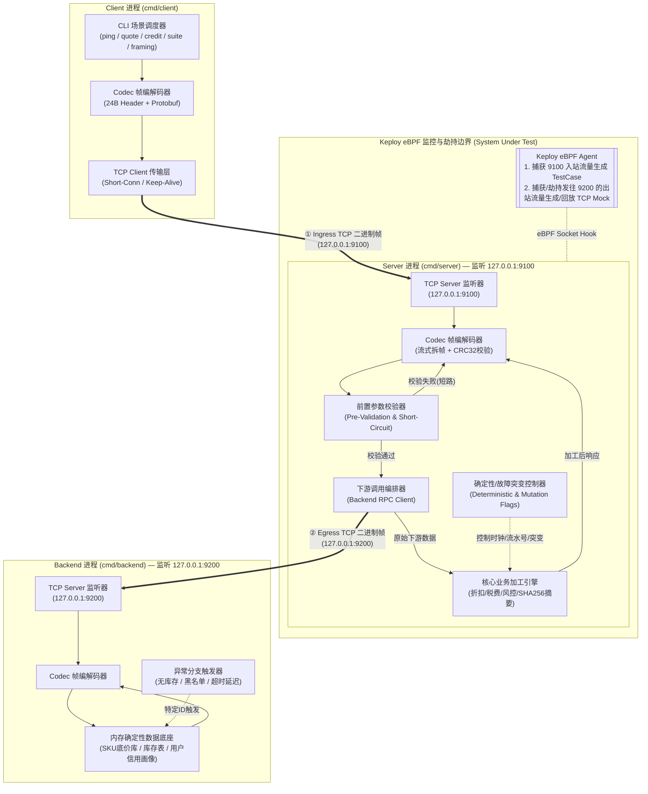
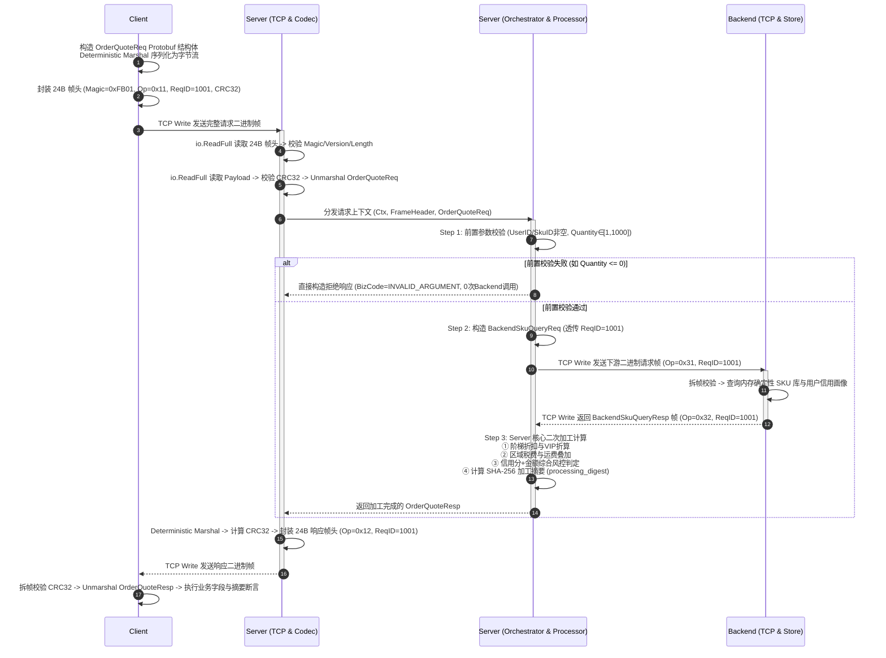
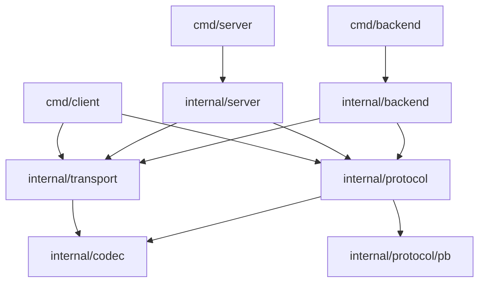

# flowbench 系统总体架构设计规范 (System Architecture)

- **文档编号**：`01-system-architecture.md`
- **文档版本**：v1.0.0
- **编制日期**：2026-10-25
- **当前阶段**：阶段二：系统架构设计文档（总览篇）
- **状态**：已定稿 (Finalized)

---

## 1. 架构设计目标与原则 (Architectural Goals & Principles)

`flowbench` 的系统架构围绕以下四大核心工程目标构建：

1. **三层微服务职责清晰隔离**：将系统拆分为独立的三个操作系统进程——`Client`（流量发起与验证端）、`Server`（核心被测系统 SUT，负责业务编排与二次加工）、`Backend`（下游基础数据与原子规则服务），完整还原生产环境中“上游调用 -> 本服务处理并调下游 -> 汇总加工返回”的典型微服务链路。
2. **纯粹的自定义 TCP 二进制协议栈**：在传输层直接使用 Go 原生 `net.Conn` (TCP)，在应用层通过自研 24 字节定长二进制帧头（Frame Header）承载 Protobuf 二进制载荷，完全剥离 HTTP/1.1、HTTP/2 与 gRPC，使网络字节流纯粹由自定义二进制帧构成。
3. **面向 Keploy eBPF 的最佳可观测与可回放性**：针对 Keploy 内核态 eBPF 探针捕获 Ingress（入站）和劫持 Egress（出站）TCP 流量的工作机制，提供无歧义的请求-响应帧边界、可切换的短连接/长连接模型以及严格的确定性计算控制。
4. **零外部运行时依赖**：所有子系统编译为独立静态/原生二进制文件，无外部数据库或中间件依赖，确保在任意 Linux 环境中秒级拉起并执行端到端测试。

---

## 2. 系统总体拓扑与网络模型 (System Topology & Network Model)

### 2.1 三级微服务部署与端口拓扑



### 2.2 端口与地址安全规范
| 子系统 | 进程二进制名称 | 角色定义 | 默认监听/目标地址 | 协议栈 |
| :--- | :--- | :--- | :--- | :--- |
| **Backend** | `flowbench-backend` | 下游基础数据与规则计算服务 | 监听 `127.0.0.1:9200` | Raw TCP + 24B Frame + Protobuf |
| **Server** | `flowbench-server` | 核心被测服务 (SUT)，承上启下与业务加工 | 监听 `127.0.0.1:9100`<br>连接下游 `127.0.0.1:9200` | Raw TCP + 24B Frame + Protobuf |
| **Client** | `flowbench-client` | 上游调用客户端与测试断言驱动器 | 连接服务端 `127.0.0.1:9100` | Raw TCP + 24B Frame + Protobuf |

> [!IMPORTANT]
> 所有服务端监听地址默认强制绑定 `127.0.0.1`（本地环回），禁止默认监听 `0.0.0.0`，既满足本地安全合规要求，又确保 Keploy 在单机环回网卡（`lo`）上稳定拦截 TCP Socket 系统调用。

---

## 3. 端到端请求生命周期 (End-to-End Request Lifecycle)

以核心业务场景 **订单计价与风控聚合 (`OrderQuote`, `OpCode=0x11`)** 为例，单次请求在三端之间的完整流转时序如下：



---

## 4. 代码工程结构与模块分层设计 (Package Layout & Layering)

### 4.1 详细目录树结构

```text
flowbench/
├── proto/
│   └── flowbench/
│       └── v1/
│           └── messages.proto          # 统一定义 Client<->Server 与 Server<->Backend 的 Protobuf 消息
├── cmd/
│   ├── client/
│   │   └── main.go                     # Client 命令行参数解析、场景执行器与结果报告输出
│   ├── server/
│   │   └── main.go                     # Server 启动入口、配置加载、信号监听与优雅停机
│   └── backend/
│       └── main.go                     # Backend 启动入口、内存数据底座初始化与优雅停机
├── internal/
│   ├── codec/
│   │   ├── frame.go                    # 24B 帧头定义、OpCode/Status/Flags 常量、Frame 结构与封包/拆包
│   │   ├── stream.go                   # 基于 io.ReadFull 的流式读写器 (ReadFrame / WriteFrame)
│   │   └── frame_test.go               # 编解码、CRC32 篡改检测、粘包与单字节半包拆帧单元测试
│   ├── protocol/
│   │   ├── pb/                         # protoc 生成的 messages.pb.go 代码包
│   │   │   └── messages.pb.go
│   │   └── marshal.go                  # 确定性 Protobuf 封送辅助函数 (MarshalDeterministic / Unmarshal)
│   ├── transport/
│   │   ├── server.go                   # 通用 TCP Server 封装（并发连接处理、Deadline、优雅关闭）
│   │   └── client.go                   # 通用 TCP Client 封装（支持 Short-Conn 短连接与 Keep-Alive 长连接）
│   ├── backend/
│   │   ├── store.go                    # 确定性内存数据集（预置 SKU 价格/库存/重量、用户信用分与风险标签）
│   │   ├── handler.go                  # Backend 帧路由处理器（处理 OpBackendOrderQuery / OpBackendCreditQuery）
│   │   └── handler_test.go             # Backend 业务逻辑单元测试
│   └── server/
│       ├── config.go                   # Server 运行配置（含 Deterministic 开关、FaultMutation 突变模式）
│       ├── processor.go                # 核心业务二次加工纯函数引擎（折扣、税费、风控、SHA-256 摘要）
│       ├── handler.go                  # Server 帧路由与下游 Backend 编排处理器
│       └── processor_test.go           # 加工引擎与确定性摘要单元测试
├── keploy/
│   └── keploy.yml                      # Keploy 录制与测试配置文件
├── scripts/
│   ├── verify-e2e.sh                   # 本地三端全链路自动化联调与断言脚本
│   ├── keploy-record.sh                # Keploy 流量录制编排脚本
│   └── keploy-test.sh                  # Keploy 离线回放（无 Backend）验证脚本
├── tests/
│   └── e2e_test.go                     # Go 原生三端全链路集成测试（含粘包压测、短路校验、突变检测）
└── Makefile                            # 标准化构建、测试、格式化与验证入口
```

### 4.2 模块依赖有向无环图 (Package Dependency DAG)



- **单向依赖原则**：`internal/codec` 与 `internal/protocol/pb` 处于最底层，不依赖任何上层业务包；`internal/server` 与 `internal/backend` 互不依赖，仅通过 `internal/protocol` 中定义的契约消息与 `internal/transport` 进行网络交互，严格模拟真实微服务物理隔离。

---

## 5. TCP 连接模型与并发控制设计 (Connection & Concurrency Model)

为了全面验证 Keploy eBPF 探针对不同 TCP 连接生命周期的适应能力，`internal/transport/client.go` 设计支持两种连接模式：

1. **短连接模式 (`ConnModeShort = "short"`，默认推荐用于 Keploy 录制/回放)**：
   - 每次 RPC 调用（无论是 `Client -> Server` 还是 `Server -> Backend`）均通过 `net.DialTimeout` 建立一条新的 TCP 连接，发送 1 个请求帧并读取 1 个响应帧后立即调用 `conn.Close()`。
   - **设计考量**：在 Keploy 的 Generic TCP 录制回放机制中，短连接生命周期边界清晰，每次 `Server -> Backend` 的出站连接对应唯一一次请求与响应二进制流，能够最大化提升 eBPF 出站 Mock 匹配确定性。
2. **长连接复用模式 (`ConnModeKeepAlive = "keepalive"`)**：
   - 客户端维护长连接，在同一个 `net.Conn` 上按序发送多个请求帧并读取对应响应帧（通过互斥锁保证同一连接上帧写入与读取的原子性，并通过 `Header.RequestID` 严格校验响应归属）。
   - **设计考量**：用于压测流式拆包状态机（粘包/连续帧）以及测试 Keploy 在单条 TCP 流承载多次交互时的行为表现。

---

## 6. 优雅停机与信号处理设计 (Graceful Shutdown)

Keploy 在完成 `record` 或 `test` 时，会向被测进程（`flowbench-server`）发送 `SIGINT` 或 `SIGTERM` 信号。若被测进程被强制杀死或未能正常关闭监听句柄，可能导致覆盖率或尾部录制数据刷盘异常。因此 `Server` 与 `Backend` 统一实现标准优雅停机流程：

1. 主 Goroutine 通过 `signal.NotifyContext(context.Background(), syscall.SIGINT, syscall.SIGTERM)` 监听退出信号。
2. 收到信号后，立即调用 `listener.Close()` 停止接收新连接，`Accept()` 循环识别到 `net.ErrClosed` 后正常退出。
3. 使用 `sync.WaitGroup` 追踪所有活跃连接处理 Goroutine，为在途请求预留最多 `3s` 排空窗口（Drain Timeout），随后关闭下游客户端连接并以退出码 `0` 正常结束进程。

---

## 7. 安全设计检查与验证计划 (Security Design & Verification Plan)

遵循安全编码规范，本架构在设计层面落实以下防护控制：

1. **输入校验与帧长边界防护 (Input Validation & Max Frame Size)**：
   - 所有外部 TCP 字节流视为不可信输入。`codec.ReadFrame` 在读取 24B 帧头后，强制校验 `Magic == 0xFB01`、`Version == 0x01` 以及 `PayloadLen <= 4 * 1024 * 1024 (4MB)`，防止恶意超大 `PayloadLen` 引发内存分配 OOM。
   - `Server` 侧前置校验器严格检查字符串长度与数值范围（如 `Quantity > 0 && Quantity <= 10000`、`ApplyAmountCents > 0`）。
2. **网络暴露面收敛 (Localhost Binding Only)**：
   - 所有服务默认绑定 `127.0.0.1`，测试与验证期间严禁绑定 `0.0.0.0`。
3. **无敏感硬编码与安全日志 (No Hardcoded Secrets & Safe Logging)**：
   - 本测试基准环境不涉及真实用户密码或生产密钥；结构化日志仅输出业务测试 ID、帧元数据与校验摘要。
   - `TODO(security)`：若未来将该自定义二进制协议扩展至跨主机生产环境，需在 `transport` 层升级为 `crypto/tls` (TLS 1.3 / mTLS) 并引入基于 HMAC 或 Token 的帧级身份认证（当前阶段为支持明文 eBPF 流量录制验证，按 Non-Goal 4 保持本地环回明文 TCP）。
