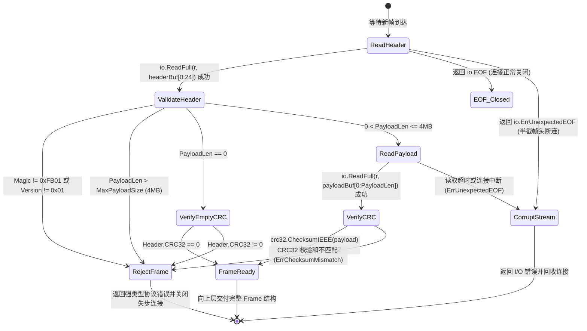

# flowbench 自定义二进制帧协议与编解码设计规范 (Wire Protocol & Codec)

- **文档编号**：`02-wire-protocol-and-codec.md`
- **文档版本**：v1.0.0
- **编制日期**：2026-10-25
- **当前阶段**：阶段二：系统架构设计文档（协议篇）
- **状态**：已定稿 (Finalized)

---

## 1. 协议栈分层模型 (Protocol Stack Layering)

`flowbench` 摒弃 HTTP/2 与 gRPC，直接在 TCP 字节流之上构建轻量、紧凑、自描述的二进制帧协议（**FlowBench Wire Protocol v1, FBWP/1.0**）：

```text
+-------------------------------------------------------------------+
| 业务消息层 (Application Message Layer)                            |
|   OrderQuoteReq / OrderQuoteResp / CreditEvalReq / BackendQuery   |
+-------------------------------------------------------------------+
| 序列化层 (Serialization Layer)                                    |
|   Google Protobuf Wire Format (proto.Marshal Deterministic=true)  |
+-------------------------------------------------------------------+
| 二进制帧封装层 (Custom Binary Framing Layer - FBWP/1.0)           |
|   24-Byte Fixed Header (Big-Endian) + Variable Protobuf Payload   |
+-------------------------------------------------------------------+
| 传输层 (Transport Layer)                                          |
|   Raw TCP Socket (net.Conn over 127.0.0.1)                        |
+-------------------------------------------------------------------+
```

---

## 2. 24 字节定长二进制帧头布局 (24-Byte Frame Header Layout)

所有帧头多字节数值字段严格采用 **网络字节序 / 大端字节序 (`binary.BigEndian`)**。帧头总长度固定为 **24 字节（3 × 8 Bytes，天然 64 位对齐）**，紧随其后的是长度为 `PayloadLen` 字节的 Protobuf 序列化二进制载荷。

### 2.1 帧结构字节位图 (Byte Offset Diagram)

```text
 0                   1                   2                   3
 0 1 2 3 4 5 6 7 8 9 0 1 2 3 4 5 6 7 8 9 0 1 2 3 4 5 6 7 8 9 0 1
+-+-+-+-+-+-+-+-+-+-+-+-+-+-+-+-+-+-+-+-+-+-+-+-+-+-+-+-+-+-+-+-+
|         Magic (0xFB01)        | Version(0x01) |    OpCode     |  Bytes 0..3
+-+-+-+-+-+-+-+-+-+-+-+-+-+-+-+-+-+-+-+-+-+-+-+-+-+-+-+-+-+-+-+-+
|     Flags     |    Status     |        Reserved (0x0000)      |  Bytes 4..7
+-+-+-+-+-+-+-+-+-+-+-+-+-+-+-+-+-+-+-+-+-+-+-+-+-+-+-+-+-+-+-+-+
|                                                               |
+                       RequestID (64-bit)                      +  Bytes 8..15
|                                                               |
+-+-+-+-+-+-+-+-+-+-+-+-+-+-+-+-+-+-+-+-+-+-+-+-+-+-+-+-+-+-+-+-+
|                       PayloadLen (32-bit)                     |  Bytes 16..19
+-+-+-+-+-+-+-+-+-+-+-+-+-+-+-+-+-+-+-+-+-+-+-+-+-+-+-+-+-+-+-+-+
|                         CRC32 (32-bit)                        |  Bytes 20..23
+-+-+-+-+-+-+-+-+-+-+-+-+-+-+-+-+-+-+-+-+-+-+-+-+-+-+-+-+-+-+-+-+
|                                                               |
~                  Protobuf Payload (0..N Bytes)                ~  Bytes 24..(24+N-1)
|                                                               |
+-+-+-+-+-+-+-+-+-+-+-+-+-+-+-+-+-+-+-+-+-+-+-+-+-+-+-+-+-+-+-+-+
```

### 2.2 帧头字段详细定义

| 字节偏移 | 字段名 | Go 类型 | 字节数 | 取值规范与职责说明 |
| :---: | :--- | :---: | :---: | :--- |
| `0..1` | `Magic` | `uint16` | 2B | 固定魔数 `0xFB01`（高字节 `0xFB` 代表 **F**low**B**ench，低字节 `0x01`）。用于快速识别合法协议流，探测粘包错位或非法非标连接。 |
| `2` | `Version` | `uint8` | 1B | 协议版本号，当前固定为 `0x01`。版本不匹配时直接返回 `StatusUnsupportedVersion`。 |
| `3` | `OpCode` | `uint8` | 1B | 操作码，唯一标识 Payload 承载的 Protobuf 消息类型与调用方向（详见 2.3 节）。 |
| `4` | `Flags` | `uint8` | 1B | 按位标志位：<br>- `Bit 0 (0x01)`: `FlagDeterministic`（请求方指示本次调用强制使用确定性模式）<br>- `Bit 1 (0x02)`: `FlagDebugTrace`（请求方要求返回详细加工追踪信息）<br>- `Bit 2..7`: 预留置 0。 |
| `5` | `Status` | `uint8` | 1B | 帧传输状态码：<br>- 请求帧固定填 `0x00 (StatusOK)`；<br>- 响应帧：`0x00` 表示协议封送正常（业务级成功/失败包含在 Protobuf 响应体内），非零表示协议级/框架级错误（详见 2.4 节）。 |
| `6..7` | `Reserved` | `uint16` | 2B | 对齐保留字段，发送端固定写入 `0x0000`，接收端忽略。 |
| `8..15` | `RequestID` | `uint64` | 8B | 64 位无符号请求唯一标识。由 `Client` 生成并写入请求帧，`Server` 调用 `Backend` 时原样透传该 `RequestID`，最终在返回 `Client` 的响应帧中原样带回。 |
| `16..19` | `PayloadLen` | `uint32` | 4B | 紧随帧头之后的 Protobuf 二进制载荷字节数。允许为 `0`（空载荷帧）；上限硬约束为 `MaxPayloadSize = 4,194,304 (4MB)`。 |
| `20..23` | `CRC32` | `uint32` | 4B | 采用 IEEE 多项式（`crc32.ChecksumIEEE(payload)`）对 `Payload` 字节切片计算的 32 位循环冗余校验码。当 `PayloadLen == 0` 时，固定为 `0x00000000`。 |

---

### 2.3 操作码字典 (`OpCode` Mapping)

协议严格区分 **`Client <-> Server`（入口段）** 与 **`Server <-> Backend`（下游段）** 的操作码，奇数表示 Request，偶数表示对应的 Response，`0xFF` 表示通用错误响应帧：

| OpCode (Hex) | 常量名称 | 通信方向 | 关联 Protobuf Message | 语义说明 |
| :---: | :--- | :--- | :--- | :--- |
| `0x01` | `OpPingReq` | `Client -> Server`<br>`Server -> Backend` | `PingRequest` | 链路探活与基础二进制帧回显请求 |
| `0x02` | `OpPongResp` | `Server -> Client`<br>`Backend -> Server` | `PongResponse` | 链路探活响应 |
| `0x11` | `OpOrderQuoteReq` | `Client -> Server` | `OrderQuoteRequest` | 客户端发起订单计价、库存核验与风控评估请求 |
| `0x12` | `OpOrderQuoteResp` | `Server -> Client` | `OrderQuoteResponse` | Server 完成下游查询与二次加工后的订单计价响应 |
| `0x21` | `OpCreditEvalReq` | `Client -> Server` | `CreditEvalRequest` | 客户端发起客户授信额度评估请求 |
| `0x22` | `OpCreditEvalResp` | `Server -> Client` | `CreditEvalResponse` | Server 完成多维规则聚合后的授信评估响应 |
| `0x31` | `OpBackendOrderQueryReq` | `Server -> Backend` | `BackendOrderQueryRequest` | Server 向下游 Backend 查询商品底价、实时库存与用户信用底数 |
| `0x32` | `OpBackendOrderQueryResp` | `Backend -> Server` | `BackendOrderQueryResponse` | Backend 返回的商品与用户底层基础数据 |
| `0x41` | `OpBackendCreditQueryReq` | `Server -> Backend` | `BackendCreditQueryRequest` | Server 向下游 Backend 查询客户历史履约记录与风险标签 |
| `0x42` | `OpBackendCreditQueryResp` | `Backend -> Server` | `BackendCreditQueryResponse` | Backend 返回的客户征信底层档案数据 |
| `0xFF` | `OpErrorResp` | 任意响应方向 | `ErrorResponse` | 协议层或未捕获系统级异常响应帧 |

### 2.4 帧级状态码字典 (`Status` Code)

| Status (Hex) | 常量名称 | 触发条件与处理方式 |
| :---: | :--- | :--- |
| `0x00` | `StatusOK` | 正常业务帧（业务处理成功或业务级校验拒绝均使用 `StatusOK`，具体业务结果由 Protobuf 内的 `biz_code` 表达） |
| `0x01` | `StatusBadPayload` | 接收端对 Payload 执行 `proto.Unmarshal` 失败 |
| `0x02` | `StatusUnknownOpCode` | 接收端收到无法识别或不属于当前子系统职责的 `OpCode` |
| `0x03` | `StatusDownstreamError` | `Server` 调用 `Backend` 时发生网络超时、断连或下游协议错误 |
| `0x04` | `StatusInternalError` | 服务端内部发生未预期系统错误 |

---

## 3. 流式 TCP 拆粘包状态机设计 (Stream Framing State Machine)

由于 TCP 是面向字节流的无边界传输协议（Stream-oriented Protocol），操作系统内核缓冲区与网卡 MTU 分片会导致：
- **半包（Fragmentation）**：一个 100 字节的帧被拆分成多次 `conn.Read` 到达（甚至极端情况下每次只读到 1 字节）；
- **粘包（Coalescing）**：连续发送的多个帧在一次 `conn.Read` 调用中同时到达。

### 3.1 基于 `io.ReadFull` 的两阶段确定性拆帧算法

`internal/codec/stream.go` 严禁直接使用单次 `conn.Read(buf)`，必须通过两阶段定长完整读取状态机实现拆包：



### 3.2 关键实现守则
1. **单次 Write 原子性（助推 eBPF 抓包清晰度）**：在 `WriteFrame(w io.Writer, frame *Frame)` 中，先在内存中分配 `24 + len(payload)` 字节的连续切片，将 24 字节帧头与 Payload 组装为一个完整连续缓冲区后，通过单次 `w.Write(fullBuf)` 写入 TCP Socket。这样在正常发送路径下，单个业务帧对应一次 `write/sendto` 系统调用，极大方便 Keploy eBPF 探针按报文捕获。
2. **確定性 Protobuf 编码**：在 `internal/protocol/marshal.go` 中统一封装：
   ```go
   var deterministicMarshaller = proto.MarshalOptions{
       Deterministic: true,
   }
   ```
   任何发出的 Protobuf 消息均通过 `deterministicMarshaller.Marshal(msg)` 序列化，彻底杜绝 Go `map` 遍历随机性导致相同业务数据生成不同字节流与不同 `CRC32` 的隐患。
