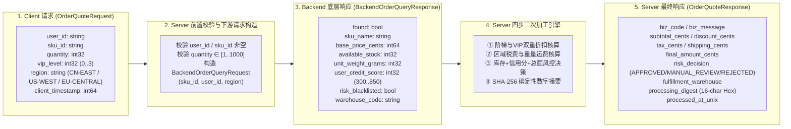

# flowbench 三端协同与 Server 业务加工编排设计规范 (Service Orchestration & Processing)

- **文档编号**：`03-service-orchestration.md`
- **文档版本**：v1.0.0
- **编制日期**：2026-10-25
- **当前阶段**：阶段二：系统架构设计文档（业务篇）
- **状态**：已定稿 (Finalized)

---

## 1. 设计目标：为什么需要有深度的 Server 侧加工逻辑？

在三层微服务（`Client -> Server -> Backend`）验证环境中，如果 `Server` 只是把 `Backend` 的响应原封不动转发给 `Client`，则无法验证以下关键问题：
1. **入站与出站二进制帧结构的异构性**：真实业务中，`Client <-> Server` 的对外接口契约（外部请求/聚合视图响应）与 `Server <-> Backend` 的内部调用契约（底层原子数据查询）往往采用完全不同的 Protobuf Message 定义与 OpCode。
2. **Server 代码回归缺陷检出（Regression Detection）**：流量回放测试的核心价值是当 `Backend` 被 Mock 固定后，一旦 `Server` 自身的业务计算逻辑（如折扣公式、税率规则、风控阈值、摘要算法）被错误修改，离线回放测试能够通过比对 `Server` 输出给 `Client` 的二进制帧立即报警。
3. **确定性与非确定性字段控制**：通过在 `Server` 加工阶段集中管理时间戳、流水号与 SHA-256 业务摘要，能够精确控制响应报文的字节级确定性。

---

## 2. 核心业务链路一：订单计价与风控聚合 (`OrderQuote`)

### 2.1 三端数据流转与字段演化图



---

### 2.2 Step 1：`Server` 前置参数校验规则 (Pre-Validation & Short-Circuit)

当 `Server` 收到 `OpOrderQuoteReq (0x11)` 帧后，在进行任何网络 I/O（调用 `Backend`）之前，优先执行本地前置校验：

1. **必填项校验**：`strings.TrimSpace(req.UserId) == ""` 或 `strings.TrimSpace(req.SkuId) == ""`；
2. **数量合法性校验**：`req.Quantity <= 0` 或 `req.Quantity > 1000`；
3. **VIP 等级范围校验**：`req.VipLevel < 0` 或 `req.VipLevel > 3`。

**短路行为（Short-Circuit）**：
一旦上述任一校验失败，`Server` **绝不向 `Backend` 发起 TCP 调用**，直接构造 `OrderQuoteResponse`：
- `biz_code = 400 (BIZ_INVALID_ARGUMENT)`
- `risk_decision = "REJECTED_PRECHECK"`
- `final_amount_cents = 0`
- 计算对应的 `processing_digest` 并立即通过 `OpOrderQuoteResp (0x12)` 返回给 `Client`。

---

### 2.3 Step 2：`Server` 四大核心业务加工算子精确数学规范

当前置校验通过且 `Backend` 返回 `BackendOrderQueryResponse` 后，若商品不存在（`!resp.Found`），返回 `biz_code = 404`；若商品存在，`Server` 严格采用 **`int64` 整数分（Cents）与基点（Basis Points, $1\text{ bp} = 0.01\% = \frac{1}{10000}$）** 进行确定性定点算术计算，彻底杜绝 `float64` 跨平台精度误差：

#### 算子 ①：原始小计与阶梯+VIP 双重折扣核算 (`Subtotal & Discount`)
1. **原始商品小计 (`subtotal_cents`)**：
   $$\text{subtotal\_cents} = \text{base\_price\_cents} \times \text{int64}(\text{quantity})$$
2. **VIP 等级折扣基点 (`vip_discount_bps`)**：
   - `vip_level == 0`：$0\text{ bps}$ (无折扣)
   - `vip_level == 1`：$500\text{ bps}$ (减免 $5\%$)
   - `vip_level == 2`：$1000\text{ bps}$ (减免 $10\%$)
   - `vip_level == 3`：$1500\text{ bps}$ (减免 $15\%$)
3. **数量阶梯折扣基点 (`qty_discount_bps`)**：
   - `quantity < 5`：$0\text{ bps}$
   - `5 <= quantity < 20`：$300\text{ bps}$ (额外减免 $3\%$)
   - `quantity >= 20`：$600\text{ bps}$ (额外减免 $6\%$)
4. **总折扣金额 (`discount_cents`) 与折后净额 (`discounted_cents`)**：
   $$\text{total\_bps} = \text{vip\_discount\_bps} + \text{qty\_discount\_bps}$$
   $$\text{discount\_cents} = \frac{\text{subtotal\_cents} \times \text{total\_bps}}{10000}$$
   $$\text{discounted\_cents} = \text{subtotal\_cents} - \text{discount\_cents}$$
   *(注：若开启回归突变测试开关 `-fault-mutation=discount_bug`，则人为注入偏差 `discount_cents += 100`，用于验证回放比对能否检出 1 元的计算错误)*。

#### 算子 ②：区域税费与重量阶梯运费核算 (`Regional Tax & Shipping`)
1. **区域税率基点 (`tax_rate_bps`)**：
   - `"CN-EAST"` / `"CN-NORTH"`：$600\text{ bps}$ ($6\%$ 增值税)
   - `"US-WEST"`：$825\text{ bps}$ ($8.25\%$ 州消费税)
   - `"EU-CENTRAL"`：$1900\text{ bps}$ ($19\%$ VAT)
   - 其他未指定区域：默认 $1000\text{ bps}$ ($10\%$)
   $$\text{tax\_cents} = \frac{\text{discounted\_cents} \times \text{tax\_rate\_bps}}{10000}$$
2. **重量阶梯履约运费 (`shipping_cents`)**：
   - 总重量 $\text{total\_weight\_grams} = \text{unit\_weight\_grams} \times \text{quantity}$；
   - 若 $\text{discounted\_cents} \ge 50000$（折后满 500.00 元）且非跨境（`CN-*`），免运费 $\text{shipping\_cents} = 0$；
   - 否则：基础首重费 $1200\text{ cents}$ (12.00 元)，每超过 $1000\text{g}$ 续重加收 $500\text{ cents}$：
     $$\text{shipping\_cents} = 1200 + \left\lfloor\frac{\max(0, \text{total\_weight\_grams} - 1000)}{1000}\right\rfloor \times 500$$
3. **最终应付总额 (`final_amount_cents`)**：
   $$\text{final\_amount\_cents} = \text{discounted\_cents} + \text{tax\_cents} + \text{shipping\_cents}$$

#### 算子 ③：库存核验与多维综合风控决策机 (`Risk & Fulfillment Decision`)
按以下优先级顺序判定业务状态码 `biz_code` 与风控结论 `risk_decision`：
1. **黑名单一票否决**：若 `Backend` 返回 `risk_blacklisted == true` -> `biz_code = 403 (BIZ_RISK_REJECTED)`，`risk_decision = "REJECTED_BLACKLIST"`，`final_amount_cents = 0`；
2. **库存不足拦截**：若 `req.Quantity > resp.AvailableStock` -> `biz_code = 409 (BIZ_OUT_OF_STOCK)`，`risk_decision = "REJECTED_STOCK"`，`final_amount_cents = 0`；
3. **低信用分高额订单拒单**：若 `resp.UserCreditScore < 550` 且 `final_amount_cents > 20000` -> `biz_code = 403 (BIZ_RISK_REJECTED)`，`risk_decision = "REJECTED_LOW_CREDIT"`；
4. **中等信用分或大额订单转人工审核**：若 `resp.UserCreditScore < 650` 或 `final_amount_cents > 100000` -> `biz_code = 200 (BIZ_OK)`，`risk_decision = "MANUAL_REVIEW"`；
5. **自动审批通过**：其余正常情况 -> `biz_code = 200 (BIZ_OK)`，`risk_decision = "APPROVED"`。

#### 算子 ④：确定性加工数字摘要 (`processing_digest`)
为确保 `Client` 与回放比对器均能一键核验上述全套加工链路的一致性，`Server` 将关键输入与加工结果按固定格式拼接并计算 SHA-256，取前 16 位小写十六进制字符作为 `processing_digest`：
```go
digestInput := fmt.Sprintf(
    "req=%d|user=%s|sku=%s|qty=%d|sub=%d|disc=%d|tax=%d|ship=%d|final=%d|code=%d|decision=%s|wh=%s",
    reqID, req.UserId, req.SkuId, req.Quantity,
    subtotalCents, discountCents, taxCents, shippingCents, finalAmountCents,
    bizCode, riskDecision, warehouseCode,
)
sum := sha256.Sum256([]byte(digestInput))
processingDigest := hex.EncodeToString(sum[:8]) // 16 hex chars
```

---

## 3. 核心业务链路二：客户授信评估 (`CreditEval`)

为验证单端口多 `OpCode` 与不同 Protobuf 消息结构的流量监控能力，提供第二条完整三层调用链（`OpCreditEvalReq 0x21` -> `OpBackendCreditQueryReq 0x41` -> `OpBackendCreditQueryResp 0x42` -> `OpCreditEvalResp 0x22`）：

1. **`Client` 发起 `CreditEvalRequest`**：传入 `user_id`、`requested_limit_cents`（申请授信额度）、`annual_income_cents`（年收入）、`existing_debt_cents`（存量负债）。
2. **`Server` 调用 `Backend` (`BackendCreditQueryRequest`)**：查询该用户的 `credit_score`、`historical_default_count`（历史逾期次数）、`account_age_months`（账户账龄）与 `risk_blacklisted`。
3. **`Server` 授信额度加工模型**：
   - 若 `risk_blacklisted` 或 `historical_default_count >= 3` 或 `credit_score < 500`：直接拒批（`approved_limit_cents = 0, credit_grade = "D", decision = "REJECTED"`）；
   - 计算负债收入比（DTI Basis Points）：$\text{dti\_bps} = \frac{\text{existing\_debt\_cents} \times 10000}{\text{annual\_income\_cents}}$；
   - 根据信用分评定等级（`>=750` 为 `"A"` 系数 $40\%$，`>=650` 为 `"B"` 系数 $25\%$，`>=500` 为 `"C"` 系数 $15\%$），结合账龄加成与已有负债扣减得出最大可授信上限 `max_allowable_cents`；
   - 最终获批额度 $\text{approved\_limit\_cents} = \min(\text{requested\_limit\_cents}, \text{max\_allowable\_cents})$，并生成 `processing_digest`。

---

## 4. 确定性控制策略 (Determinism Control Strategy)

在二进制协议回放测试中，哪怕响应体中有 1 个字节因系统当前时间变化而不同，都会导致 Protobuf 载荷字节改变以及帧头 `CRC32` 改变。为此 `Server` 设计了双模式时钟与流水号生成器：

| 字段名称 | 确定性模式 (`-deterministic=true`，默认) | 非确定性模式 (`-deterministic=false`，对照实验) |
| :--- | :--- | :--- |
| `processed_at_unix` | 若请求携带非零 `client_timestamp` 则等于 `client_timestamp + 1`；否则等于固定基准纪元 `1700000000` | 取实时系统时钟 `time.Now().UnixNano()` |
| `trace_tag` | 固定格式 `fmt.Sprintf("trace-det-%d", header.RequestID)` | 附加随机数 `fmt.Sprintf("trace-dyn-%d-%d", header.RequestID, rand.Int63())` |

---

## 5. `Backend` 确定性内存数据字典 (In-Memory Deterministic Dataset)

`internal/backend/store.go` 预置以下标准测试数据集，供全链路联调与录制使用：

### 5.1 预置商品库 (SKU Catalog)
| `sku_id` | 商品名称 | `base_price_cents` | `available_stock` | `unit_weight_grams` | `warehouse_code` | 设计用途 |
| :--- | :--- | :---: | :---: | :---: | :---: | :--- |
| `SKU-PRO-01` | 企业级千兆交换机 | `10000` (100.00元) | `50` | `1500` | `WH-SH-01` | 标准计价、VIP 折扣与续重运费测试 |
| `SKU-EDGE-02` | 边缘计算网关节点 | `80000` (800.00元) | `10` | `800` | `WH-BJ-02` | 高单价满额免运费与大额风控转审测试 |
| `SKU-OUT-OF-STOCK` | 紧缺算力模组 | `50000` (500.00元) | `0` | `2000` | `WH-SZ-01` | 触发库存不足拒单分支 (`SC-04`) |
| `SKU-SLOW-500MS` | 慢查询延迟测试件 | `2000` (20.00元) | `100` | `500` | `WH-GZ-01` | 模拟 `Backend` 耗时响应 |

### 5.2 预置用户信用画像库 (User Credit Profiles)
| `user_id` | `credit_score` | `historical_default_count` | `account_age_months` | `risk_blacklisted` | 设计用途 |
| :--- | :---: | :---: | :---: | :---: | :--- |
| `USR-VIP-001` | `780` | `0` | `36` | `false` | 高信用优质客户（自动审批通过 + A级授信） |
| `USR-NORMAL-002` | `620` | `1` | `14` | `false` | 中等信用客户（触发人工审核 + B级授信） |
| `USR-LOW-003` | `510` | `2` | `6` | `false` | 低信用客户（高额订单拒单 + C级受限授信） |
| `USR-BLACKLIST` | `350` | `5` | `2` | `true` | 黑名单高危用户（一票否决拦截） |
