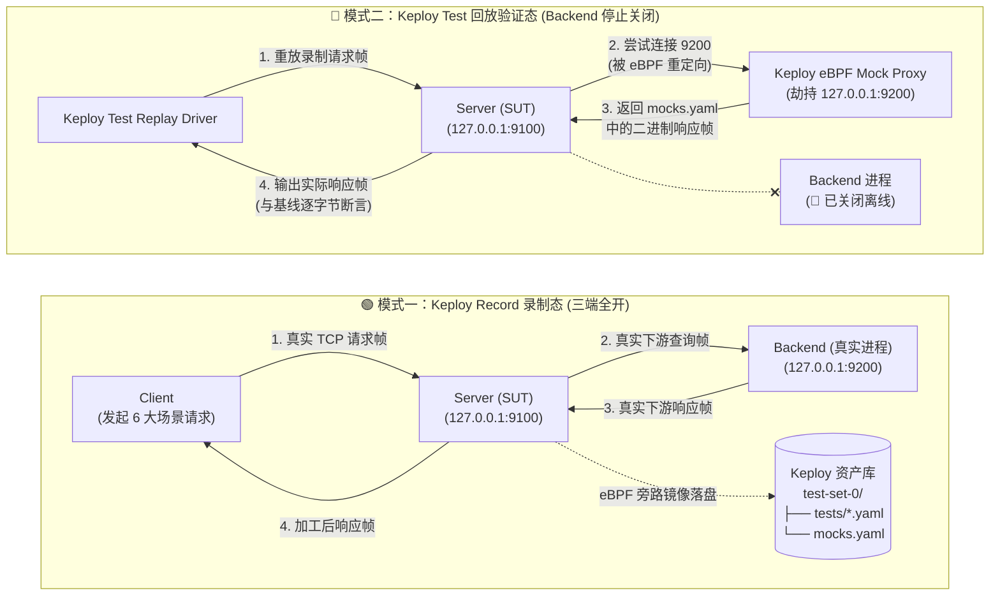

# flowbench Keploy eBPF 流量监控、录制与回放验证架构规范 (Keploy Traffic Verification)

- **文档编号**：`04-keploy-traffic-verification.md`
- **文档版本**：v1.0.0
- **编制日期**：2026-10-25
- **当前阶段**：阶段二：系统架构设计文档（验证篇）
- **状态**：已定稿 (Finalized)

---

## 1. Keploy 在自定义二进制协议下的工作机理 (eBPF Interception Mechanics)

[Keploy](https://github.com/keploy/keploy) 通过在 Linux 内核态挂载 **eBPF (Extended Berkeley Packet Filter)** 探针（Hook `sys_enter_accept`、`sys_enter_connect`、`sys_enter_read`、`sys_enter_write`、`sock_ops` 等系统调用），无需修改应用层代码或引入 SDK，即可透明观测被测进程（`flowbench-server`）的所有 TCP Socket I/O。

当协议为**非 HTTP、非 gRPC 的自定义 Protobuf 二进制协议**时，Keploy 的处理路径如下：

1. **入站流量（Ingress：`Client -> 127.0.0.1:9100 Server`）**：
   - `Server` 调用 `accept()` 接收来自 `Client` 的连接后，eBPF 探针捕获 `read()` 到的 24B 帧头 + Protobuf 请求字节流作为 **Request Payload**，并捕获 `write()` 回写给 `Client` 的 24B 帧头 + Protobuf 响应字节流作为 **Response Payload**。
   - 由于首字节 `0xFB 0x01` 不匹配 HTTP 方法（`GET`/`POST`/`PRI * HTTP/2.0`），Keploy 将其识别为通用流/二进制流量或导出为 Base64/原始二进制载荷保存至测试用例文件。
2. **出站依赖流量（Egress：`Server -> 127.0.0.1:9200 Backend`）**：
   - `Server` 调用 `connect()` 连接下游 `Backend (127.0.0.1:9200)` 时，eBPF 探针将其标记为外部依赖（Outgoing Dependency）。
   - **Record 模式**：透传真实连接至 `Backend`，同时将 `Server` 写出的二进制请求帧与从 `Backend` 读入的二进制响应帧配对录制到 `mocks.yaml`（Generic TCP / Binary Mock）。
   - **Test 回放模式**：当 `Server` 再次发起 `connect(127.0.0.1:9200)` 时，Keploy 的 eBPF `connect` 钩子将该出站连接透明重定向至 Keploy 内置的本地 Mock Proxy 端口；当 `Server` 发送二进制查询帧时，Mock Proxy 根据录制的 `mocks.yaml` 直接返回对应的二进制响应帧，从而使 `Server` 在 **`Backend` 完全离线** 的情况下完成全链路业务计算。

---

## 2. 录制态 (Record) 与回放态 (Test) 架构拓扑对比

---

## 3. 六大验证场景与回放断言设计 (Verification Scenarios & Assertions)

`flowbench-client -mode=suite` 将按固定顺序（`RequestID = 1001 .. 1006`）执行以下 6 个标准请求，形成完整的验证矩阵：

| 序号 | RequestID | 对应场景 | OpCode | 请求核心参数 | Server 下游调用行为 | 预期 Server 加工输出 |
| :---: | :---: | :--- | :---: | :--- | :--- | :--- |
| **1** | `1001` | `SC-01` 链路探活 | `0x01` (`PingReq`) | `message = "flowbench-probe"` | **0 次**（纯 Ingress 处理） | `PongResp`: 原样回显标识与服务状态 `SERVING` |
| **2** | `1002` | `SC-02` VIP 阶梯计价 | `0x11` (`OrderQuoteReq`) | `user="USR-VIP-001"`, `sku="SKU-PRO-01"`, `qty=5`, `vip=2`, `region="CN-EAST"` | **1 次** (`0x31 -> 0x32`) 查询底价 `10000`、库存 `50`、信用 `780` | `subtotal=50000`, `discount=6500` (10%VIP+3%满5件), `tax=2610` (6%), `shipping=3700` (7.5kg), `final=49810`, `decision="APPROVED"` |
| **3** | `1003` | `SC-03` 前置校验短路 | `0x11` (`OrderQuoteReq`) | `user="USR-VIP-001"`, `sku="SKU-PRO-01"`, `qty=0` (非法数量) | **0 次**（前置校验直接拦截） | `biz_code=400`, `final=0`, `decision="REJECTED_PRECHECK"` |
| **4** | `1004` | `SC-04` 库存不足拒单 | `0x11` (`OrderQuoteReq`) | `user="USR-VIP-001"`, `sku="SKU-OUT-OF-STOCK"`, `qty=2`, `vip=1` | **1 次** (`0x31 -> 0x32`) 查询返回 `available_stock=0` | `biz_code=409`, `final=0`, `decision="REJECTED_STOCK"` |
| **5** | `1005` | `SC-04B` 低信用风控拒单 | `0x11` (`OrderQuoteReq`) | `user="USR-LOW-003"`, `sku="SKU-EDGE-02"`, `qty=1`, `vip=0`, `region="US-WEST"` | **1 次** (`0x31 -> 0x32`) 查询底价 `80000`、信用 `510 (<550)` | `biz_code=403`, `decision="REJECTED_LOW_CREDIT"` |
| **6** | `1006` | `SC-05` 跨 OpCode 授信评估 | `0x21` (`CreditEvalReq`) | `user="USR-VIP-001"`, `req_limit=5000000`, `income=20000000`, `debt=2000000` | **1 次** (`0x41 -> 0x42`) 查询历史违约 `0`、信用 `780`、账龄 `36` | `biz_code=200`, `credit_grade="A"`, `approved_limit=5000000`, `decision="APPROVED"` |

---

## 4. 关键技术挑战与工程对策 (Key Technical Challenges & Mitigations)

### 4.1 二进制协议的请求-响应边界识别
- **挑战**：自定义二进制协议没有 HTTP 的 `\r\n\r\n` 或 `Content-Length` 文本头，eBPF 探针依赖系统调用 `read`/`write` 边界与连接生命周期来切分报文。
- **工程对策**：
  1. **单次原子写入**：在 `codec.WriteFrame` 中将 24B 帧头与 Payload 拼接为单一连续 `[]byte` 后调用一次 `conn.Write`，确保单个逻辑帧对应单次内核 `write` 事件，不产生人为拆分的多次系统调用。
  2. **默认采用短连接模式 (`-conn-mode=short`) 进行标准录制**：每次请求独占一个四元组端口生命周期，使 Keploy 的入站用例录制与出站 TCP Mock 匹配达到 100% 确定性；同时保留 `-conn-mode=keepalive` 作为对比研究项。

### 4.2 非确定性字节对二进制回放的破坏与隔离
- **挑战**：在 HTTP/JSON 协议中，Keploy 可以通过配置 `noise` 忽略 JSON 中的特定字段（如 `timestamp`）；但对于**自定义二进制帧 + Protobuf**，Keploy 无法在不了解私有 `.proto` Schema 与自定义 24B 帧头 CRC32 算法的情况下局部剔除某个 Protobuf tag，任何 1 个动态字节都会导致 Payload 改变且帧头 `CRC32` 改变。
- **工程对策**：
  - `Server` 默认启用 **Deterministic Mode (`-deterministic=true`)**：所有响应时间戳由请求帧中的逻辑时钟 `client_timestamp` 确定性派生，Protobuf 序列化强制开启 `proto.MarshalOptions{Deterministic: true}`。
  - 提供 `-deterministic=false` 对照开关，在验证报告中实证演示动态字段如何触发二进制回放失败，为企业私有二进制协议接入流量回放系统提供架构改造范本（即：**外置时钟源 / 注入式逻辑时钟 + 确定性序列化**）。

---

## 5. 双层验证体系：原生 E2E + Keploy eBPF 实机录制回放

为兼顾日常 CI 快速回归与 eBPF 内核级流量验证，`flowbench` 提供两套互补的自动化验证流水线：

1. **Go 原生全链路与协议边界验证 (`go test -v -race ./...` & `scripts/verify-e2e.sh`)**：
   - 在用户态完整测试 24B 帧编解码、CRC32 篡改拦截、单字节碎片与多帧粘包拆包、三端全场景通信、`Server` 加工公式准确性以及突变检测。
2. **Keploy eBPF 录制与离线回放验证 (`scripts/keploy-record.sh` & `scripts/keploy-test.sh`)**：
   - 调用系统安装的 `keploy` CLI（需 Linux `sudo` / `CAP_BPF` 权限挂载 eBPF 探针），执行真实的 `keploy mock record`（启动真实 `Backend` + Keploy 包裹 `Server` 与 `Client -mode=suite`）与 `keploy mock replay`（不启动 `Backend`，仅由 Keploy eBPF 劫持 `Server -> 127.0.0.1:9200` 并返回二进制 Mock），并在脚本退出前强制清理所有后台进程。

---

## 6. Keploy v3.6.163 (Linux 6.8 eBPF) 实机验证结论与协议边界发现

在 `Linux 6.8.0-147-generic (x86_64)` + `Keploy 3.6.163` 环境下对 `flowbench` 进行实机验证，得出以下极具工程价值的实证结论：

1. **发现一：`keploy record / test` 的 Ingress Forwarder 仅支持 HTTP/1.1**：
   - 在 `keploy record` 模式下，eBPF 探针拦截 `flowbench-server` 的 `bind(127.0.0.1:9100)` 系统调用，将其重映射至随机端口，并启动 `Using request-framed HTTP/1.1 proxy with MSG_PEEK pool liveness` 监听 `9100`。
   - 当 `flowbench-client` 发送 `0xFB01` 开头的自定义二进制帧时，Ingress Forwarder 尝试按 HTTP/1.1 解析并报错：
     `Failed to parse downstream HTTP request {"error": "malformed HTTP request \"\\xfb\\x01\\x01\\x01...\""}`，同时向客户端回写 `HTTP/1.1 400 Bad Request`（导致客户端读取到魔数 `0x4854` 即 `"HT"`）。
2. **发现二：Keploy Egress Proxy (`:16789`) 完美支持自定义二进制协议 (`V2 generic parser`)**：
   - 当 `flowbench-server` 向 `127.0.0.1:9200 (Backend)` 发起自定义 Protobuf 二进制调用时，Keploy 的出站代理自动遍历协议探测器（`postgres_v3` -> `mongo_v2` -> `http` -> `mysql` -> `http2` -> `grpc`）后回退至 `generic` 解析器（`The external dependency is not supported. Hence using generic parser`）。
   - Keploy 准确捕获每次短连接的 24B 帧头 + Protobuf 请求与响应，将其以 Base64 二进制块（`+wEB...` 解码即为 `0xFB 0x01 0x01`）持久化至 [`keploy/keploy/flowbench-e2e/mocks.yaml`](file:///home/fugui/flowbench/keploy/keploy/flowbench-e2e/mocks.yaml)（共 4 条 `kind: Generic` 二进制 Mock）。
3. **发现三：`keploy mock record / replay` 实现非 HTTP 二进制服务的全链路离线回放**：
   - 通过 `keploy mock record` 与 `keploy mock replay --on-miss fail --strict`，Keploy 将同一测试作业内的 `Client -> Server:9100` 识别为 `self-call` 原生透传（绕过仅支持 HTTP 的 Ingress Proxy），同时通过 eBPF 100% 劫持 `Server -> Backend:9200` 出站连接。
   - 在**彻底关闭 `flowbench-backend` 进程**的离线回放测试中，Keploy 精准返回 4 条二进制 Mock（`loaded: 4, consumed: 4, missed: 0`），6 大业务场景（`SC-01 ~ SC-05`）100% 离线通过；注入 `-fault-mutation=discount_bug` 后，回放立即检出金额与摘要偏差并以非零退出码拦截失败。
