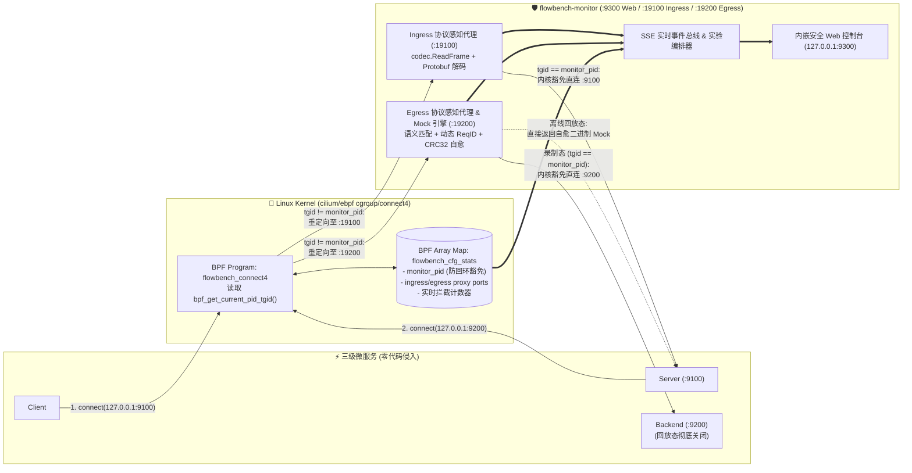

# flowbench 原生 `cilium/ebpf` 协议感知监控、智能回放与实时 Web 控制台架构设计

- **文档编号**：`05-ebpf-native-monitor-and-console.md`
- **文档版本**：v1.0.0
- **编制日期**：2026-10-26
- **当前阶段**：阶段二（演进篇）：系统架构设计文档
- **状态**：已定稿 (Finalized)

---

## 1. 架构设计目标与整体拓扑 (Architecture Overview)

针对第一阶段实机验证揭示的 Keploy 局限（Ingress 硬编码 HTTP/1.1 报错 `0x4854`、Egress 退化为 Base64 盲字节块、无法感知 24B 帧头与 Protobuf 明文、缺乏私有协议可视化控制台），本模块直接基于 **`github.com/cilium/ebpf`** 构建原生协议感知的内核级流量监控、录制回放与实时 Web 控制台子系统（`cmd/monitor`）。



---

## 2. 内核态 `cilium/ebpf` 探针设计 (`internal/ebpf`)

### 2.1 纯 Go 原生 BPF 指令集构建（零外部 Clang 依赖）

为保证项目在任何 Linux 环境下仅凭 `go build` 即可一键编译并加载真实内核 eBPF 探针，我们直接使用 `github.com/cilium/ebpf/asm` 构建 `BPF_CGROUP_INET4_CONNECT` (`ebpf.CGroupInet4Connect`) 程序。

### 2.2 `struct bpf_sock_addr` 内存布局与端口改写原理

在 Linux 内核 `<linux/bpf.h>` 中，`cgroup/connect4` 上下文 `struct bpf_sock_addr` 的关键偏移量如下：
- `offset 0` (`u32 user_family`)：`AF_INET` (2)
- `offset 4` (`u32 user_ip4`)：目标 IPv4 地址（网络字节序，在小端 x86_64 机器上 `127.0.0.1` 为 `0x0100007F`）
- `offset 24` (`u32 user_port`)：目标端口（网络字节序保存在低 16 位，如 `9100` 为 `htons(9100) = 0x8C23`，`9200` 为 `htons(9200) = 0xF023`）
- `offset 36` (`u32 protocol`)：`IPPROTO_TCP` (6)

### 2.3 基于 `bpf_get_current_pid_tgid()` 的内核态防死锁回环机制

当 `flowbench-monitor` 拦截了 `Client -> 127.0.0.1:9100` 或 `Server -> 127.0.0.1:9200` 的连接后，在录制模式下，监控器自身需要作为客户端向真正的 `127.0.0.1:9100` 和 `127.0.0.1:9200` 发起透传连接。
为防止监控器自身发起的透传连接再次被 eBPF 重定向回监控器（造成无限自环），BPF 程序执行以下精确判定：

1. 调用内核辅助函数 `bpf_get_current_pid_tgid()` (`FnGetCurrentPidTgid`)，右移 32 位获取当前进程的 `TGID`（即用户态 `os.Getpid()`）；
2. 查询 BPF Map `flowbench_state_map` 中预写入的 `monitor_pid`：
   - **若 `current_tgid == monitor_pid`**：判定为监控器自身发起的透传/探活连接，递增 `stat_bypassed_self` 计数并立即返回 `1`（放行直连真实目标端口）；
   - **若 `current_tgid != monitor_pid`** 且目标 IP 为 `127.0.0.1`：
     - 当 `user_port == htons(9100)` 且开启 Ingress 拦截时：将 `ctx->user_port` 改写为 `htons(ingress_proxy_port)`（如 `19100`），递增 `stat_ingress_redirected`；
     - 当 `user_port == htons(9200)` 且开启 Egress 拦截时：将 `ctx->user_port` 改写为 `htons(egress_proxy_port)`（如 `19200`），递增 `stat_egress_redirected`。

### 2.4 BPF Map 状态表定义 (`flowbench_state_map`)

采用 `ebpf.Array` 类型（`MaxEntries = 8`，`KeySize = 4`，`ValueSize = 8`）实现内核态与用户态的高速配置下发与遥测采集：

| Map Key (`uint32`) | 常量名称 | 读写方向 | 含义说明 |
| :---: | :--- | :---: | :--- |
| `0` | `MapKeyMonitorPID` | 用户态写 / 内核读 | `flowbench-monitor` 进程自身的 PID，用于内核防回环豁免 |
| `1` | `MapKeyEnableFlags` | 用户态写 / 内核读 | 位掩码：`bit0=1` 启用 Ingress(9100) 劫持，`bit1=1` 启用 Egress(9200) 劫持 |
| `2` | `MapKeyIngressProxyPort` | 用户态写 / 内核读 | Ingress 透明代理端口（网络字节序 `htons(port)`） |
| `3` | `MapKeyEgressProxyPort` | 用户态写 / 内核读 | Egress 透明代理端口（网络字节序 `htons(port)`） |
| `4` | `MapKeyStatTotalConnects` | 内核原子累加 / 用户态读 | 累计观测到的 TCP `connect()` 总次数 |
| `5` | `MapKeyStatIngressRedirect` | 内核原子累加 / 用户态读 | 累计劫持重定向 `127.0.0.1:9100` 的入站连接次数 |
| `6` | `MapKeyStatEgressRedirect` | 内核原子累加 / 用户态读 | 累计劫持重定向 `127.0.0.1:9200` 的出站连接次数 |
| `7` | `MapKeyStatBypassedSelf` | 内核原子累加 / 用户态读 | 累计豁免监控器自身透传连接的次数 |

---

## 3. 协议感知录制与智能自愈回放引擎 (`internal/monitor`)

### 3.1 深度帧解剖与结构化模型 (`CapturedFrameEvent`)

每一帧经过 Ingress (`:19100`) 或 Egress (`:19200`) 代理的自定义二进制报文，均通过 [`codec.ReadFrame`](file:///home/fugui/flowbench/internal/codec/codec.go#L112-L162) 与 [`protocol.NewMessageForOpCode`](file:///home/fugui/flowbench/internal/protocol/protocol.go#L27-L48) 解剖为如下结构化事件：

```go
type CapturedFrameEvent struct {
    SeqID          uint64            `json:"seq_id"`
    Timestamp      string            `json:"timestamp"`
    Direction      string            `json:"direction"`       // "INGRESS_REQ", "INGRESS_RESP", "EGRESS_REQ", "EGRESS_RESP", "EGRESS_MOCK_RESP"
    Mode           string            `json:"mode"`            // "RECORD", "REPLAY"
    Header         DecodedHeaderInfo `json:"header"`          // 24B 帧头全字段明细
    HeaderBytesHex []string          `json:"header_bytes_hex"`// 24 个字节的独立 Hex 数组，供前端渲染 24B 解剖色块
    CRC32Valid     bool              `json:"crc32_valid"`     // 载荷 CRC32 校验结果
    ProtobufJSON   map[string]any    `json:"protobuf_json"`   // 解码后的业务字段明文
    RawWireHex     string            `json:"raw_wire_hex"`    // 完整帧 Hex Dump
    RawBase64      string            `json:"raw_base64"`      // 与 Keploy 对照的 Base64 编码
    LatencyMs      float64           `json:"latency_ms"`
}
```

### 3.2 智能语义匹配与 `RequestID` / `CRC32` 自愈回放算法

在离线回放模式（`Backend` 关闭）下，当 `Server` 向 `127.0.0.1:9200` 发送下游查询帧 `reqFrame` 时：
1. **双重匹配策略**：
   - **语义键匹配（优先）**：提取 `reqFrame.Header.OpCode` 并反序列化 Protobuf 请求，生成确定性业务签名 `SemanticKey(opCode, protoMsg)`（忽略帧头中的 `RequestID` 和 `Flags`）。这意味着即使 `Server` 在不同运行批次中生成了全新的 `RequestID`，依然能 100% 命中对应的 Mock！
   - **原始字节匹配（兜底）**：若为未知扩展 OpCode，则按原始 Payload 字节匹配。
2. **动态重写与 `CRC32` 自愈封装**：
   - 取出录制库中匹配的响应模板 `mockRespFrame`；
   - 将 `mockRespFrame.Header.RequestID` 动态改写为当前 `reqFrame.Header.RequestID`；
   - 重新计算 `crc32.ChecksumIEEE(mockRespFrame.Payload)` 写入 `mockRespFrame.Header.CRC32`；
   - 调用 `codec.WriteFrame` 单次原子写回 `Server` Socket。

### 3.3 双层回归断言与 Protobuf 字段级 Diff (`FieldDiff`)

在回放测试中，针对每个场景（`SC-01 ~ SC-05`），将 `Server` 实际返回的二进制帧 `actualFrame` 与录制基线 `expectedFrame` 进行双层比对：
1. **第一层（Wire & CRC32 字节比对）**：比对 `expectedFrame.Header.CRC32 == actualFrame.Header.CRC32` 及原始字节流；
2. **第二层（Protobuf 语义字段级 Diff）**：若字节不一致，将两帧的 Payload 反序列化为 JSON Map，逐个字段比对并输出 `[]FieldDiff{FieldPath, ExpectedValue, ActualValue}`（如 `discount_cents: 6500 -> 6600`、`final_amount_cents: 50310 -> 50204`）。

---

## 4. 安全 Web 可视化控制台架构 (`cmd/monitor` & `internal/monitor/web`)

### 4.1 服务端 HTTP / SSE 接口契约（仅绑定 `127.0.0.1:9300`）

| 路径 | 方法 | 功能说明 |
| :--- | :---: | :--- |
| `/` | `GET` | 返回内嵌（`//go:embed`）的单页可视化监控控制台页面 |
| `/api/status` | `GET` | 返回当前三端存活状态、`cilium/ebpf` 探针挂载状态、BPF Map 实时计数、已录制用例与 Mock 列表 |
| `/api/events` | `GET` | **SSE (Server-Sent Events)** 实时流，零延迟推送捕获的每一帧 `CapturedFrameEvent` |
| `/api/run` | `POST` | 触发一键实验：`{"action": "record" \| "replay" \| "mutation" \| "non_deterministic"}`，自动编排三端与 eBPF 并返回完整场景断言报告与字段级 Diff |
| `/api/keploy-mocks` | `GET` | 读取并实时逆向解码仓库中的 [`keploy/keploy/flowbench-e2e/mocks.yaml`](file:///home/fugui/flowbench/keploy/keploy/flowbench-e2e/mocks.yaml)，返回 Base64 原文与解码后的 24B 帧头 + Protobuf 明文对照表 |

### 4.2 Web 安全防护设计 (Security Hardening)

1. **严格环回绑定**：默认仅绑定 `127.0.0.1:9300`，防止外部网络未授权访问。
2. **安全 HTTP 响应头**：所有响应强制设置 `X-Content-Type-Options: nosniff`、`X-Frame-Options: DENY`、`Cache-Control: no-store` 与严格的 `Content-Security-Policy`。
3. **零 `innerHTML` 的纯 DOM 安全渲染**：前端 JavaScript 100% 采用 `document.createElement`、`textContent`、`replaceChildren` 构建 DOM 节点，从根源杜绝 DOM XSS 风险。
4. **受控实验执行白名单**：`/api/run` 仅接受预定义的 4 种枚举常量（`record`、`replay`、`mutation`、`non_deterministic`），内部直接调用 Go 原生函数编排，不拼接任何外部 Shell 参数。
