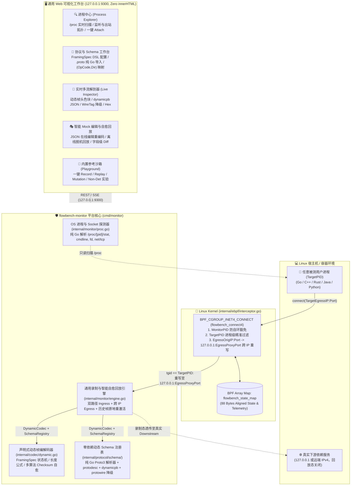
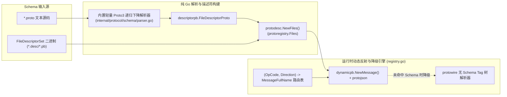

# flowbench 通用私有 Protobuf 协议监听与自愈回放工具平台架构设计

- **文档编号**：`06-universal-protobuf-platform-arch.md`
- **文档版本**：v1.0.0
- **编制日期**：2026-10-27
- **当前阶段**：阶段二（平台化演进）：系统架构设计文档
- **状态**：已定稿 (Finalized)

---

## 1. 架构演进目标与总体拓扑 (Architecture Overview)

基于 [`docs/01-features/03-universal-protobuf-platform.md`](file:///home/fugui/flowbench/docs/01-features/03-universal-protobuf-platform.md) (v1.1.0)，本设计文档将 `flowbench-monitor`（[`cmd/monitor`](file:///home/fugui/flowbench/cmd/monitor/main.go)）从固定 24B 帧头与特定三端 Demo 绑定的监控器，全面升级为**面向任意 OS 用户进程、支持声明式帧头 DSL 与动态 Protobuf Schema 反射的通用私有二进制协议监听与自愈回放平台**，同时 100% 保留内置三端参考沙箱（Playground）的开箱体验与回归基准。



---

## 2. 模块一：声明式二进制帧头 DSL 与动态流式状态机 (`internal/codec`)

### 2.1 `FramingSpec` 核心数据结构定义 (`internal/codec/dynamic.go`)

在完全保留现有 [`codec.Header`](file:///home/fugui/flowbench/internal/codec/frame.go#L62-L72) 与 [`codec.ReadFrame`](file:///home/fugui/flowbench/internal/codec/stream.go) 接口以兼容存量代码的基础上，新增通用的 `FramingSpec` 与 `DynamicFrame` 引擎：

```go
package codec

// ByteOrderType 定义多字节整型字段的字节序
type ByteOrderType string

const (
	ByteOrderBigEndian    ByteOrderType = "BigEndian"
	ByteOrderLittleEndian ByteOrderType = "LittleEndian"
)

// LengthSemantics 定义长度字段的计量范围语义
type LengthSemantics string

const (
	LengthSemanticsPayloadOnly LengthSemantics = "payload_only" // 长度字段仅表示 Payload 字节数
	LengthSemanticsTotalFrame  LengthSemantics = "total_frame"  // 长度字段表示整帧总字节数 (Header + Payload)
)

// ChecksumAlgorithm 定义可插拔校验和算法枚举
type ChecksumAlgorithm string

const (
	ChecksumNone            ChecksumAlgorithm = "none"
	ChecksumCRC32IEEE       ChecksumAlgorithm = "crc32_ieee"
	ChecksumCRC32Castagnoli ChecksumAlgorithm = "crc32_castagnoli"
	ChecksumAdler32         ChecksumAlgorithm = "adler32"
)

// ChecksumScope 定义校验和覆盖的数据范围
type ChecksumScope string

const (
	ChecksumScopePayloadOnly       ChecksumScope = "payload_only"
	ChecksumScopeFullFrameNoChkSum ChecksumScope = "full_frame_except_checksum"
)

// ChecksumPlaceholderMode 定义全帧校验和计算时校验和字段自身的占位方式
type ChecksumPlaceholderMode string

const (
	ChecksumPlaceholderZeroFill  ChecksumPlaceholderMode = "zero_fill"  // 将校验和字段区间置 0 参与计算
	ChecksumPlaceholderSkipBytes ChecksumPlaceholderMode = "skip_bytes" // 跳过校验和字段区间拼接计算
)

// FramingSpec 定义通用私有二进制协议帧头 DSL 规范
type FramingSpec struct {
	ProtocolName   string            `json:"protocol_name"`
	ByteOrder      ByteOrderType     `json:"byte_order"`       // "BigEndian" | "LittleEndian"
	MinHeaderBytes int               `json:"min_header_bytes"` // 定长帧头字节数，必须等于 PayloadOffset
	PayloadOffset  int               `json:"payload_offset"`   // Protobuf 载荷起始字节偏移
	Magic          MagicFieldSpec    `json:"magic"`
	LengthField    LengthFieldSpec   `json:"length_field"`
	OpCodeField    IntFieldSpec      `json:"opcode_field"`
	SeqIDField     IntFieldSpec      `json:"seq_id_field"`
	ChecksumField  ChecksumFieldSpec `json:"checksum_field"`
}

type MagicFieldSpec struct {
	Enabled  bool   `json:"enabled"`
	Offset   int    `json:"offset"`
	Length   int    `json:"length"`    // 1 | 2 | 4
	ValueHex string `json:"value_hex"` // 如 "0xFB01" 或 "0xAA55"
}

type LengthFieldSpec struct {
	Offset          int             `json:"offset"`
	Width           int             `json:"width"`             // 1 | 2 | 4
	Semantics       LengthSemantics `json:"semantics"`         // "payload_only" | "total_frame"
	Bias            int             `json:"bias"`              // 有符号长度补偿值
	MaxAllowedBytes uint32          `json:"max_allowed_bytes"` // 防 OOM 载荷上限 (默认 4MB)
}

type IntFieldSpec struct {
	Offset int    `json:"offset"`
	Width  int    `json:"width"` // 1 | 2 | 4 | 8
	Type   string `json:"type"`  // "uint8" | "uint16" | "uint32" | "uint64"
}

type ChecksumFieldSpec struct {
	Enabled         bool                    `json:"enabled"`
	Offset          int                     `json:"offset"`
	Width           int                     `json:"width"`            // 固定 4 字节 (uint32)
	Algorithm       ChecksumAlgorithm       `json:"algorithm"`        // "none" | "crc32_ieee" | "crc32_castagnoli" | "adler32"
	Scope           ChecksumScope           `json:"scope"`            // "payload_only" | "full_frame_except_checksum"
	PlaceholderMode ChecksumPlaceholderMode `json:"placeholder_mode"` // "zero_fill" | "skip_bytes"
}
```

### 2.2 动态拆帧、长度换算与 Checksum 自愈重写算法

1. **规范合法性前置校验 (`FramingSpec.Validate()`)**：
   - 强制校验 `MinHeaderBytes >= 4 && MinHeaderBytes <= 128` 且 `PayloadOffset == MinHeaderBytes`；
   - 强制校验 `Magic`、`LengthField`、`OpCodeField`、`SeqIDField`、`ChecksumField` 的 `[Offset, Offset+Width]` 均严格位于 `[0, MinHeaderBytes]` 边界内，杜绝越界 Slice Panic。
2. **标准载荷长度换算公式**：
   读取 `MinHeaderBytes` 字节的 `HeaderRaw` 后，按 `ByteOrder` 提取无符号整数 `rawLen`，执行：
   ```go
   headerDeduction := 0
   if spec.LengthField.Semantics == LengthSemanticsTotalFrame {
       headerDeduction = spec.PayloadOffset
   }
   payloadLen := int64(rawLen) + int64(spec.LengthField.Bias) - int64(headerDeduction)
   if payloadLen < 0 || uint64(payloadLen) > uint64(spec.LengthField.MaxAllowedBytes) {
       return nil, ErrPayloadTooLarge
   }
   ```
3. **序列号与载荷自愈重写 (`RebuildDynamicFrame`)**：
   当在离线回放中改写了 `SeqID` 或用户在 Web 界面编辑了 Mock 响应的 Protobuf 载荷后：
   - 按 `LengthField.Semantics` 与 `Bias` 逆运算更新帧头中的 `LengthField`：
     $$\text{RawLengthVal} = \text{len(Payload)} - \text{Bias} + (\text{if } \text{total\_frame} \text{ then } \text{PayloadOffset} \text{ else } 0)$$
   - 按 `SeqIDField.Offset` 与 `Width` 写入新序列号；
   - 按 `ChecksumField` 的算法（`crc32.ChecksumIEEE` / `crc32.MakeTable(crc32.Castagnoli)` / `adler32.Checksum`）与范围（`payload_only` 或 `full_frame_except_checksum` 的 `zero_fill` / `skip_bytes`）重新计算校验和并写回 `HeaderRaw[chk.Offset : chk.Offset+4]`。

### 2.3 内置三大预置协议模板 (`PresetFramingSpecs`)

| 模板 ID | 协议名称 | 字节序 | 帧头长度 | 魔数 | 长度字段 | OpCode | SeqID | 校验和策略 |
| :--- | :--- | :---: | :---: | :---: | :--- | :---: | :---: | :--- |
| `flowbench-v1` | FlowBench 默认 24B 协议 | `BigEndian` | 24B | `0xFB01` (`0..2`) | `16..20` (`payload_only`, `bias=0`) | `3..4` (`uint8`) | `8..16` (`uint64`) | `20..24` (`crc32_ieee`, `payload_only`) |
| `generic-financial-v2` | 金融交易网关 20B 协议 | `BigEndian` | 20B | `0xAA55` (`0..2`) | `2..6` (`total_frame`, `bias=0`) | `6..8` (`uint16`) | `8..16` (`uint64`) | `16..20` (`crc32_castagnoli`, `full_frame_except_checksum`, `zero_fill`) |
| `gaming-sync-v1` | 低延迟帧同步 12B 协议 | `LittleEndian` | 12B | 无 (`enabled=false`) | `0..2` (`payload_only`, `uint16`) | `2..4` (`uint16`) | `4..8` (`uint32`) | `8..12` (`adler32`, `payload_only`) |

---

## 3. 模块二：零依赖动态 Protobuf Schema 注册表与反射引擎 (`internal/protocol/schema`)

### 3.1 架构分层与零外部依赖设计

为满足 [`SCHEMA-01` ~ `SCHEMA-04`](file:///home/fugui/flowbench/docs/01-features/03-universal-protobuf-platform.md#L337-L340) 要求，同时坚持**零外部 `protoc` 二进制依赖、零新增第三方库**，我们在 `internal/protocol/schema` 包中基于官方 `google.golang.org/protobuf` 构建完整的动态反射引擎：



### 3.2 纯 Go 轻量级 Proto3 解析器 (`internal/protocol/schema/parser.go`)

针对用户直接上传或粘贴 `.proto` 文本的场景，实现纯 Go 词法与递归下降语法解析器 `ParseProtoFile(filename, src string) (*descriptorpb.FileDescriptorProto, error)`，支持：
- `syntax = "proto3";`、`package <pkg>;`、`option go_package = "...";`；
- 顶层与嵌套 `message <Name> { ... }` 定义；
- 顶层与嵌套 `enum <Name> { ... }` 定义；
- 全部 Protobuf 标量类型（`int32`, `int64`, `uint32`, `uint64`, `sint32`, `sint64`, `bool`, `string`, `bytes`, `float`, `double`, `fixed32`, `fixed64`, `sfixed32`, `sfixed64`）；
- `repeated` 列表修饰符；
- `map<KeyType, ValueType> field_name = N;`（自动在 `DescriptorProto` 中合成为标准 `MapEntry` 嵌套 Message 结构，与 `protoc` 编译器行为 100% 一致）；
- 跨 Message / Enum 类型引用自动解析（支持同包简写名与全限定名解析）。

### 3.3 `(OpCode, Direction)` 二元组联合路由与无 Schema 优雅降级

1. **联合路由键 (`RouteKey`)**：
   ```go
   type TrafficDirection string
   const (
       DirectionReq  TrafficDirection = "REQ"  // 客户端发往服务端的请求帧 (INGRESS_REQ / EGRESS_REQ)
       DirectionResp TrafficDirection = "RESP" // 服务端返回的响应帧 (INGRESS_RESP / EGRESS_RESP / EGRESS_MOCK_RESP)
   )

   type OpCodeRouteBinding struct {
       OpCode          uint32 `json:"op_code"`
       OpName          string `json:"op_name"`
       RequestMessage  string `json:"request_message"`  // 如 "flowbench.v1.OrderQuoteReq"
       ResponseMessage string `json:"response_message"` // 如 "flowbench.v1.OrderQuoteResp" (当请求响应同 OpCode 时配在同一项；不同 OpCode 时也可独立配置)
   }
   ```
   查找目标 `protoreflect.MessageDescriptor` 时：
   - 若当前帧流向为 `REQ`，优先取 `binding.RequestMessage`；
   - 若当前帧流向为 `RESP`，优先取 `binding.ResponseMessage`（若为空则回退取 `binding.RequestMessage`）；
   - 完美兼容“请求/响应不同 OpCode（如 `0x11` -> `OrderQuoteReq`, `0x12` -> `OrderQuoteResp`）”与“请求/响应共享同一 OpCode（如 `0x11` 的 `REQ` -> `OrderQuoteReq`, `RESP` -> `OrderQuoteResp`）”。

2. **无 Schema 时的 `protowire` Tag 树优雅降级 (`DecodeWireTagsFallback`)**：
   当某个 `OpCode` 尚未绑定 `.proto` 消息时，使用官方 `google.golang.org/protobuf/encoding/protowire` 对二进制 Payload 进行无损 Wire Tag 扫描：
   - `VarintType` -> 输出整型数值；
   - `Fixed32Type` / `Fixed64Type` -> 输出定长整数；
   - `BytesType` -> 若为合法可见 UTF-8 字符串则输出字符串，若内部可递归拆解为嵌套的子 Protobuf Wire Message 则输出嵌套对象，否则输出 `hex:...`；
   - 返回标记 `"_schema_less": true` 与 `"fields": {"tag_1": 1001, "tag_2": "SKU-001", ...}`。
   - 一旦用户上传 `.proto` 并绑定映射，引擎调用 `RehydrateCapturedFrames()` 遍历内存中已捕获的历史帧，原地利用 `dynamicpb` 重新反序列化为完整业务字段名 JSON 并通过 SSE 通知前端刷新。

---

## 4. 模块三：OS 级 `/proc` 进程与网络发现引擎 (`internal/monitor/proc.go`)

### 4.1 零外部命令依赖的 `/proc` 扫描器

为遵守安全编码规范（严禁拼接 Shell 命令调用 `ps`/`netstat`/`lsof`），进程探测器 100% 通过 Go 标准库 `os` 读取 Linux `/proc` 虚拟文件系统：

```go
type ProcessSocketInfo struct {
	PID             int      `json:"pid"`
	PPID            int      `json:"ppid"`
	Name            string   `json:"name"`
	Cmdline         string   `json:"cmdline"`
	CgroupPath      string   `json:"cgroup_path"`
	ListenPorts     []uint16 `json:"listen_ports"`      // TCP LISTEN 状态端口列表 (Ingress 候选)
	ActiveEndpoints []string `json:"active_endpoints"`  // TCP ESTABLISHED 远端 IP:Port 列表 (Egress 候选)
	IsFlowbenchDemo bool     `json:"is_flowbench_demo"` // 是否为 flowbench 内置沙箱进程
}
```

扫描算法步骤：
1. 解析 `/proc/net/tcp`：提取所有 `st == 0x0A` (`TCP_LISTEN`) 与 `st == 0x01` (`TCP_ESTABLISHED`) 的 Socket 条目，建立 `inode -> SocketEndpoint` 索引表；
2. 遍历 `/proc/[0-9]*` 目录：
   - 读取 `/proc/[pid]/comm` 与 `/proc/[pid]/cmdline`（将 `\x00` 替换为空格并截断至安全长度 256 字符）；
   - 读取 `/proc/[pid]/cgroup` 提取 Cgroup v2 相对路径并拼接 `/sys/fs/cgroup`；
   - 读取 `/proc/[pid]/fd/` 下的符号链接（如 `socket:[12345]`），与第一步的 `inode` 表关联，聚合出该进程的 `ListenPorts` 与 `ActiveEndpoints`；
3. 支持按关键字（进程名、PID、端口号）过滤，并置顶展示拥有活跃 TCP 监听端口的服务进程。

---

## 5. 模块四：支持 `TargetPID` 精准过滤与跨 IP 重写的 `cilium/ebpf` 探针升级 (`internal/ebpf`)

### 5.1 扩展后的 `BPFState` 内存布局 (`internal/ebpf/interceptor.go`)

在现有 80 字节 `BPFState` 基础上，扩展至 96 字节（12 个 `uint64` 字段，严格 8 字节对齐）：

| 字节偏移 (Offset) | 字段名称 | 类型 | 含义说明 |
| :---: | :--- | :---: | :--- |
| `0` | `MonitorPID` | `uint64` | `flowbench-monitor` 平台自身 PID（防回环最高优先级豁免） |
| `8` | `EnableFlags` | `uint64` | 位掩码：`bit0=1` 启用 Ingress 劫持，`bit1=1` 启用 Egress 劫持 |
| `16` | `IngressOrigPortNet` | `uint64` | 被监听服务的原始入站端口（网络字节序 `htons(port)`） |
| `24` | `IngressProxyPortNet` | `uint64` | 平台 Ingress 透明代理端口（网络字节序 `htons(port)`） |
| `32` | `EgressOrigPortNet` | `uint64` | 被劫持下游依赖的原始端口（网络字节序 `htons(port)`） |
| `40` | `EgressProxyPortNet` | `uint64` | 平台 Egress 代理/Mock 端口（网络字节序 `htons(port)`） |
| `48` | `StatIngressRedirected` | `uint64` | 累计重定向的入站连接数 |
| `56` | `StatEgressRedirected` | `uint64` | 累计重定向的出站连接数 |
| `64` | `StatBypassedSelf` | `uint64` | 累计豁免监控器自身透传连接数 |
| `72` | `StatTotalConnects` | `uint64` | 累计观测到的 TCP `connect()` 总数 |
| `80` | `TargetPID` | `uint64` | **新增**：被测目标进程 TGID（`0` 表示不限制 PID，用于全链路沙箱；`>0` 时仅拦截该 PID 发起的 Egress 连接） |
| `88` | `EgressOrigIPNet` | `uint64` | **新增**：被劫持下游依赖的原始 IPv4 地址（网络字节序 `uint32`，默认 `0x0100007f` 即 `127.0.0.1`） |

### 5.2 `buildConnect4Instructions` BPF 字节码升级逻辑

```text
1. R6 = ctx (struct bpf_sock_addr *)
2. Lookup BPF Map (Key=0) -> R7 (BPFState *)
3. R7->StatTotalConnects++
4. R0 = bpf_get_current_pid_tgid() >> 32 (当前调用 connect 的进程 TGID)
5. 若 R0 == R7->MonitorPID:
     R7->StatBypassedSelf++
     goto exit_allow (防死锁自环豁免)
6. R8 = ctx->user_port (offset 24), R9 = R7->EnableFlags
7. [检查 Egress 拦截]:
   - 若 (R9 & FlagInterceptEgress) != 0:
   - 若 R7->TargetPID != 0 且 R0 != R7->TargetPID:
       goto check_ingress (精准进程级隔离：非目标进程发起的出站连接绝不拦截！)
   - 读取 ctx->user_ip4 (offset 4) 至 R2
   - 若 R2 == R7->EgressOrigIPNet 且 R8 == R7->EgressOrigPortNet:
       ctx->user_ip4  = 0x0100007f (127.0.0.1，支持将远端下游 IP 重写回本地代理)
       ctx->user_port = R7->EgressProxyPortNet
       R7->StatEgressRedirected++
       goto exit_allow
8. [检查 Ingress 拦截 (check_ingress)]:
   - 若 (R9 & FlagInterceptIngress) != 0:
   - 若 R7->TargetPID != 0 且 R0 == R7->TargetPID:
       goto exit_allow (被测进程自身不是入站客户端)
   - 读取 ctx->user_ip4 (offset 4) 至 R2
   - 若 R2 == 0x0100007f 且 R8 == R7->IngressOrigPortNet:
       ctx->user_port = R7->IngressProxyPortNet
       R7->StatIngressRedirected++
9. exit_allow: return 1
```

---

## 6. 模块五：通用 Web 控制台 API 契约与安全设计 (`internal/monitor/server.go`)

### 6.1 平台 HTTP / SSE 接口契约矩阵（仅监听 `127.0.0.1:9300`）

| 路径 | 方法 | 所属特性 | 请求体 / 参数 | 功能说明 |
| :--- | :---: | :---: | :--- | :--- |
| `/` | `GET` | `WEB-01~05` | 无 | 返回 `//go:embed` 内嵌的通用平台单页控制台 |
| `/api/status` | `GET` | `WEB-01~05` | 无 | 返回 eBPF 状态、当前 Attach 进程配置、当前 `FramingSpec`、已加载 Schema 消息列表、录制用例与 Mock 列表 |
| `/api/events` | `GET` | `WEB-03` | 无 | SSE 实时事件流，推送捕获的 `CapturedFrameEvent` |
| `/api/processes` | `GET` | `PROC-01` | `?q=<keyword>` | 实时扫描 `/proc` 返回系统活动进程及关联监听端口/出站连接 |
| `/api/attach` | `POST` | `PROC-02` | `{"target_pid": 1234, "ingress_port": 9100, "egress_host": "127.0.0.1", "egress_port": 9200}` | 动态绑定目标进程与端口，启动双路径代理并更新内核 BPF Map |
| `/api/detach` | `POST` | `PROC-03` | `{}` | 停止针对当前用户进程的拦截，恢复 BPF Map 默认沙箱就绪态 |
| `/api/protocol/spec` | `POST` | `EXT-01/04` | `{"preset": "flowbench-v1"}` 或完整 `FramingSpec` JSON | 切换预置协议模板或应用自定义二进制帧头 DSL 规范 |
| `/api/protocol/schema` | `POST` | `SCHEMA-01/02`| `{"proto_filename": "...", "proto_source": "...", "bindings": [...]}` | 纯 Go 在线解析 `.proto` 源码、更新 `(OpCode, Direction)` 映射并重激活历史帧明文 |
| `/api/mocks/update` | `POST` | `WEB-04` | `{"mock_id": "...", "response_json": {...}}` | 在线修改 Mock 响应 JSON，自动通过 `dynamicpb` + `DynamicCodec` 重编译二进制帧并重算 Checksum |
| `/api/run` | `POST` | `WEB-05` | `{"action": "record" \| "replay" \| "mutation" \| "non_deterministic"}` | 运行内置沙箱一键实验或针对已录制会话触发离线回放验证 |

---

## 7. 安全设计检查与验证计划 (Security Verification Plan)

遵循安全编码规范（`mandatory-secure-web-skills`），本平台在设计阶段建立如下强制安全防护与验证计划：

### 7.1 核心安全控制措施
1. **严格本地环回绑定 (Localhost Binding Only)**：
   - Web 控制台（`127.0.0.1:9300`）与动态 Ingress/Egress 代理端口强制仅绑定 `127.0.0.1`，严禁监听 `0.0.0.0`。
2. **输入校验、上传大小限制与防路径穿越 (Input Validation & Upload Security)**：
   - 所有 POST JSON 接口强制使用 `http.MaxBytesReader(w, r.Body, 1<<20)`（最大 1MB），防止超大请求体引发 DoS / OOM；
   - `.proto` 源码导入采用内存纯文本词法解析（`ParseProtoFile`），校验文件名仅包含合法字符（使用 `filepath.Base` 剥离任何路径前缀，拒绝 `..`），**不在 Web 根目录下写入任何用户上传文件**；
   - `FramingSpec` 更新时严格执行 `spec.Validate()`，校验 `MaxAllowedBytes <= 16MB` 及各字段偏移量不越界。
3. **零外部命令执行 (Zero Command Injection)**：
   - 进程探测（`/api/processes`）100% 通过读取 `/proc` 文件系统实现，**严禁调用 `os/exec` 执行 `ps`、`lsof`、`netstat`、`protoc` 等外部命令**，从根源消除命令注入风险。
4. **前端零 `innerHTML` 与严格防 XSS 策略 (XSS & DOM Hardening)**：
   - `internal/monitor/web/app.js` 严格禁止使用 `innerHTML`、`outerHTML`、`insertAdjacentHTML`、`document.write`；所有进程名、命令行参数、`.proto` 字段名与 JSON 载荷均 100% 通过 `document.createElement`、`textContent` 与 `replaceChildren` 渲染；
   - 严禁使用原生阻塞式 `alert()`、`confirm()`、`prompt()`，统一使用页面内非阻塞状态横幅（Toast/Banner）；
   - 严禁在前端使用 `console.log` 打印敏感或结构化用户对象。
5. **安全响应头与 HTTP 方法白名单 (Secure HTTP Headers & Method Allow-List)**：
   - 全部响应强制注入：
     - `Content-Security-Policy: default-src 'self'; script-src 'self'; style-src 'self'; img-src 'self' data:; connect-src 'self'; object-src 'none'; frame-ancestors 'none'; base-uri 'self'`
     - `X-Content-Type-Options: nosniff`
     - `X-Frame-Options: DENY`
     - `Cache-Control: no-store`
     - `Permissions-Policy: camera=(), microphone=(), geolocation=()`
   - 路由层严格限制仅允许 `GET` 与 `POST` 方法，其他方法（如 `TRACE`, `PUT`, `DELETE`）一律返回 `405 Method Not Allowed`。
6. **受控豁免项说明 (`TODO(security)`)**：
   - `TODO(security)`：当前 `flowbench-monitor` 为单机开发者本地环回（`127.0.0.1`）诊断工具，无多租户账户体系与外部数据库（遵循 Non-Goal 2 & 3），因此暂不引入 OAuth2/MFA、Argon2 密码哈希、外部杀毒引擎扫描或 SQL 数据库连接；若未来演进为团队共享云端平台，需在网关层补充 OAuth2/OIDC 认证、CSRF Token 及上传文件沙箱扫描。

### 7.2 自动化安全与功能验证矩阵
1. **单测校验**：
   - `internal/codec/dynamic_test.go`：覆盖 3 套预置协议模板拆粘包、1 字节碎片流、长度 `total_frame`/`payload_only`/`bias` 换算、`zero_fill`/`skip_bytes` 全帧 Checksum 自愈及畸形越界配置拦截；
   - `internal/protocol/schema/schema_test.go`：覆盖纯 Go `.proto` 源码在线解析（含嵌套 Message、Enum、Repeated、Map）、`(OpCode, Direction)` 联合路由、`dynamicpb` JSON 双向转换、无 Schema `protowire` Tag 降级与补传 Schema 后的历史帧重激活；
   - `internal/ebpf/interceptor_test.go`：覆盖 `TargetPID` 进程级精准过滤与跨 IP 重写状态校验；
2. **Web 安全与集成校验**：
   - 静态扫描确认 `internal/monitor/web/` 中 `innerHTML`、`alert(`、`console.log(` 出现次数为 `0`；
   - 验证 `/api/processes`、`/api/attach`、`/api/protocol/spec`、`/api/protocol/schema`、`/api/mocks/update` 全套接口及 CSP 安全响应头。
