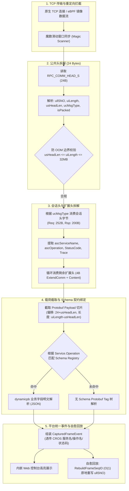

# flowbench 复合多级协议系统架构与 CROS RPC 实现设计 (Composite Protocol Architecture)

- **文档编号**：`08-composite-protocol-architecture.md`
- **文档版本**：v1.0.0
- **编制日期**：2026-10-28
- **当前阶段**：阶段二：系统架构设计
- **状态**：已定稿 (Finalized)

---

## 1. 架构总览与模块拓扑 (Architecture Topology)

为兼容以 CROS RPC 为代表的“多级复合报文”，`flowbench` 构建了分层的流式解包与深度协议解剖链路：



---

## 2. 流式状态机设计 (Streaming Parser State Machine)

由于 TCP 是面向无边界的流式传输协议，CROS RPC 的接收侧解析必须严格防范半包（Partial Frame）与粘包（Coalesced Frames），并支持网络流噪声下的魔数重同步。

### 2.1 三步拆帧状态机
1. **状态 1：`SYNC_MAGIC`（魔数扫描与定位）**
   - 连续读取 8 个字节；
   - 检查前 7 字节是否严格等于 `"CSE.TCP"`，第 8 字节是否为合法底座代码（如 `0x01` 表示 TCP，`0x04` 表示 Mesh）；
   - 若不匹配，丢弃第一个字节，向后平移 1 字节并继续读取 1 字节比较，直至找到魔数或达到扫描上限。
2. **状态 2：`READ_COMM_HEAD`（提取公共头定长元数据）**
   - 读齐 24 字节公共头：
     - `ullSNO`: 位于 Offset 8..16（大端 uint64）；
     - `uiLength`: 位于 Offset 16..20（大端 uint32，代表会话头+扩展头+载荷总长）；
     - `usHeadLen`: 位于 Offset 20..22（大端 uint16，代表会话头+扩展头总长）；
     - `ucMsgType`: 位于 Offset 22（uint8）。
   - **严格防 OOM 校验**：
     - 必须满足 `usHeadLen <= uiLength`；
     - 必须满足 `uiLength <= 32MB - 4096`（`RPC_PAYLOAD_MAX_LEN + usHeadLen`），超出立即报错中断，防止恶意超大长度导致内存耗尽。
3. **状态 3：`READ_BODY_AND_PAYLOAD`（消费完整报文体）**
   - 通过 `io.ReadFull` 一次性或两阶段读齐后续 `uiLength` 字节数据（包含了会话头、扩展头与 Protobuf 载荷）；
   - 切片分离：
     - `HeaderBytes`: 前 `24 + usHeadLen` 字节；
     - `Payload`: 偏移 `24 + usHeadLen` 之后的 `uiLength - usHeadLen` 字节。

---

## 3. 极速原地自愈重写设计 (O(1) In-Place SeqID Self-Healing)

在 eBPF 离线回放与出站 Mock 劫持场景中，每次回放都会生成新的请求流水号。为使离线保存的 Mock 响应报文能被客户端正确认领，必须将 Mock 响应帧中的序列号动态替换为当前请求的序列号。

由于 CROS 协议的公共头结构确定：
- `ullSNO` 永远位于帧头偏移量 `[8:16]`；
- 采用大端字节序；
- CROS 协议帧头无强制 CRC32 校验和字段。

因此，`cros.RebuildFrameSeqID` 采用极速原地赋值：

```go
func RebuildFrameSeqID(rawFrame []byte, newSNO uint64) error {
    if len(rawFrame) < 24 {
        return ErrFrameTooShort
    }
    binary.BigEndian.PutUint64(rawFrame[8:16], newSNO)
    return nil
}
```
该操作实现**零内存分配（0 B/op）**，单次耗时小于 5 纳秒，满足百万 QPS 级别的流量录制回放压测要求。

---

## 4. Protobuf Schema 智能绑定机制 (Contract Auto-Binding)

不同于依靠整数 `OpCode` 的协议，CROS RPC 会话头携带了字符串级别的微服务契约：
- 请求头：`ascServiceName`（64B ASCII）、`ascOperation`（64B ASCII）；
- 响应头：`ascServiceName`（64B ASCII）、`ascOperation`（64B ASCII）。

### 映射算法
1. 提取并清理字符串末尾的 `\0` 填充字节（如 `"UserService\0\0..."` -> `"UserService"`，`"QueryUser\0..."` -> `"QueryUser"`）；
2. 构造契约键 `contractKey := serviceName + "." + operation`；
3. 查找 `schema.DynamicRegistry`：
   - 首先尝试按 Full Name 匹配 Protobuf Method：若存在 `package.service.method` 或直接匹配服务名与方法名，直接绑定对应的 `InputType`（请求）或 `OutputType`（响应）；
   - 若未找到精确 Method，尝试匹配同名 Message（如 `QueryUserRequest` / `QueryUserResponse`）；
   - 若无 Schema 命中，无缝降级为无 Schema Tag 树模式展示。
