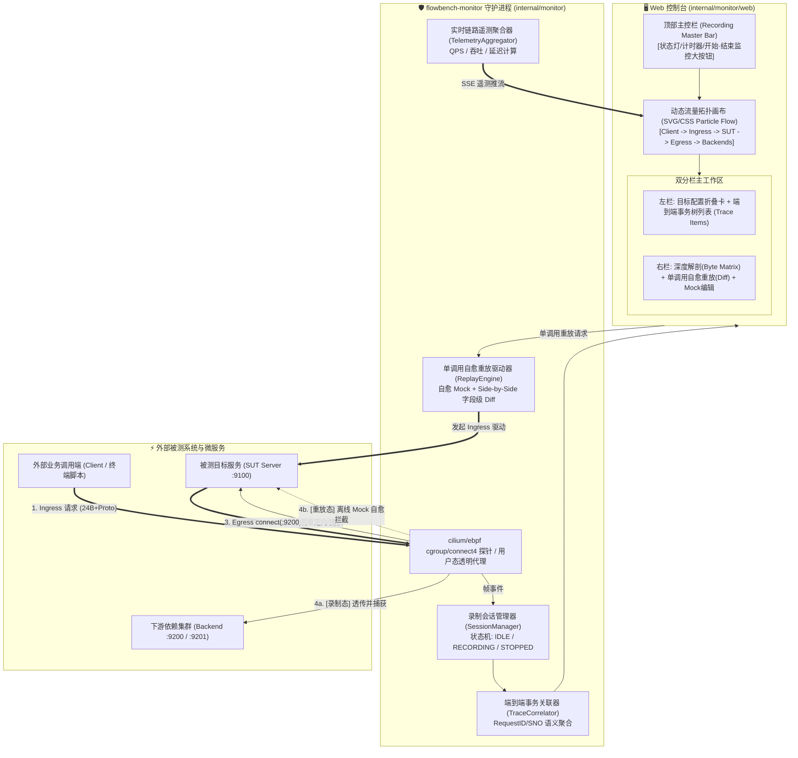
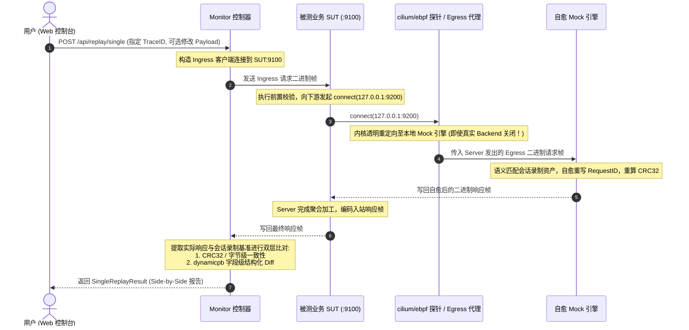

# flowbench 手工录制监控、动态拓扑与单调用自愈重放架构设计

- **文档编号**：`09-interactive-session-and-replay-architecture.md`
- **文档版本**：v1.0.0
- **编制日期**：2026-10-28
- **当前阶段**：阶段二：系统架构设计
- **状态**：定稿待审 (Ready for Review)

---

## 1. 架构总览与交互拓扑 (System Architecture Overview)



---

## 2. 录制会话与状态机设计 (Session Lifecycle State Machine)

### 2.1 会话状态定义
```go
type SessionStatus string

const (
    SessionStatusIdle      SessionStatus = "IDLE"      // 待命：未开始录制或已重置
    SessionStatusRecording SessionStatus = "RECORDING" // 录制中：eBPF 探针拦截激活，持续捕获外部流量
    SessionStatusStopped   SessionStatus = "STOPPED"   // 已结束：录制停止，资产已固化，支持分析与重放
)
```

### 2.2 核心数据结构
```go
// RecordingSession 描述一个完整的手工录制会话
type RecordingSession struct {
    SessionID    string              `json:"session_id"`
    Title        string              `json:"title"`
    Status       SessionStatus       `json:"status"`
    StartedAt    string              `json:"started_at"`
    StoppedAt    string              `json:"stopped_at,omitempty"`
    DurationSec  float64             `json:"duration_sec"`
    TargetPID    int                 `json:"target_pid"`
    ProcessName  string              `json:"process_name"`
    IngressPort  uint16              `json:"ingress_port"`
    Backends     []BackendEndpoint   `json:"backends"`
    TotalFrames  int                 `json:"total_frames"`
    TotalTraces  int                 `json:"total_traces"`
    RawFrames    []CapturedFrameEvent`json:"raw_frames"`
    Traces       []TransactionTrace  `json:"traces"`
    MocksCreated []RecordedMockAsset `json:"mocks_created"`
}

// TransactionTrace 描述由一次客户端入站请求触发的完整端到端事务树
type TransactionTrace struct {
    TraceID       string             `json:"trace_id"`       // 全局唯一事务标识
    RequestID     uint64             `json:"request_id"`     // 关联的业务 RequestID / SNO
    OpName        string             `json:"op_name"`        // 顶层业务操作名 (如 OpOrderQuote)
    StatusCode    uint32             `json:"status_code"`    // 最终响应状态码
    StatusName    string             `json:"status_name"`    // 状态码语义 (StatusOK)
    DurationMs    float64            `json:"duration_ms"`    // 端到端总耗时
    StartedAt     string             `json:"started_at"`     // 请求起始时间
    IngressReq    CapturedFrameEvent `json:"ingress_req"`    // 入站请求帧
    IngressResp   *CapturedFrameEvent`json:"ingress_resp"`   // 入站响应帧 (若已返回)
    SubCalls      []SubCallDetail    `json:"sub_calls"`      // 触发的所有出站子调用
    HasDiff       bool               `json:"has_diff"`       // 重放后是否产生字段 Diff
    LastReplay    *SingleReplayResult`json:"last_replay,omitempty"`
}

// SubCallDetail 描述端到端事务中针对某个特定下游 Backend 的出站子调用
type SubCallDetail struct {
    SubCallID     string             `json:"sub_call_id"`
    TargetBackend string             `json:"target_backend"` // 目标下游地址 (如 127.0.0.1:9200)
    BackendName   string             `json:"backend_name"`   // 后端语义名 (如 order-stock)
    OpName        string             `json:"op_name"`        // 子调用操作名
    DurationMs    float64            `json:"duration_ms"`
    EgressReq     CapturedFrameEvent `json:"egress_req"`     // 出站查询帧
    EgressResp    *CapturedFrameEvent`json:"egress_resp"`    // 出站响应帧
}
```

---

## 3. 端到端事务关联引擎算法 (Transaction Correlation)

由于网络 TCP 连接具有多路复用与异步乱序特性，Monitor 捕获到的离散二进制帧序列通过以下算法实时归并为结构化 `TransactionTrace`：

1. **入站请求识别**：当检测到方向为 `INGRESS_REQ` 的帧时，根据 `Header.RequestID`（或 CROS-RPC 的 `Header.ullSNO`）创建新的 `TransactionTrace`，置于活跃事务哈希表 `activeTraces[requestID]` 中；
2. **出站子调用关联**：当检测到 `EGRESS_REQ` 时，在当前活跃事务中查找时间戳重合且 `RequestID` 匹配的上下文，向其 `SubCalls` 列表中追加新的 `SubCallDetail`；
3. **出站响应匹配**：当检测到 `EGRESS_RESP` 时，按 `RequestID` 补齐对应 `SubCall` 的响应帧与耗时；
4. **入站响应闭环**：当检测到对应 `RequestID` 的 `INGRESS_RESP` 帧时，回填事务的最终状态码并计算端到端总耗时 `DurationMs`，将该事务从 `activeTraces` 移入 `completedTraces`。

---

## 4. 单调用原地自愈重放机制 (Single-Call Replay Studio)



---

## 5. 动态流量拓扑与链路遥测 (Dynamic Topology Telemetry)

### 5.1 拓扑节点与边模型
- **Node: Client**（外部调用方）
- **Edge 1: IngressLink**（`Client -> SUT:ingressPort`）
- **Node: SUT**（目标业务进程，标明 `TargetPID`、进程名与监听端口）
- **Edge 2: EgressLink**（`SUT -> EgressInterceptor`）
- **Node: EgressInterceptor**（内核 eBPF 探针或用户态代理）
- **Edges 3..N: BackendLinks**（`EgressInterceptor -> Backend_N`）
- **Nodes: Backend_N**（各个下游依赖服务）

### 5.2 链路 Telemetry 遥测指标计算
Telemetry 聚合器维护 1 秒滑动窗口，统计各条 Edge 的：
- `QPS`：每秒流经帧数；
- `BytesPerSec`：每秒字节吞吐率（自动格式化为 `B/s`、`KB/s`、`MB/s`）；
- `AvgLatencyMs`：滑动窗口平均响应耗时；
- `IsActive`：近 1.5 秒内是否有流量通过（驱动 SVG/CSS 动效粒子流水激活/休眠）。
这些指标通过已有的 `/api/events` SSE 通道以 `type: "telemetry"` 事件推送至前端。
