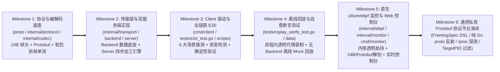

# flowbench 工程实施路线图与验收总则 (Implementation Roadmap)

- **文档编号**：`01-roadmap.md`
- **文档版本**：v1.0.0
- **编制日期**：2026-10-25
- **当前阶段**：阶段三：工程实施规划与验收总则
- **状态**：已定稿 (Finalized)

---

## 1. 工程实施总则与递进策略 (Execution Strategy)

基于已冻结的二进制帧协议契约（[`docs/03-api/01-binary-frame-spec.md`](file:///home/fugui/flowbench/docs/03-api/01-binary-frame-spec.md)）与 Protobuf 消息契约（[`docs/03-api/02-protobuf-messages.md`](file:///home/fugui/flowbench/docs/03-api/02-protobuf-messages.md)），工程实施阶段（阶段四）拆分为 **4 个正交递进的里程碑（Milestone 1 ~ Milestone 4）**。每个里程碑均遵循 **TDD（测试驱动与即时验证）** 原则，前一个 Milestone 的单元测试与静态检查 100% 通过后，方可推进至下一 Milestone。

---

## 2. Milestone 依赖拓扑图 (Milestone DAG)

---

## 3. 里程碑全景矩阵与交付物清单

| 里程碑 | 作战卡文档 | 核心交付代码与资产 | 自动化验收门禁 (Quality Gate) |
| :--- | :--- | :--- | :--- |
| **M1：协议与编解码底座** | [`02-m1-protocol-and-codec.md`](file:///home/fugui/flowbench/docs/04-tasks/02-m1-protocol-and-codec.md) | `go.mod`、`proto/flowbench/v1/messages.proto`、`internal/protocol/pb/messages.pb.go`、`internal/protocol/marshal.go`、`internal/codec/frame.go`、`internal/codec/stream.go`、`internal/codec/frame_test.go` | `go test -v -race ./internal/codec/... ./internal/protocol/...` 100% 通过（覆盖单字节半包、10帧粘包、CRC32篡改、超大帧拦截、确定性 Marshal） |
| **M2：传输层与双服务端** | [`03-m2-backend-and-server.md`](file:///home/fugui/flowbench/docs/04-tasks/03-m2-backend-and-server.md) | `internal/transport/{server,client}.go`、`internal/backend/{store,handler,handler_test}.go`、`internal/server/{config,processor,handler,processor_test}.go`、`cmd/backend/main.go`、`cmd/server/main.go` | `go build ./cmd/backend ./cmd/server` 成功；`go test -v -race ./internal/...` 100% 通过 |
| **M3：Client 驱动与全链路 E2E** | [`04-m3-client-and-e2e.md`](file:///home/fugui/flowbench/docs/04-tasks/04-m3-client-and-e2e.md) | `cmd/client/main.go`、`tests/e2e_test.go`、`Makefile`、`scripts/verify-e2e.sh` | `go test -v -race ./...` 全绿；`./scripts/verify-e2e.sh` 跑通 `SC-01`~`SC-06` 全部场景且自动清理后台进程 |
| **M4：离线回放与自愈断言验证** | `tests/replay_verify_test.go` | `tests/replay_verify_test.go`、`data/native-ebpf-assets.json` | 进程内透明录制、出站 Mock 劫持、无 Backend 离线回放与回归突变精确拦截 |
| **M5：原生 eBPF 协议感知监控** | [`06-m5-ebpf-monitor-and-console.md`](file:///home/fugui/flowbench/docs/04-tasks/06-m5-ebpf-monitor-and-console.md) | `internal/ebpf/`、`internal/monitor/`、`cmd/monitor/`、`scripts/start-monitor.sh` | 内核态 `cgroup/connect4` 透明劫持、动态 RequestID 自愈、字段级 Diff 诊断与安全 Web 控制台 |
| **M6：通用私有 Protobuf 协议平台** | [`07-m6-universal-protobuf-platform.md`](file:///home/fugui/flowbench/docs/04-tasks/07-m6-universal-protobuf-platform.md) | `internal/codec/dynamic.go`、`internal/protocol/schema/`、`internal/monitor/proc.go`、`internal/ebpf/`、`internal/monitor/` | 声明式 `FramingSpec` DSL 拆帧、零依赖 `.proto` 动态反射、`/proc` 进程扫描与 `TargetPID` 精准拦截 |

---

## 4. 全局质量门禁红线 (Mandatory Quality Gates)

1. **零 gRPC 依赖验证**：`grep -i "grpc" go.mod` 必须为空，仅依赖 `google.golang.org/protobuf`。
2. **静态检查与竞态零容忍**：每次提交前必须通过 `go fmt ./...`、`go vet ./...` 与 `go test -race ./...`。
3. **端口与进程卫生**：所有服务端默认绑定 `127.0.0.1`；任何自动化测试或脚本结束后，`ps aux | grep flowbench-` 必须无残留进程。
